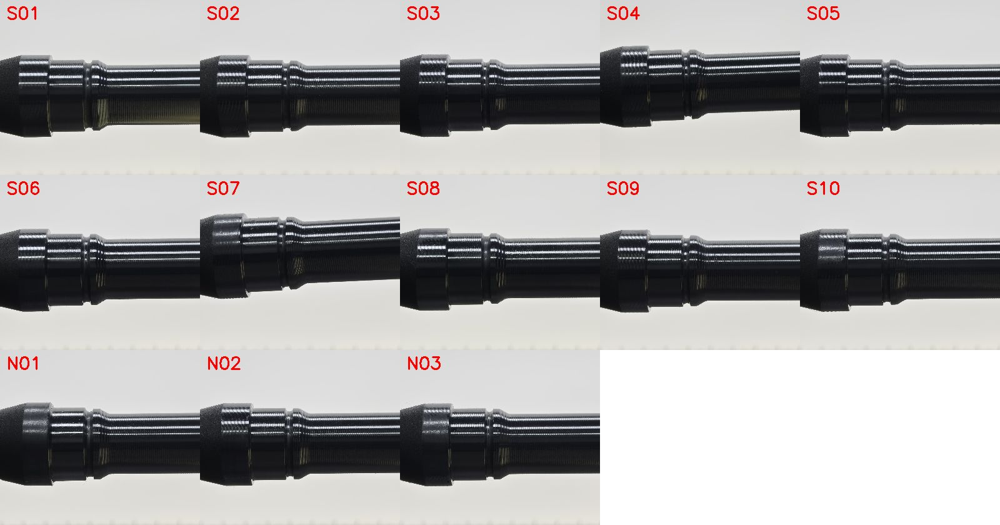
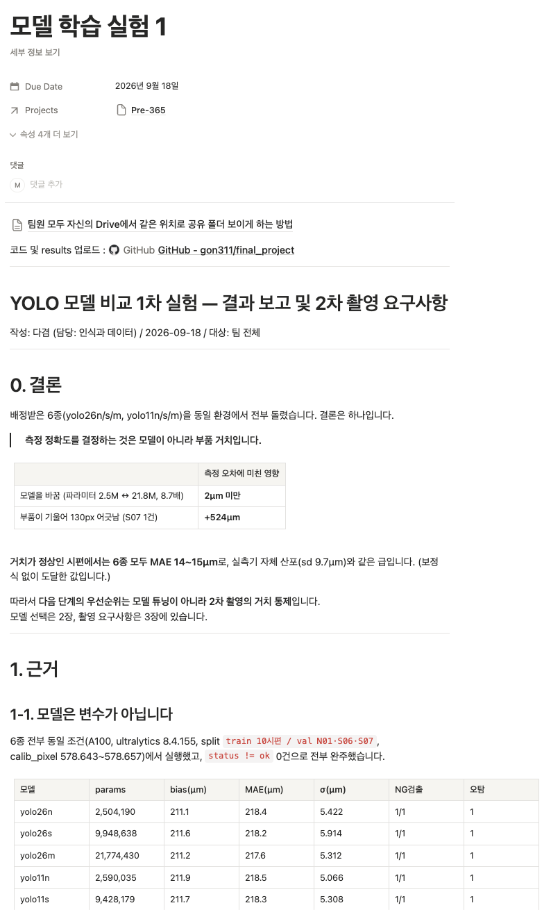
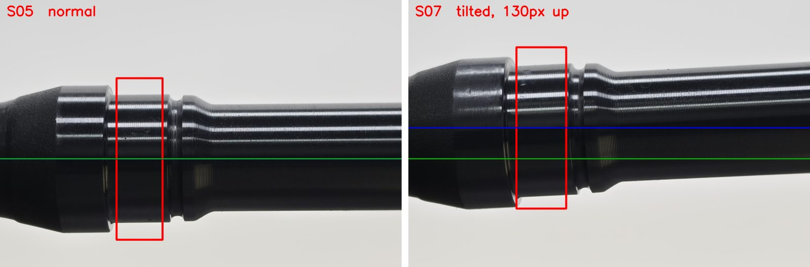
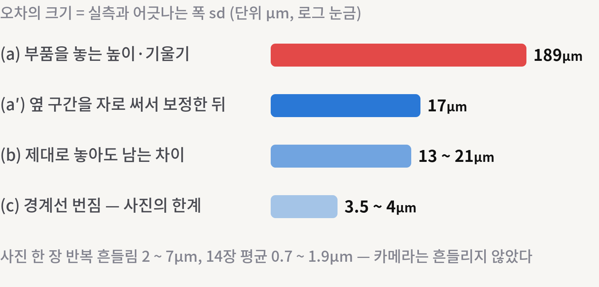
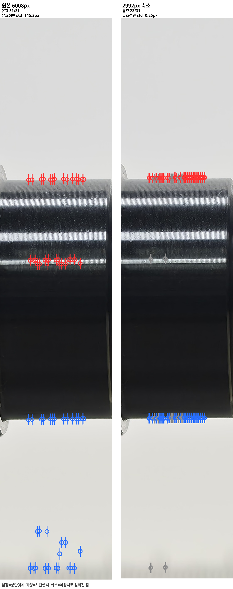
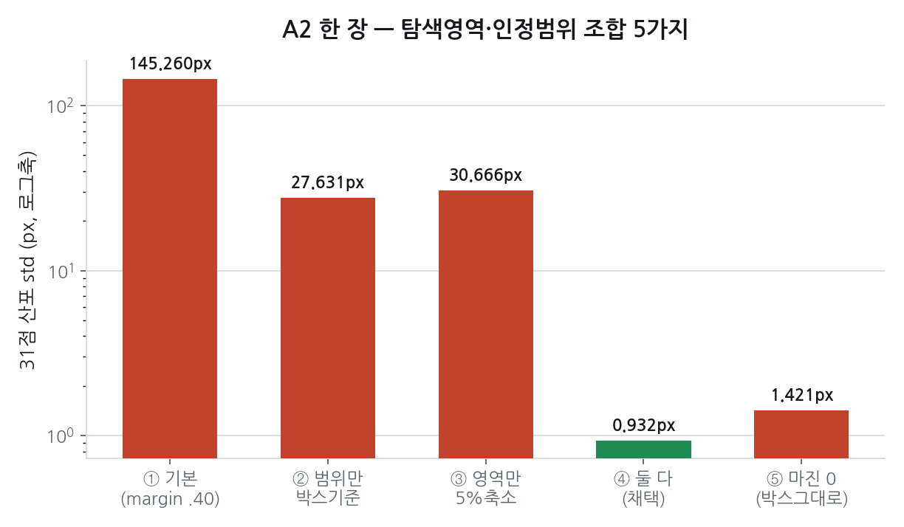
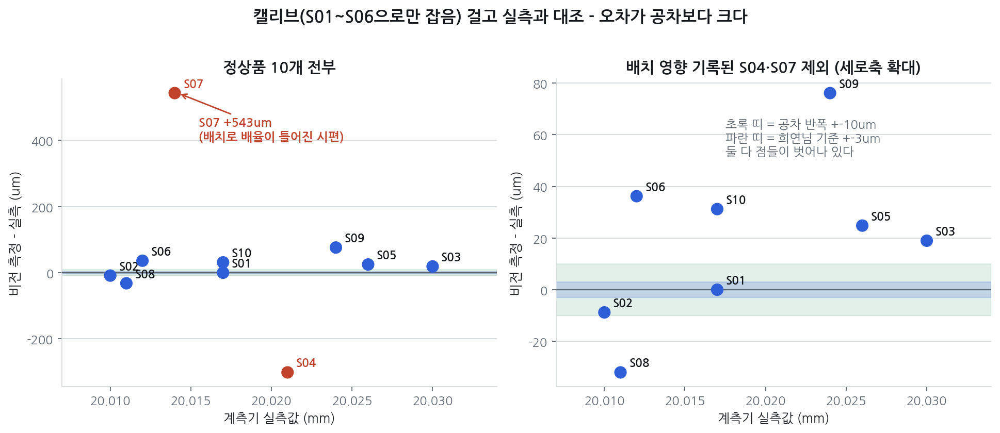

# 회의록 2026-09-17 \~ 09-23

녹취 기준 정리. 참석은 3인(팀장·선행 개발자·팀원) 전원.

---

## 2026-09-17 (목) — 오전 10:19 · 12:07 · 15:15

### 1. 현재 데이터로는 합·불 판정 불가 → 제안서 방향
- 9/16 현장 사진 161장으로는 정상품의 합·불 판정이 안 된다는 데 합의
- 제안서 방향: "지금 수준(규격에서 50\~55µm 이상 벗어난 불량 검출) PoC + 향상 경로"
- 15시에 선행 개발자가 "OK/NG 수준으로는 업체가 받지 않는다"며 정밀 측정 목표를 다시 제기. 1단계 이상 검출 → 2단계 정밀 측정으로 잇기로 함

### 2. 측정 규격 합의
- 측정 구간 = 베어링 압입부 가운데, 양 끝(단차·모서리)을 빼고 위·아래 엣지
- 말로는 60%·15포인트였으나 코드(V1)는 18\~82%·31포인트 → 코드 기준으로 정리
- 튀는 사진은 원인을 추적하지 않고 빼고 캘리브하기로 함(당시 결정)

### 3. 캘리브·검증 촬영 방식
- 캘리브와 캘리브 검증은 고정 촬영, 반복 측정은 시편을 다시 놓고 촬영. 멘토에게 확인하기로 함
- 다음 촬영: 배경은 백라이트만, 측정부 클로즈업, 캘리브용·검증용 두 세트, 검교정 핀게이지 2개
- 재촬영은 하루 전 연락하면 가능(업체 대표 확인)

### 4. 역할 · 후속
- 팀원: YOLO 버전별 비교 실험 / 선행 개발자: YOLO 검토 / 팀장: 산출 근거 정리·멘토 질문·텔레센트릭 조사
- 멘토 질문은 총론 1\~2개 + 세부 질문은 매주 하나씩
- 회의 녹음은 시작할 때 알리기로 함

---

## 2026-09-18 (금) 14:32

### 1. YOLO 6종 비교 결과 (팀원)
- yolo26n/s/m, yolo11n/s/m을 같은 조건에서 비교 → 모델을 바꿔서 생기는 측정 차이는 2µm 미만, S07 기울어짐(약 130px)이 만든 차이는 +524µm
- 거치가 정상인 시편은 6종 모두 MAE 14\~15µm. σ는 정확도가 아니라 재현성 지표(S07이 σ는 더 작았다)
- 모델 선택은 박스 안정성·conf 기준: yolo11s 권장. 현행 26n은 conf 최소 0.30이라 재확인 필요

### 2. 2차 촬영 요구사항 (팀원)
- 거치 고정: 축을 화면과 수평으로, 시편이 바뀌어도 축 높이가 일정하게
- 기준 부품은 같은 세션에서 3장 이상 찍어 중앙값 사용, 실측값은 현장에서 기록
- 일부러 틀어 놓은 촬영 세트, 불량 시편 추가 확보(N03은 20.006mm로 규격 하한 바로 밖이라 치수로 구분이 어려운 불량)

### 3. 자체 촬영 테스트 (팀장)
- JPEG 1.4µm vs RAW 3.4µm, 기본 카메라 자동 모드로 찍어 2992px로 축소한 것이 가장 안정 → RAW·프로 모드·노출 잠금 불필요
- 텔레센트릭: 스마트폰에 쓸 만한 대여 제품이 마땅치 않음. 스마트폰용 특허 제품(약 500만 원)은 참고 자료로 보관

### 4. 제안서 목표 · 운영
- 목표 = "정밀 측정이 어디까지 도달하나". 합·불 판정은 제안서 목표로 약속하지 않기로 3인 합의
- 제안 발표는 팀장(9/21 월), KPT는 매주 금 17시 발표 — 팀원이 발표
- 예산에 텔레센트릭 대여 항목 포함, 팀장 9/28·29 개인 일정

---

## 2026-09-21 (월) — 제안서 발표

### 1. 문제와 목표
- 대상 Ø20.020 ±0.010mm(공차 폭 20µm). 폰 사진 픽셀 하나가 공차보다 크다
- 목표 = 계측기를 대신할 정밀도: 흔들림 sd 3µm·치우침 ±1µm. 현재 17µm, 중간 관문 8µm

### 2. 근거 — 9/16 현장 161장
- 오차 세 층: 배치 189µm → 두 기준 보간 후 17µm / 제대로 놓아도 남는 시편 간 차이 13\~21µm / 경계선 번짐 3.5\~4µm
- YOLO 버전을 바꿔도 비슷. 7월 모델은 9월 사진에서 부품을 못 찾았고 9월 사진으로 재학습해 해결 → "모델이 아니라 들어가는 사진이 정한다"
- 집 테스트: 기본 카메라 최고 해상도로 찍어 줄이면 1.0µm

### 3. 되는 것 / 안 되는 것
- 규격에서 50µm 넘게 벗어난 불량은 지금도 검출
- 정상품끼리 구분은 불가(지름 차이가 1px 안). 흔들림이 3µm까지 내려오면 10개 중 약 4개(37%)를 계측기 없이 확정

### 4. 계획
- 처방 세 가지: 기준자(검교정 핀게이지 2개, 같은 평면) / 받침대(V블록+스토퍼, 다시 놓기 20\~30회) / 촬영 조건 고정(최고 해상도 축소·근접·백라이트)
- 4주차 갈림길: 흔들림 2\~3µm 도달 시 현장 판정 시스템, 아니면 산업용 카메라가 필요하다는 근거를 업체에 전달

---

## 2026-09-22 (화) 17:25 · 17:53

### 1. 원본 해상도 A2 이상 현상 제기 (선행 개발자)
- 시편1 두 번째 사진(A2)에서 31개 측정선의 상·하단 엣지가 제자리를 벗어나 잡히는 현상 공유
- 원인 후보로 샤프트 표면의 밝은 반사띠를 지목, 엣지 선택 알고리즘 개선을 담은 대책 보고서 공유

### 2. 팀원 관점
- 수평이 맞은 시편은 자기 실험에서 엣지를 못 잡은 적이 없었다. 문제는 S07(약 6° 기울어짐, +500µm)
- 코드를 어디서 바꿨는지 공유해 달라고 요청 — 사진만으로는 원인 판단이 어렵다
- 선행 개발자: 6° 기울기 원인 후보로 카메라 각도, 끝단을 밀어 맞춘 면의 평탄도를 제시

### 3. 코드 점검 vs 촬영 환경 — 관점 차이 확인
- 선행 개발자: 캘리브 → 캘리브 검증 → Gage R&R 순서로 가야 하며, 엣지 검출 알고리즘 점검도 필요
- 팀장·팀원: 새로 찍을 데이터에 맞춰 코드는 다시 맞추면 되므로 우선은 촬영 시나리오·구조물
- 선행 개발자 보고서를 같이 읽고 다음 날 이어서 논의하기로 함

---

## 2026-09-23 (수) 11:02

### 1. 원인 재현 — 해상도
- 팀원: 같은 코드·모델이 2992px에서는 정상, 원본 6008px에서는 선행 개발자 화면과 같은 오검출 → 해상도 통일 필요
- 선행 개발자: 원본으로 시편1 14장이 1155\~1523px로 벌어지고, A2 31점 표준편차 173px → 촬영계가 아니라 엣지 검출 단계 문제로 판단
- 코드 로직(V1): 강한 gradient 후보 중 지름이 가장 큰 쌍을 고름 → 바깥쪽 반사·배경이 후보로 남으면 잘못 선택

### 2. 알고리즘 보강 제안
- 팀원: 박스 경계에 가까운 후보 선택, 허용 지름 기준 조정, 31점이 직선 위에 있다는 제약(라인 피팅)
- 선행 개발자: 원래 코드의 라인 피팅(상·하단 직선이 평행해야 함)을 강화하는 방향에 공감
- 팀장: YOLO 박스 안에서만 CV가 동작하게 → 14장 결과를 오후에 공유

### 3. 검증 기준
- 선행 개발자: 캘리브(픽셀당 mm)로 S07\~S10을 측정해 실측과 비교, 오차 3µm 이내면 측정 쪽은 완료
- 팀장: 지금은 컨센서스를 맞추는 시기이고, 전날의 문제 제기가 도움이 됐다

---

## 2026-09-23 (수) 15:39 · 16:14

### 1. 원인·해결안 공유 (팀장, 브리핑 문서)
- 원본에서 31개 측정선 중 17개가 오검출(과반) → 중앙값이 오답 쪽으로. 2992px는 8개(소수)라 걸러졌다
- 해결: YOLO 박스 안에서만 탐색 + 허용 지름 범위를 박스 기준으로 → A2 산포 145px → 0.93px, 시편1 14장 1157\~1158px
- 16:14 선행 개발자: 원본에서 상단 엣지가 반사띠에 잡힌 것을 확인, 그동안 튀던 원인이 이것이었다 → vertical_margin을 반영해 실험 계속

### 2. 정확도 검증
- S01 한 개로 잡은 캘리브 17.30µm/px(팀 상수 17.28과 일치) → S07\~S10 MAE 170.6µm, 정상품 10개 중 9개 오판정
- 반복 촬영 흔들림(3\~11µm)은 작지만 시편을 바꾸면 값이 크게 움직인다 → 정확도 병목은 배치, 다음 단계는 지그

### 3. 캘리브 설계 재확인 (선행 개발자)
- 시편 구성 의도: S01\~03 = 중앙·하한·상한(캘리브용), S04\~06 = 검증용, S07\~10 = 테스트용
- 요청: 이 설계로 픽셀당 mm를 산출 → S04\~06으로 검증(인정할 허용 오차 기준이 필요) → S07\~10 측정

### 4. 일정 (잠정)
- 9/30(화) 11시 멘토링 → 오후에 촬영 프로토콜·시나리오 정리
- 10/1(목) KPT 정리, 10/2(금) 공장 촬영(KPT 발표는 팀원). 공장 연락은 월요일에 선행 개발자가
- 팀장: 추석 기간 촬영 구조물 시험(백라이트를 바닥에, 차양, 폰 고정·높이 조절)

**회의 후 정정** (브리핑 문서에 반영)
- 제안서 17µm와 이번 5.4µm를 비교할 수 없는 이유는 "축소 이미지라서"가 아니라 지표가 달라서다(5.4 = 반복성, 17 = 실측 대비 오차). 같은 지표로 재면 원본과 2992가 거의 같다(보정 전 186 vs 189µm)
- 라인 피팅의 "장별 개선"은 서로 다른 양을 비교한 것이라 근거가 되지 않는다
- 탐색 범위(vertical_margin)만 줄이면 오답이다. 허용 범위를 박스 기준으로 함께 바꿔야 한다(박스 그대로인 margin 0도 같은 결과)
