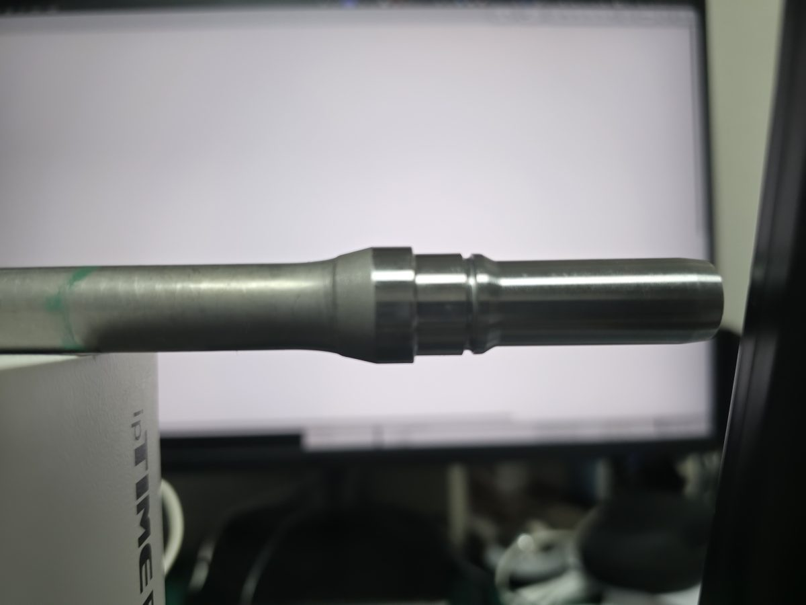
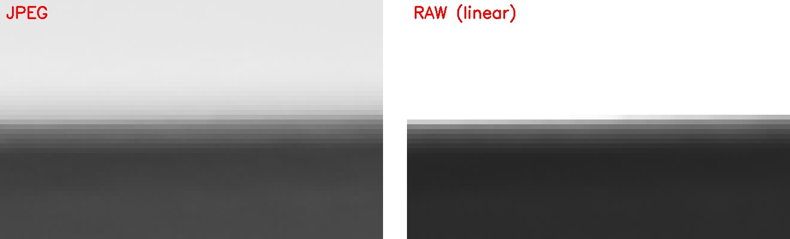
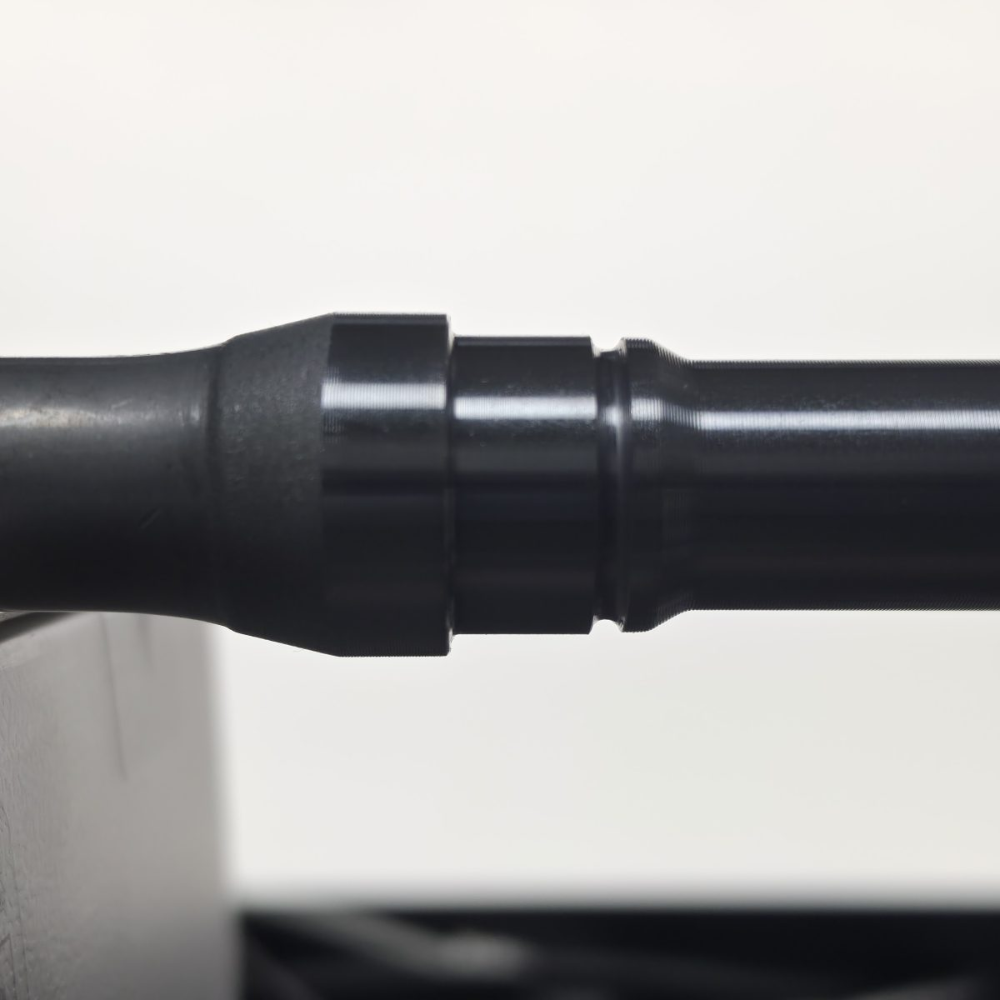
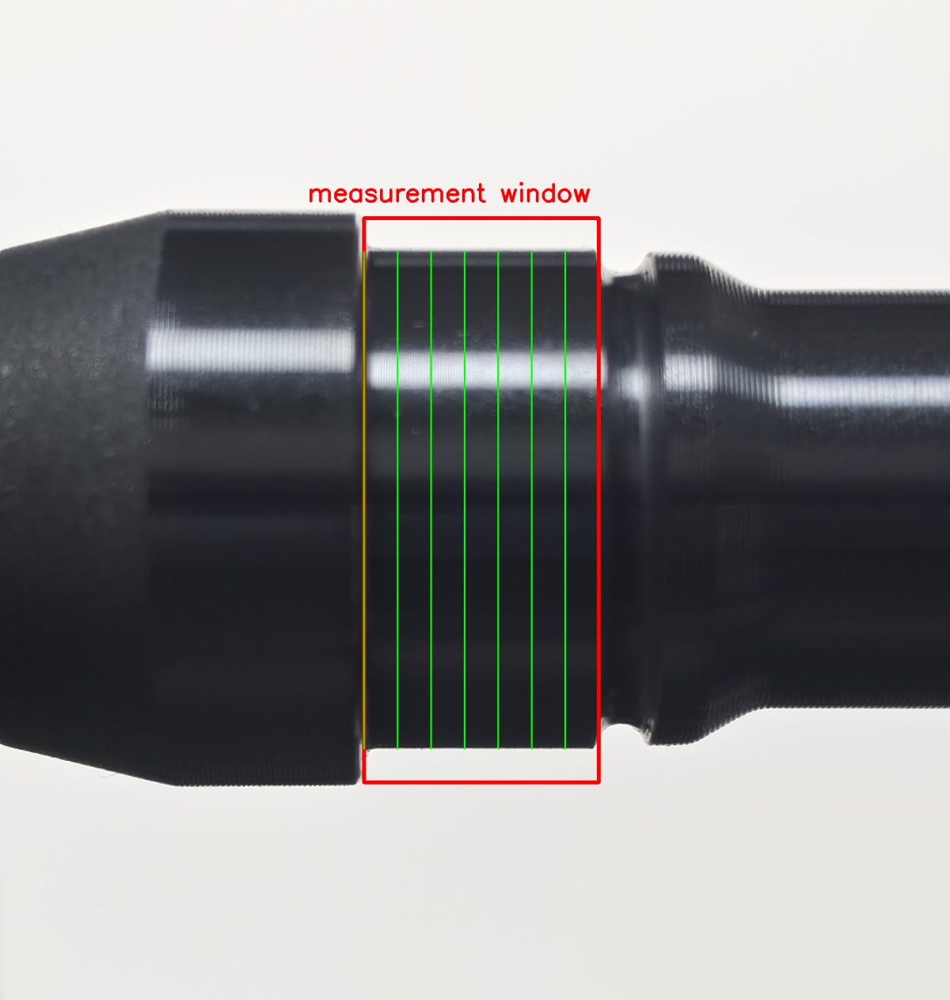
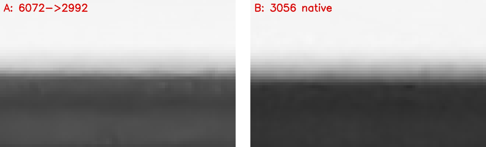

# 2026-09-18 — 자체 촬영 테스트: RAW가 답인가, 무엇이 흔들림을 줄이나

현장 재촬영 전에 집에서 답할 수 있는 질문부터 답했다. 보유 NG 시편 1개, 모니터 흰 화면을 백라이트로, 삼각대. 실측값이 없으므로 **절대값(mm)은 보지 않고 같은 자리에서 연속 촬영했을 때의 흔들림(반복 sd)만** 본다.
코드 `experiments/20260918_home_tests/`, 출력 `experiments/results/20260918_home/`. 측정은 위치 검출 모델 없이 윤곽 프로파일(열마다 기울기 최대 엣지 → 칼라끝·홈으로 정렬한 창의 중앙값)로 했다.

## 1. RAW vs JPEG (오전 첫 세트)

촬영 장면: 무코팅(은색) NG 시편, 모니터 흰 화면 백라이트, 컵 위 거치. 표면에 밝은 반사 띠가 보인다.

Expert RAW 앱, 200MP, **수동 노출 고정**(ISO 125 · 1/180s · f/1.4 · 1배), RAW+JPEG 15쌍, 78초 연속. 무코팅(은색) 시편. 1px ≈ 53µm(2992 기준).
DNG는 JPEG XL 압축 리니어 DNG 1.7이라 LibRaw로는 안 열리고 tifffile + imagecodecs로 디코딩했다.

| | 원 sd | 시간 추세 | 추세 제거 sd |
|---|---|---|---|
| JPEG → 2992 | 8.2µm | −19µm/분 (r = −0.99) | **1.4µm** |
| RAW → 2992 | 9.4µm | −21µm/분 (r = −0.93) | 3.4µm |
| RAW 반해상도에서 직접 | 11.1µm | | 8.4µm |
| RAW − JPEG (프레임별) | 평균 +2.48px (일정), sd 0.066px | | |

- **RAW는 흔들림을 줄이지 않았다.** 폰의 노이즈 제거가 엣지를 매끈하게 만들어 프레임 간 흔들림을 오히려 줄인다. RAW는 리니어라 엣지 잡음이 그대로다
- 이 세트의 진짜 변동은 잡음이 아니라 **78초 동안의 일방향 드리프트**였다. JPEG·RAW가 똑같이 흐른다 → 처리가 아니라 물리적 이동(컵 위 거치·모니터 예열 등 세팅 문제로 추정). 9/16 현장 데이터에는 같은 드리프트가 없다(시편당 21초, 추세 방향 제각각)
- RAW는 JPEG보다 +2.48px 크게 읽힌다(리니어 vs 감마의 엣지 위치 차이). 일정하므로 캘리브가 흡수하지만 **RAW와 JPEG는 캘리브를 따로** 해야 한다

같은 프레임 윗변 8배 확대(80×50px). **눈에는 RAW가 더 뚜렷하지만, 그건 RAW가 밝기를 리니어로 기록해 어두운 쪽이 눌려 보이기 때문이다(렌즈 번짐은 두 사진이 같다).** 측정은 비탈의 가운데를 서브픽셀로 찾는데, JPEG는 비탈이 6px쯤에 걸쳐 표본이 많고 RAW는 2 ~ 3px뿐이라 가운데가 정수 위치로 붙으며 프레임마다 흔들린다(3.4 vs 1.4µm). 눈금이 6개인 자와 2개인 자로 눈금 사이 값을 읽는 차이다. 비탈 모양이 다르니 가운데 위치도 다르다(+2.48px, 일정한 바이어스).

## 2. 기본 카메라 A/B/C (오전 둘째 세트)

 

왼쪽: A 세트 장면(검정 코팅 시편, 2배줌, 지우개 받침). 오른쪽: 2992 축소본에서 자동으로 잡은 측정 창(칼라 끝 ~ 홈 사이 가운데 50%). 시편 윗면의 밝은 하이라이트 띠가 보인다.

기본 카메라 앱, **2배줌**, 검정 코팅 시편, 지우개 받침, 세트 사이에 아무것도 안 건드림. 1px ≈ 22µm(2992 기준, 9/16의 34.7보다 근접).

| 세트 | 설정 | n | 추세 제거 sd | 비고 |
|---|---|---|---|---|
| **A** | 사진 모드 **자동**, 6072 → 2992 축소 | 14 (20초) | **1.0µm** | 드리프트 없음(−3.6µm/분) |
| B | 프로 모드 **수동 고정**, 3056 (축소 없음) | 14 (22초) | 9.5µm | |
| C | A 조건으로 2분 뒤 | 7 (8초) | 0.9µm | |
| D | 5배줌 | 7 | — | 구도가 달라 같은 방법으로 못 잼 |

- **고해상도로 찍어 2992로 줄이는 것이 결정적이다.** A 1.0 vs B 9.5µm — 같은 시편·같은 순간·같은 방법에서 10배. 축소가 픽셀을 평균해 잡음을 깎는다. 09-16 "200M→2992(3.8) vs 12M 원본(7.6 ~ 11.9)"과 같은 방향

같은 위치 윗변 8배 확대. 왼쪽 A(6072→2992 축소)는 경계 비탈이 고르고, 오른쪽 B(3056 원본)는 비탈 안 픽셀이 거칠다. 이 거칠기가 프레임마다 다르게 찍혀 흔들림이 된다.

- **자동 노출은 문제가 아니다.** 노출 잠금·프로 모드·RAW 셋 다 우선순위에서 내려간다
- **가까이 찍으면 µm가 준다.** 같은 0.05px 흔들림이 22µm/px에서는 1.1µm, 34.7µm/px에서는 1.7µm
- 이 세팅에서 프레임 잡음 1.0µm — 9/16 바닥 3.5 ~ 4µm보다 낮다. 엣지 번짐 층은 고정 상수가 아니라 **촬영 조건으로 내려갈 여지가 있다**. 단서: n=14, 모니터 백라이트, 집

## 3. 같은 프레임을 측정 엔진 두 방식으로

A 세트(14장)를 (가) 위 프로파일 방식과 (나) 현재 파이프라인(위치 검출 박스 → ROI 안 31개 측정선 → 허용 지름범위 안 바깥쪽 엣지 쌍 → 중앙값)으로 각각 쟀다. 위치 검출은 7월 학습 모델이 이 구도에서 14장 전부 미검출이라 9/16 데이터로 학습한 모델을 썼다.

| | A (자동·축소) | B (프로·원본) |
|---|---|---|
| (가) 프로파일 방식 | 1.0µm | 9.5µm |
| (나) 현재 파이프라인 | 7.4µm | 붕괴(sd 85px) |

- 이 시편은 검정 코팅 표면에 **밝은 하이라이트 띠**가 있다. (나)의 엣지 쌍 선택(ROI 비율 허용범위 + 바깥쪽 쌍 우선)이 그 띠와 진짜 엣지 사이를 오간다. (가)는 아랫변을 "밝음이 150행 이상 이어지는 첫 자리"로 잡아 하이라이트를 건너뛴다
- → 엣지 선택 제약조건을 보강할 구체적 사례. 멘토 질문 2부 "외경 엣지를 안정적으로 고르는 제약조건"의 실증 데이터
- 위치 검출 모델은 **촬영 조건이 바뀌면 재학습이 필수**(7월 모델 0/14 → 9/16 학습 모델 14/14)

## 4. 다음 현장 촬영에 반영

- 기본 카메라 · 자동 · **최고 해상도 모드** · 2배줌 · 측정부 + 핀게이지가 들어가는 한도에서 근접 · 측정은 2992 축소본
- RAW · 프로 모드 · 노출 잠금 **불필요**
- 삼각대 + 타이머/리모컨, 세트 30초 안, 세트 시작·끝에 같은 시편 재촬영으로 드리프트 점검, 촬영 전 폰·조명 예열 2 ~ 3분, 시편은 구르지 않는 받침
- 위치 검출 모델은 새 조건 사진으로 재학습
- 측정 엔진: 하이라이트 있는 표면에서 엣지 쌍 규칙 보강

## 5. 한계
- 시편 1개, 세트당 14장·20초, 모니터 백라이트. 현장 라이트패드·코팅 시편 여러 개에서 재확인 필요
- 오차 sd(실측 대비)가 아니라 **프레임 간 반복 sd**다. 놓는 방식·기준 구간 차이는 이 실험에 없다
- 5배줌 세트는 분석 못 함
