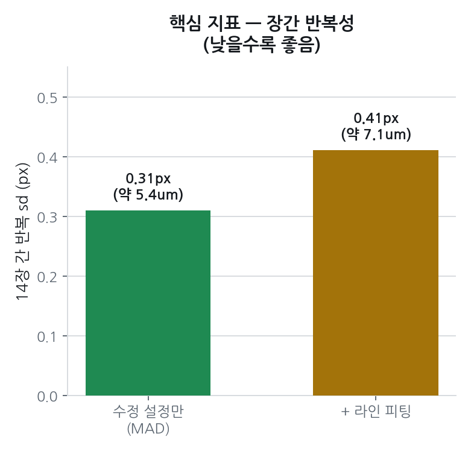

# 2026-09-23 브리핑 — 원본 해상도에서 31점 엣지가 왜 흔들렸나

같은 날 작성한 [`2026-09-23_엣지검출_원본해상도_실험.md`](./2026-09-23_엣지검출_원본해상도_실험.md)의 내용을, 팀 회의에서 화면 보면서 설명할 수 있도록 이미지·차트 위주로 다시 정리한 버전이다. 서사·회의 대화 기록 전체는 그 문서를 보고, 여기는 "보여줄 것" 중심이다.

## 요약

- **희연님이 지목한 현상은 실재했다.** 원본 해상도(6008px)에서 31개 측정선 중 **17개가 통째로 다른 쌍**(반사띠를 상단으로, 배경을 하단으로)을 잡는다. 오답이 과반이라 중앙값까지 오답 쪽으로 끌려가고, 그래서 이상치 필터가 이걸 "31/31 정상"으로 통과시킨다 — 조용한 실패다.
- 기존 대응(D-001, 2992px로 축소)은 이미 이 문제를 **우회**하고 있었다. 왜 되는지는 몰랐다.
- **원본 해상도를 그대로 유지한 채 근본 원인을 고치는 설정**(탐색 영역을 좁히고 + 허용 지름 범위를 박스 기준으로)을 찾아 14장 전체로 검증했다 → 장간 반복 sd 5.4µm.
- 다겸님이 제안한 라인 피팅 보강도 같이 실험했다. 한 컷 안에서는 확실히 더 깨끗해지는데(다겸님 말이 맞다), 장간 반복성에서는 차이가 표본 노이즈 안이라 **더 낫다는 근거가 없다** → 채택 보류, 평행도 진단용 보조로는 계속 사용.

| 지표 | 이전 | 이후 |
|---|---|---|
| A2 한 장, 31점 산포(원본 해상도) | 145.26px (≈2.51mm, 공차의 125배) | 0.93px (≈16µm) |
| 시편1 14장, 장간 반복 sd | 계산 무의미(오답 포함) | 0.31px (≈5.4µm) |
| 라인 피팅까지 추가 | — | 컷 내부↓, 장간은 차이 불분명 → 채택 보류 |

### 이번 실험이 답한 것 / 답하지 않은 것

회의에서 제일 먼저 맞춰야 할 경계선이다. **정밀도(얼마나 일관되게 재는가)와 정확도(실제 지름과 얼마나 가까운가)는 다른 축이고, 오늘 잰 건 전자뿐이다.**

| | 오늘 답한 것 | 아직 답 못 한 것 |
|---|---|---|
| 무엇을 쟀나 | 같은 시편을 여러 번 찍었을 때 값이 얼마나 일치하나 (**정밀도**) | 그 값이 계측기 실측과 얼마나 가까운가 (**정확도**) |
| 결과 | 원본 해상도로도 장간 sd 0.31px ≈ 5.4µm | 미측정. 캘리브(px→mm) 걸고 시편 7~10 실측 대조 필요 |
| 합격선 | (기준 없음 — 비교용 숫자) | **희연님이 준 기준: 실측 대비 3µm 이내** |

반복은 잘 되는데 전부 같은 방향으로 치우쳐 있을 수 있다(치우침/bias). 그래서 5.4µm를 3µm 기준과 직접 견줄 수 없다 — 같은 축의 숫자가 아니다.

### 단위 환산 근거

이 문서의 µm 값은 전부 아래 상수로 환산했다 (`docs/02_facts.md`의 캘리브 상수).

- 2992px 기준 **1px = 34.7µm** → 원본(6008px) 기준 34.7 × 2992/6008 = **약 17.28µm/px**
- 이 값은 09-17에 따로 기록해 둔 "정상 9장이면 17.3µm"와 일치한다(서로 다른 경로로 나온 숫자가 맞아떨어짐)
- 공차 Ø20.020 ±0.010mm → 전폭 20µm, 반폭 10µm

---

## 1. 재현 확인

> 돌린 코드: [`experiments/20260923_edge_selection/check.py`](../../experiments/20260923_edge_selection/check.py) (숫자) · [`visualize.py`](../../experiments/20260923_edge_selection/visualize.py) (사진 위 표시) · [`count_wrong.py`](../../experiments/20260923_edge_selection/count_wrong.py) (31점 하나씩 대조)
> 측정 엔진: `shaft_core.py`의 `measure_roi()` · `find_outer_edge()` — 희연님 `measurement_engine.py`를 실험용으로 이식한 것

A2(시편1 14회 촬영 중 2번째, `20260916_154320.jpg`)를 `shaft_core.measure_roi`로 원본 6008px와 팀이 쓰는 2992px 축소본 양쪽에서 직접 측정했다. YOLO는 두 해상도에서 완전히 같은 자리(정확히 축소 비율만큼)를 conf 0.97로 찾았다 → **문제는 탐지가 아니라 그 다음, 엣지를 찾는 단계다.**

| 조건 | 유효점 | 대표값(median) | 31점 산포(std) |
|---|---|---|---|
| 원본 6008px | 31/31 | 1287.96px | **145.260px** |
| 2992px 축소 | 23/31 | 577.25px | **0.254px** |


원본(왼쪽)에서는 상단 표시(빨강)가 두 줄로, 하단 표시(파랑)도 두 줄로 갈라져 있는 게 육안으로 보인다. 2992px(오른쪽)에서는 둘 다 실제 물체 경계에 촘촘히 모인다. 회색 점은 이상치로 걸러진 점.

### 31개 점이 어떻게 갈리는지 (숫자로)

수정 설정으로 얻은 정답 위치(상단 y=2766, 하단 y=3922)를 기준으로 기본 설정의 31개 점을 하나씩 대조했다.

| 무리 | 개수 | 상단 위치 | 하단 위치 | 그 무리의 지름 |
|---|---|---|---|---|
| 정확히 맞은 점 | **14개** | 기준 ±3px | 기준 ±3px | 1155.7px |
| 통째로 다른 쌍을 잡은 점 | **17개** | 기준보다 388~409px 아래 (반사띠) | 기준보다 540~718px 아래 (배경) | 1483.8px |

- 틀린 17개는 상단·하단이 **동시에** 틀린다. 반사띠를 상단으로, 배경을 하단으로 잡은 한 쌍이다.
- **오답이 과반(17 대 14)이라 전체 중앙값이 오답 쪽에 얹힌다** → 대표값 1288.0px.
- **이것이 "31/31 유효"의 정체다.** 두 무리로 갈라지면 MAD(중앙절대편차) 자체가 커져서 그 3배 안에 31개가 전부 들어온다. 이상치 제거가 고장 난 게 아니라, 판단 기준이 될 다수파가 이미 틀려 있었다.
- 09-12 한계탐색 실험에서 적어둔 메커니즘("두 무리로 갈리고 큰 쪽이 과반이 되면 중앙값이 통째로 넘어간다")이 현장 사진에서 그대로 재현된 것이다.


**이 그림 한 장이 "왜 시스템이 못 잡았나"를 설명한다.** 이상치 제거는 중앙값에서 얼마나 떨어졌는지로 판단하는데, 점들이 두 무리로 갈리면 그 흩어짐 자체가 커져서 허용 밴드가 **696~1880px(±약 10mm)** 까지 벌어진다. 이러면 어떤 점도 이상치가 될 수 없다. **이상치 필터는 "소수가 튀는 상황"을 위한 장치라, 다수파가 틀린 상황에서는 원리적으로 못 잡는다.**

> ⚠️ **회의에서 그림 두 개를 나란히 볼 때 주의.** 다겸님은 희연님이 띄운 시각화를 보고 "하단은 균일하고 상단이 문제"로 읽었는데, 위 A2 재현에서는 상·하단이 17개씩 같이 틀리고 오히려 하단 이탈이 더 크다(718px 대 409px). 같은 사진·같은 코드로 낸 그림이 아닐 가능성이 크므로(희연님 화면은 "오늘 아침에 찍은 것"), 어느 사진·어느 코드인지를 먼저 맞추고 비교해야 한다.

## 2. 근본 원인 — 허용 지름 범위가 탐색 영역에 종속돼 있다

> 해당 코드: `shaft_core.py` → `measure_roi()`(허용범위 계산) · `find_outer_edge()`(후보 거르기·선택) · `Params`(상수 정의)

`find_outer_edge`가 후보 엣지 쌍의 지름을 "정상"으로 인정하는 범위는 기본값(`dia_basis="roi"`)으로 **탐색 영역(ROI) 자체의 높이**에 비례한다. ROI는 YOLO 박스를 위아래로 40%(`vertical_margin`) 넓혀 만드는데, 원본처럼 절대 픽셀 수가 크면 이 여유 공간도 같이 커져서 반사띠·배경까지 닿는 넓은 쌍도 "정상 범위 안"으로 통과한다.

```python
# shaft_core.py — measure_roi() 중 지름 허용범위를 정하는 부분
if p.dia_basis == "box":
    dia_lo, dia_hi = box_h * p.dia_min_box, box_h * p.dia_max_box   # 박스 높이 기준(0.55~0.95)
elif p.dia_basis == "roi":
    dia_lo = dia_hi = None   # None 이면 find_outer_edge 가 ROI 높이 기준(0.25~0.60)으로 계산
```

| 파라미터 | 기본값 | 수정값 | 의미 |
|---|---|---|---|
| `vertical_margin` | 0.40 | 0.05 | 탐색 영역을 박스 높이 대비 얼마나 넓힐지 |
| `dia_basis` | `"roi"` | `"box"` | 허용 지름 범위의 계산 기준 |

`edge_select="largest"`(살아남은 후보 중 가장 지름이 큰 쌍을 고르는 규칙)는 그대로 둔다 — 이건 09-12 실험(claims C9)에서 "실수가 아니라 필요한 규칙"으로 이미 검증됐다. 문제는 그 규칙이 아니라, 규칙이 고를 수 있는 "정상 범위" 자체가 너무 넓게 열려 있던 것이다.

## 3. 해결 실험 — 둘 다 바꿔야 정답에 붙는다

> 돌린 코드: [`test_box_restrict.py`](../../experiments/20260923_edge_selection/test_box_restrict.py) · 바꾼 지점: `shaft_core.Params`의 `vertical_margin`, `dia_basis` 두 값뿐 (엔진 로직은 안 건드림)

A2 원본에 다섯 조합을 대조했다.


| 설정 | 유효점 | 대표값 | std | 결과 |
|---|---|---|---|---|
| ① 기본(margin 0.40, roi기준) | 31/31 | 1287.96px | 145.260px | 오답 |
| ② 인정범위만 박스 기준으로 | 27/31 | 1342.15px | 27.631px | 더 일관된 오답 |
| ③ 탐색범위만 5%로 축소 | 31/31 | 912.41px | 30.666px | 다른 오답 |
| **④ 탐색범위 5% + 인정범위 박스 기준** | 26/31 | **1157.00px** | **0.932px** | **정답** |
| ⑤ 탐색범위 = 박스 그대로(0%) | 30/31 | 865.86px | 1.421px | 오답 |

인정 범위가 탐색 영역 높이에 연동돼 있어서, 영역만 좁히면(③) 범위도 같이 좁아져 정답이 "너무 크다"고 걸린다. 둘을 동시에 바꿔야만(④) 정답에 붙는다.

## 4. 시편1 14장 전체로 확장

> 돌린 코드: [`test_all14.py`](../../experiments/20260923_edge_selection/test_all14.py) · 대상 사진 목록: `field/manifest_20260916.csv`의 시편1 14장

④번 조합을 시편1 14장 전체, 원본 해상도 그대로 적용했다. 코드에서는 이 한 줄이 전부다.

```python
p = dataclasses.replace(shaft_core.Params(), vertical_margin=0.05, dia_basis="box")
```


| 항목 | 기본 설정 | 수정 설정 |
|---|---|---|
| 심하게 틀린 장 | 2, 3, 13번 (1288~1493px) | 없음 |
| 14장 값 범위 | 1155 ~ 1493px | 1157.0 ~ 1158.0px |
| **장간 반복 sd** | 계산 무의미(오답 포함) | **0.31px ≈ 약 5.4µm** |

> ✅ **장간 반복 sd = 0.31px ≈ 5.4µm.** 지금까지 알려진 반복성(17µm)보다 좋은 숫자다. 원본 해상도를 유지한 채로 얻은 값이라 D-001(2992px 축소)의 정밀도상 대체 후보가 된다.

**정직하게 짚을 것** — 오늘 기본 설정으로 튀는 장(2·3·13번)이 D-001이 원래 기록한 "튄 5장(2·3·4·5·14번)"과 정확히 안 맞는다. D-001의 원래 근거가 오늘 돌린 `shaft_core.py`가 아니라 희연님의 선행 스크립트 결과였을 가능성이 크다. "원본 해상도에서 문제가 실재한다"는 결론에는 영향이 없지만, 어느 코드로 쟀느냐에 따라 몇 번이 어떻게 튀는지는 달라질 수 있다.

## 5. 라인 피팅 결합 실험 (다겸님 제안)

> 돌린 코드: [`line_fit_combo.py`](../../experiments/20260923_edge_selection/line_fit_combo.py) (`robust_line_fit()` = 직선에서 벗어난 점을 빼고 다시 긋기, 최대 3회 반복) · 노이즈 확인: [`noise_floor.py`](../../experiments/20260923_edge_selection/noise_floor.py)
> 원조 코드: 희연님 저장소 `05_Precision_Measurement/05_Line_Fitting/line_fitting_measurement.py`

희연님 GitHub의 `05_Line_Fitting/line_fitting_measurement.py`(Day025~026 단계, 최종본 이전에 있다가 빠진 로직)를 찾았고, 다겸님이 "31개 점이 직선 위에 있어야 한다"는 같은 아이디어를 독립적으로 제안했다. 오늘 이 둘을 합쳐 — 직선에서 많이 벗어난 점을 반복적으로 제거하며 다시 긋는 방식으로 구현해(`line_fit_combo.py`) 3절 수정 설정과 같이 돌려봤다.

| A2 한 장 | 상단 기울기 | 하단 기울기 | std |
|---|---|---|---|
| 기본설정+라인피팅만 | −0.398 | −0.631 | 18.537px |
| **수정+라인피팅** | **−0.0096** | **−0.0154** | **0.465px** |

위아래 기울기가 서로 다르면(−0.40 vs −0.63) 물리적으로 말이 안 된다 — 평평하게 놓인 샤프트라면 두 선이 거의 평행해야 한다. 수정 설정을 먼저 적용해야 기울기도, 값도 말이 된다.


한 장 "안"의 31점 산포는 라인 피팅을 추가하면 대부분 줄어든다(9번 장은 1.35px → 0.002px까지). 그런데 정작 핵심 지표는 반대로 움직인다.



> ⚠️ **컷 내부는 좋아지는데, 컷 간 일치도는 안 좋아진다.** 라인 기준 median이 장마다 제각각 방향(+0.9 ~ −0.6px)으로 원래 median을 벗어나서, 안은 깨끗해져도 밖에서 보면 더 흩어진다.

**다겸님이 회의에서 던진 가설("직선 피팅이 중앙값보다 더 강력하게 작용할 수 있다더라")에 대한 답이 된다.** 어느 축에서 강한지에 따라 갈린다.

| 무엇을 재나 | 중앙값(MAD) | 직선 피팅 | 어느 쪽이 강한가 |
|---|---|---|---|
| 한 컷 안 31점의 흩어짐 | 0.24 ~ 1.46px | 0.002 ~ 0.818px | **직선 피팅** (다겸님 말이 맞다) |
| 14장 간 대표값 일치도 | 0.32px | 0.43px | 판정 보류 (아래 참고) |

**★ 여기서 제가 한 번 앞서갔습니다 — 정정합니다.** 처음엔 "라인 피팅이 장간 반복성에서 더 나쁘다"고 적었는데, 14장으로 잰 sd 두 개의 차이가 표본 노이즈보다 큰지를 안 재봤습니다. 확인해보니(`noise_floor.py`, 장 단위 부트스트랩 20,000회):

- sd 차이 = +0.106px, **95% 구간 −0.022 ~ +0.202px → 0을 포함한다**
- 각 sd의 불확실성: MAD 5.6 ± 1.1µm, 라인 피팅 7.4 ± 1.4µm
- 부트스트랩 표본의 95%에서 라인 피팅이 더 나쁜 쪽으로 나오긴 함

즉 **"라인 피팅이 더 나쁘다"고 단정할 근거는 14장으로는 부족하고, "더 낫다는 근거도 없다"가 정확한 표현입니다.** 방향은 나쁜 쪽으로 기울지만 확정하려면 장 수를 늘려야 합니다. 그래서 결론은 "기각"이 아니라 **"지금 채택할 이유가 없으니 보류, 평행도(기울기) 진단용 보조로는 계속 씀"** 입니다.

## 6. 오늘 논의하고 싶은 것 · 다음 실험

1. **채택 여부** — 3절의 설정 변경(`vertical_margin↓, dia_basis="box"`)을 팀 파이프라인 기본값으로 채택할지, D-001(2992px 축소)을 유지하며 별도 트랙으로 둘지.
2. **정확도 검증(희연님 요청)** — 지금까지는 픽셀 반복성(정밀도)만 봤다. 캘리브레이션(px→mm)을 걸고 시편 7~10번의 실측(계측기) 값과 직접 대조해야 정확도를 안다. **합격선은 희연님이 회의에서 준 "실측 대비 3µm 이내".** 지금 5.4µm는 정밀도 숫자라 이 기준과 같은 축이 아니다 — 대조 전에는 넘었다/못 넘었다를 말할 수 없다.
3. **다겸님 제안 중 아직 안 해본 것** — "엣지 후보 중 **박스 경계에 가까운 쪽을 선택**"하도록 선택 규칙을 바꾸는 안. 3절에서 검증한 건 "허용 지름 범위를 박스 기준으로"(다른 손잡이)라 이건 별개다. 단 `edge_select` 변경은 09-12에 한 번 반증된 이력(C9)이 있어 그때의 다섯 축을 같이 재야 한다.
4. **다른 시편 확장** — S02~S10, N01~N03에도 같은 설정이 통하는지. 지금은 시편1 하나뿐이다.
5. **b층 잔차 영향** — 정상 촬영끼리 남는 13~21µm 잔차(C9)에 이 수정이 영향을 주는지, 별개 문제인지.
6. **라인 피팅 처리** — 5절 결과대로 보조 진단(평행도)으로만 쓸지, 아니면 다른 시편에서 반전이 재현되는지 더 볼지.
7. **각자 워킹 코드 변경 공유** — 회의에서 다겸님이 "희연님이 코드를 어디 고치셨는지 아직 못 봤다"고 했다. 같은 현상을 서로 다른 숫자로 보게 되는 원인이라, 고친 지점을 서로 공유하는 것부터 맞추자.

---

## 7. 이 결론의 제일 약한 곳 (내가 먼저 적어둔다)

회의에서 공격받을 지점을 미리 적어둔다. 아래 넷 중 하나라도 깨지면 3~4절 결론은 다시 봐야 한다.

1. **시편 하나(S01), 1회 실행이다.** 14장은 같은 시편을 반복 촬영한 것이라, 이 설정이 다른 시편의 다른 배치·조명에서도 통한다는 보장은 없다. 지금 상태는 "후보"지 "채택 근거"가 아니다.
2. **정확도를 아예 안 봤다.** 5.4µm는 일관성 숫자다. 14장이 전부 같은 방향으로 0.2mm 치우쳐 있어도 이 숫자는 똑같이 나온다. 희연님 지적이 정확히 이 지점이다.
3. **`vertical_margin=0.05`가 왜 0.05여야 하는지 근거가 없다.** 5개 조합을 훑어서 고른 값이지, 어떤 원리로 정한 값이 아니다. 시편이 박스에서 더 벗어나 놓이는 사진에서는 이 여유가 모자랄 수 있다.
4. **14개 대 17개라는 갈림이 A2 한 장에서만 확인됐다.** 다른 장에서도 "과반이 틀리는" 구조인지, 아니면 A2가 유독 심한 건지는 안 봤다.

---

## 소스코드 · 원자료

모든 실험은 conda 환경 `aiffel`에서 실행했고, 측정 엔진은 `shaft_core.py`(희연님 `measurement_engine.py` 이식본) 하나만 쓴다.

| 무엇 | 위치 |
|---|---|
| 서사·회의 대화 전체 | [`docs/05_meetings/2026-09-23_엣지검출_원본해상도_실험.md`](./2026-09-23_엣지검출_원본해상도_실험.md) |
| 근거 항목(C3 닫힘·C12·C13) | [`docs/03_claims.md`](../03_claims.md) |
| 기존 결정(2992px 축소) | [`docs/04_decisions/D-001_처리규격_2992.md`](../04_decisions/D-001_처리규격_2992.md) |
| 1절 재현 — 숫자 | [`experiments/20260923_edge_selection/check.py`](../../experiments/20260923_edge_selection/check.py) |
| 1절 재현 — 사진 위 31점 표시 | [`visualize.py`](../../experiments/20260923_edge_selection/visualize.py) |
| 1절 — 31점 하나씩 정답 대조(14 대 17) | [`count_wrong.py`](../../experiments/20260923_edge_selection/count_wrong.py) |
| 3절 — 설정 5조합 대조 | [`test_box_restrict.py`](../../experiments/20260923_edge_selection/test_box_restrict.py) |
| 4절 — 시편1 14장 확장 | [`test_all14.py`](../../experiments/20260923_edge_selection/test_all14.py) |
| 5절 — 라인 피팅 결합 | [`line_fit_combo.py`](../../experiments/20260923_edge_selection/line_fit_combo.py) |
| 5절 — 노이즈 바닥 확인(부트스트랩) | [`noise_floor.py`](../../experiments/20260923_edge_selection/noise_floor.py) |
| 이 문서의 차트 생성 | [`make_charts.py`](../../experiments/20260923_edge_selection/make_charts.py) |
| 숫자 원본 출력 전부 | [`experiments/results/20260923/raw_output.txt`](../../experiments/results/20260923/raw_output.txt) |
| 이 문서의 이미지 | `docs/images/20260923_edge_report/` |

측정 엔진(`shaft_core.py`)과 현장 사진(`field/photos/20260916_원전기계/`)은 용량·저작 문제로 이 repo에 없다. 필요하면 공유 방법을 따로 정하자.
