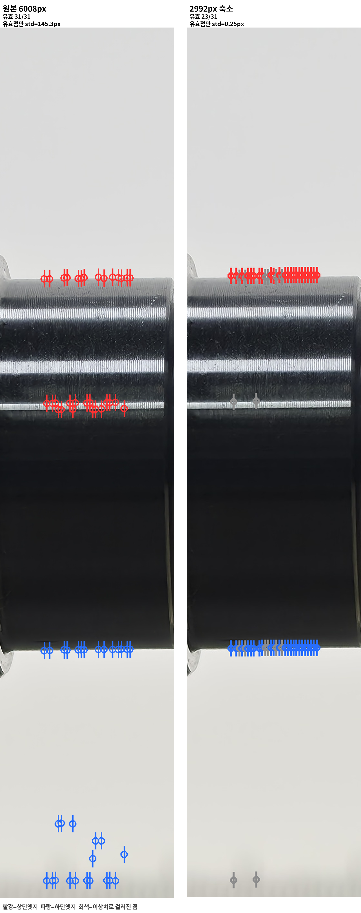
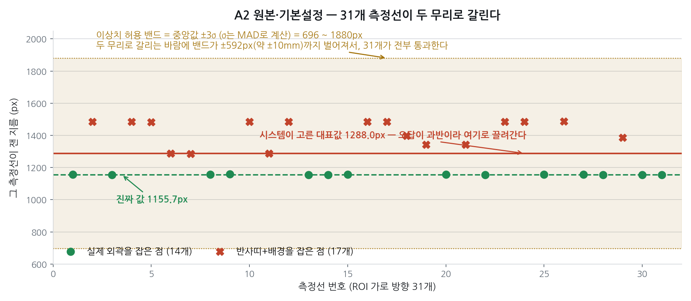
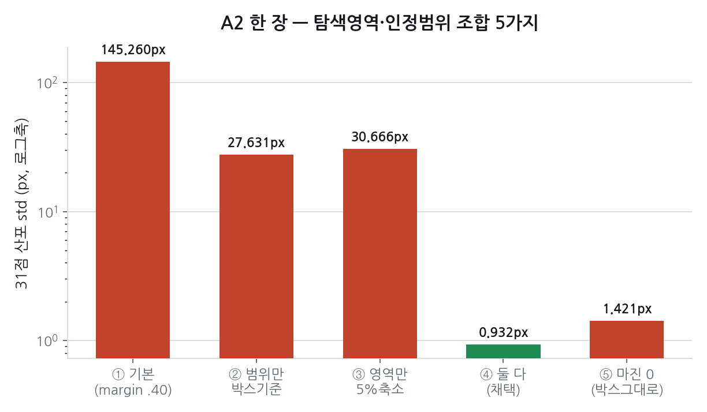
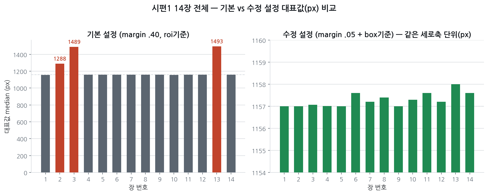
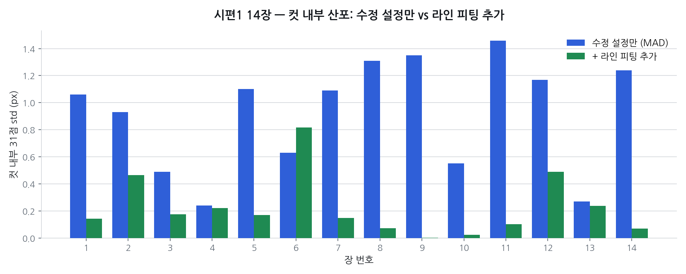
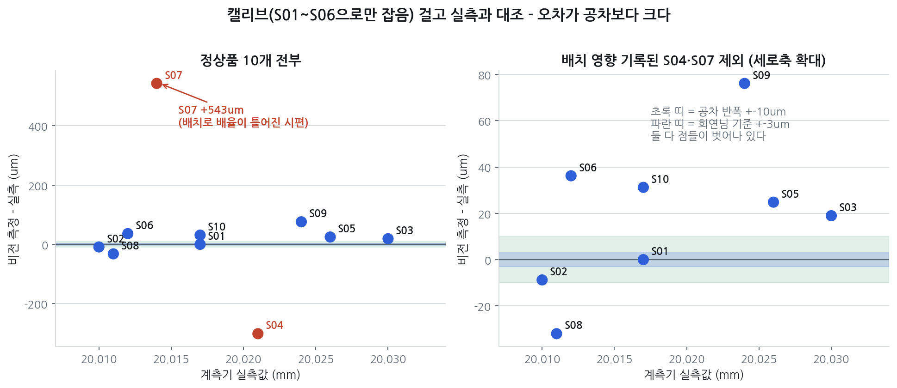

# 원본 해상도 엣지 검출 문제 — 원인·해결·정확도 검증 (2026-09-23)

작성 2026-09-23 | 대상 데이터 09-16 현장 촬영 161장 | 측정 엔진 `shaft_core.py`
상세 경과와 회의 기록은 [`2026-09-23_엣지검출_원본해상도_실험.md`](./2026-09-23_엣지검출_원본해상도_실험.md)

## 요약

| 항목 | 결과 |
|---|---|
| 현상 재현 | 재현됨. 원본 6008px에서 31개 측정선 중 17개가 반사띠·배경을 외곽으로 오인 |
| 원인 | 허용 지름 범위가 탐색 영역(ROI) 높이에 연동 → 영역을 넓히면 허용 범위도 넓어짐 |
| 해결안 | `vertical_margin` 0.40→0.05 + `dia_basis` "roi"→"box". 둘 다 바꿔야 효과 |
| 해결안 효과 | A2 31점 산포 145.26px→0.93px, 시편1 14장 장간 반복 sd 0.31px(5.4µm) |
| 반복성(정밀도) | 13개 시편 전부 장간 sd 0.16~0.65px = **2.8~11.2µm**. 시편 평균값의 흔들림은 0.8~3.2µm |
| 라인 피팅 추가 | 컷 내부 산포는 개선, 장간 반복성은 차이가 노이즈 안. 채택 근거 없음 |
| **정확도(캘리브 대조)** | **3µm 기준 미달. 정상품 10개 중 9개를 불합격으로 오판정** |
| 캘리브 시편 수 확대 | 1개→9개로 늘려도 예측 MAE 192→122µm. 전부 써도 하한 109µm. **개수로는 해결 안 됨** |
| **정확도 제약 요인** | **엣지 검출이 아니라 시편 배치. 반복 촬영 3~11µm vs 시편 교체 121~838µm** |

**결론**

1. **원본 해상도 오검출은 원인을 찾아 해결했다.** 탐색 영역을 넓히면 허용 지름 범위도 함께 넓어지는 구조가 원인이었다. 설정 2개를 동시에 바꿔 최대 2.51mm 오차를 제거했다.
2. **해결 후에도 정확도는 기준 미달이다.** 같은 시편 반복 촬영 흔들림은 3~11µm로 작지만, 실측과는 −301~+543µm 차이가 난다. 규격 판정에 쓰면 정상품 10개 중 9개를 불합격으로 오판정한다. 캘리브 시편을 늘려도 오차 하한이 109µm다.
3. **병목은 엣지 검출이 아니라 배치다.** 시편을 놓을 때마다 기울기·높이가 달라져 사진 속 크기가 변한다. 다음 단계는 지그다.

> 한 문장: 경계는 이제 제대로 잡지만, 놓을 때마다 위치가 달라져 실제 치수와 맞지 않는다. 다음은 지그다.

---

## 1. 현상 재현

A2(시편1 2번째 촬영, `20260916_154320.jpg`)를 원본 6008px와 2992px 축소본에서 측정.

| 조건 | 유효점 | 대표값 | 31점 산포 |
|---|---|---|---|
| 원본 6008px | 31/31 | 1287.96px | 145.260px |
| 2992px 축소 | 23/31 | 577.25px | 0.254px |

YOLO 박스는 두 해상도에서 동일 위치(conf 0.97). 문제는 탐지 이후 엣지 검출 단계다.



<sub>`docs/images/20260923_edge_report/A2_31점_비교.png` · 생성 `visualize.py`</sub>

### 31개 측정선의 분포

정답 위치(상단 y=2766, 하단 y=3922) 대비 기본 설정의 31개 점을 개별 대조.

| 무리 | 개수 | 상단 위치 | 하단 위치 | 지름 |
|---|---|---|---|---|
| 정상 검출 | 14개 | 기준 ±3px | 기준 ±3px | 1155.7px |
| 오검출 | 17개 | 기준 +388~409px (반사띠) | 기준 +540~718px (배경) | 1483.8px |

- 오검출 17개는 상단·하단이 동시에 틀림. 반사띠를 상단으로, 배경을 하단으로 인식한 한 쌍이다
- 오검출이 과반(17 대 14)이므로 중앙값이 오답 쪽으로 이동 → 대표값 1288.0px
- 이상치 허용 밴드가 696~1880px(±592px)까지 확대되어 31개 전부 "유효" 통과
- 이상치 제거는 소수 이탈을 걸러내는 장치이므로 다수가 틀린 경우 작동하지 않는다



<sub>`docs/images/20260923_edge_report/chart5_two_clusters.png` · 생성 `make_charts.py`(원자료 `count_wrong.py`)</sub>

## 2. 원인

`find_outer_edge`의 지름 허용 범위가 기본값 `dia_basis="roi"`에서 탐색 영역(ROI) 높이에 비례한다. ROI는 YOLO 박스를 위아래로 40%(`vertical_margin`) 확장해 만들므로, 원본처럼 절대 픽셀 수가 크면 허용 범위도 함께 확대되어 반사띠·배경까지 닿는 쌍이 통과한다.

```python
# shaft_core.py — measure_roi()
if p.dia_basis == "box":
    dia_lo, dia_hi = box_h * p.dia_min_box, box_h * p.dia_max_box   # 박스 높이 기준 0.55~0.95
elif p.dia_basis == "roi":
    dia_lo = dia_hi = None                                          # ROI 높이 기준 0.25~0.60
```

| 파라미터 | 기본값 | 변경값 | 역할 |
|---|---|---|---|
| `vertical_margin` | 0.40 | 0.05 | 탐색 영역 확장 비율 |
| `dia_basis` | `"roi"` | `"box"` | 허용 지름 범위의 기준 |

`edge_select="largest"`는 변경하지 않는다. 09-12 실험(C9)에서 대체 규칙이 더 나쁘다는 것이 확인됐다.

## 3. 해결안 검증 — A2 단일 컷



<sub>`docs/images/20260923_edge_report/chart1_5configs.png` · 생성 `make_charts.py`(원자료 `test_box_restrict.py`)</sub>

| 설정 | 유효점 | 대표값 | 산포 | 판정 |
|---|---|---|---|---|
| ① 기본(margin 0.40, roi 기준) | 31/31 | 1287.96px | 145.260px | 오답 |
| ② 허용범위만 박스 기준 | 27/31 | 1342.15px | 27.631px | 오답 |
| ③ 탐색범위만 0.05 | 31/31 | 912.41px | 30.666px | 오답 |
| **④ 탐색범위 0.05 + 박스 기준** | 26/31 | **1157.00px** | **0.932px** | **정답** |
| ⑤ 탐색범위 0 | 30/31 | 865.86px | 1.421px | 오답 |

허용 범위가 탐색 영역에 연동되어 있어 영역만 축소하면(③) 범위도 함께 축소되어 정답이 배제된다. 두 값을 동시에 변경해야 한다.

## 4. 해결안 검증 — 시편1 14장



<sub>`docs/images/20260923_edge_report/chart2_14shots_before_after.png` · 생성 `make_charts.py`(원자료 `test_all14.py`)</sub>

| 항목 | 기본 설정 | 수정 설정 |
|---|---|---|
| 심하게 이탈한 장 | 2·3·13번 (1288~1493px) | 없음 |
| 값 범위 | 1155~1493px | 1157.0~1158.0px |
| 장간 반복 sd | 산출 불가(오답 포함) | 0.31px = 5.4µm |

5.4µm의 의미:

- 같은 시편을 다시 놓지 않고 14장 연속 촬영했을 때 한 장 값이 흔들리는 폭이다. **정밀도(반복성)** 지표이며 실측과의 차이(정확도)와는 별개다
- 14장을 평균하면 평균값의 흔들림은 5.4/√14 ≈ 1.4µm. 09-17 기록(`02_facts.md`, 시편 평균 반복 흔들림 0.7~1.9µm)과 같은 범위다
- 6.1절 S01 값 0.322px(5.6µm)와의 차이는 표준편차 분모 차이(n vs n−1)다

기본 설정에서 이탈하는 장(2·3·13)이 D-001 기록의 "튄 5장(2·3·4·5·14)"과 일치하지 않는다. D-001의 근거가 `shaft_core.py`가 아닌 선행 스크립트 결과였을 가능성이 있다. 원본 해상도에서 문제가 발생한다는 결론 자체에는 영향이 없다.

## 5. 라인 피팅 결합 검토

팀원 제안(31개 점이 직선 위에 있어야 함)과 선행 개발자의 기존 코드(`05_Line_Fitting/line_fitting_measurement.py`, Day025~026)를 결합해, 직선에서 이탈한 점을 반복 제거하며 재적합하는 방식으로 검증했다.

| 조건(A2) | 상단 기울기 | 하단 기울기 | 산포 |
|---|---|---|---|
| 기본 설정 + 라인 피팅 | −0.398 | −0.631 | 18.537px |
| 수정 설정 + 라인 피팅 | −0.0096 | −0.0154 | 0.465px |

기본 설정에서는 상·하단 기울기가 불일치(평행이어야 함)하고 대표값도 오답이다. 라인 피팅 단독으로는 문제를 해결하지 못한다.



<sub>`docs/images/20260923_edge_report/chart3_linefit_within_shot.png` · 생성 `make_charts.py`(원자료 `line_fit_combo.py`)</sub>

| 지표 | 수정 설정만 | + 라인 피팅 |
|---|---|---|
| 컷 내부 31점 산포 | 0.24~1.46px | 0.002~0.818px |
| 장간 반복 sd | 0.32px | 0.43px |

장간 반복 sd 차이(+0.106px)는 장 단위 부트스트랩 20,000회에서 95% 구간이 −0.022~+0.202px로 0을 포함한다. 14장 표본으로는 두 방식의 우열을 판정할 수 없다.

**판단**: 컷 내부 산포 개선은 확인됐으나 장간 반복성 개선 근거는 없다. 채택 보류하고 평행도(기울기) 진단 지표로만 활용한다.

## 6. 정확도 검증 — 시편 전체 캘리브 대조

대상은 시편 전체 13개(정상 S01~S10 각 14장 + 사이즈 에러품 N01~N03 각 7장) = 161장, 원본 해상도 + 수정 설정. 캘리브레이션은 S01~S06으로만 산출하고 S07~S10은 예측 대상으로만 사용해 순환논증을 배제했다.

### 6.1 시편별 측정값

| 시편 | 측정 px | 측정 mm | 실측 mm | 오차 (µm) | 장간 sd (px) | 장간 sd (µm) | 평균값 흔들림 (µm) |
|---|---|---|---|---|---|---|---|
| S01 | 1157.20 | 20.0170 | 20.017 | 0 (기준) | 0.322 | 5.6 | 1.5 |
| S02 | 1156.28 | 20.0012 | 20.010 | -8.8 | 0.645 | 11.2 | 3.0 |
| S03 | 1159.04 | 20.0490 | 20.030 | +19.0 | 0.212 | 3.7 | 1.0 |
| S04 | 1140.00 | 19.7196 | 20.021 | -301.4 | 0.383 | 6.6 | 1.8 |
| S05 | 1159.15 | 20.0508 | 20.026 | +24.8 | 0.515 | 8.9 | 2.4 |
| S06 | 1159.00 | 20.0482 | 20.012 | +36.2 | 0.604 | 10.4 | 2.8 |
| S07 | 1188.42 | 20.5571 | 20.014 | +543.1 | 0.371 | 6.4 | 1.7 |
| S08 | 1155.00 | 19.9790 | 20.011 | -32.0 | 0.187 | 3.2 | 0.9 |
| S09 | 1162.00 | 20.1001 | 20.024 | +76.1 | 0.171 | 3.0 | 0.8 |
| S10 | 1159.00 | 20.0482 | 20.017 | +31.2 | 0.164 | 2.8 | 0.8 |
| N01 | 1180.11 | 20.4133 | 20.405 | +8.3 | 0.482 | 8.3 | 3.2 |
| N02 | 1161.10 | 20.0846 | 20.040 | +44.6 | 0.461 | 8.0 | 3.0 |
| N03 | 1160.00 | 20.0655 | 20.006 | +59.5 | 0.280 | 4.8 | 1.8 |

<sub>측정 mm = 측정 px × 17.30µm/px(6.2절 1점 캘리브, S01 기준). S01은 캘리브 기준이라 오차 0이 정의상 나오며, 나머지 12개는 캘리브에 쓰지 않은 값이다. 오차 = 측정 mm − 실측 mm. 장간 sd는 한 장 값의 흔들림, 평균값 흔들림은 장간 sd/√장수(S 14장, N 7장).</sub>

전 시편에서 검출 실패 없음(161/161). 장간 sd는 0.16~0.65px(2.8~11.2µm) 범위로, 시편1에서 본 반복성이 다른 시편에서도 같은 수준으로 나온다. 같은 행의 오차와 장간 sd(µm)를 나란히 보면, 캘리브 기준 S01과 S02·N01(오차가 장간 sd 이하)을 뺀 10개에서 오차가 장간 sd의 2.8~85배다. 사진을 반복할 때의 흔들림보다 실측과의 차이가 크다(6.5절).

### 6.2 캘리브레이션 값

| 방법 | 산출값 |
|---|---|
| 1점(S01 기준) | 17.2979 µm/px |
| 6개 배율 적합(S01~S06) | 17.3305 µm/px |
| 팀 문서 상수(34.7µm/px @2992 환산) | 17.28 µm/px |

독립 산출값이 기존 팀 상수와 0.01% 내에서 일치한다.

### 6.3 S07~S10 대조 결과 (1점 캘리브)

| 시편 | 예측 mm | 실측 mm | 오차 |
|---|---|---|---|
| S07 | 20.5571 | 20.014 | +543.1µm |
| S08 | 19.9790 | 20.011 | −32.0µm |
| S09 | 20.1001 | 20.024 | +76.1µm |
| S10 | 20.0482 | 20.017 | +31.2µm |

MAE 170.6µm, S07 제외 시 MAE 46.4µm. 합격 기준 3µm 미달이며 공차 반폭 10µm도 초과한다.



<sub>`docs/images/20260923_edge_report/chart6_calib_vs_actual.png` · 생성 `make_charts.py`(원자료 `calib_s07_s10.py`)</sub>

### 6.4 규격 판정에 적용한 경우 (Ø20.020 ±0.010 = 20.010~20.030mm)

| 구분 | 결과 |
|---|---|
| 정상품 10개 | **9개를 불합격으로 오판정.** 합격 판정은 캘리브 기준인 S01 하나 |
| 사이즈 에러품 3개 | 3개 전부 불합격으로 검출 |
| 종합 | 맞힘 3 · 헛경보 9 · 놓침 0 |

현재 정확도로는 합격/불합격 판정에 사용할 수 없다. 큰 이탈(N01 +385µm)은 검출되나 정상품과 미세 이탈은 구분되지 않는다.

### 6.5 제약 요인은 배치

| 항목 | 크기 |
|---|---|
| 같은 시편 반복 촬영 시 흔들림 | 0.16~0.65px = 3~11µm |
| 시편 교체 시 벌어지는 폭 | 48.4px = 838µm (S04·S07 제외 시 7.0px = 121µm) |
| 구별해야 할 실측 차이 | 20µm = 1.16px |

실측 대 측정 상관 r = −0.144(정상품 10개), S04·S07 제외 시 +0.651. S04·S07은 `02_facts.md`에 배치에 따른 배율 변동이 기록된 시편이며 원본 해상도에서도 동일하게 나타났다.

동일 시편 반복 측정은 안정적이나 시편을 교체하면 값이 이동한다. 정확도 제약 요인은 엣지 검출이 아니라 배치다.

### 6.6 해석 시 주의

캘리브레이션을 2자유도 직선 적합(mm = a×px + b)으로 산출하면 MAE 5.1µm가 나오지만, 적합 기울기가 −0.0023µm/px로 사실상 0이며 S07~S10 예측값이 전부 20.0193mm로 동일하다. 정상품의 실측 폭(20µm)이 측정 잡음보다 작아 최소제곱이 측정값을 무시하는 해로 수렴한 결과이므로 정확도 근거로 사용할 수 없다.

### 6.7 캘리브 시편 수를 늘리면

6.3은 S01 한 개로 캘리브를 잡았다. 캘리브 시편을 늘려 정확도가 개선되는지 확인했다. 정상품 10개에서 k개로 배율을 잡고 나머지 10−k개를 예측, 가능한 모든 조합을 평균했다.

| 캘리브 시편 수 k | 조합 수 | 예측 MAE 평균 | MAE 최저~최고 |
|---|---|---|---|
| 1 | 10 | 191.9µm | 114.8~545.6µm |
| 3 | 120 | 165.2µm | 50.4~256.4µm |
| 6 | 210 | 138.8µm | 15.8~238.0µm |
| 9 | 10 | 121.5µm | 5.0~560.2µm |
| 전부(오라클) | 1 | **109.2µm** | 3µm 이내 0/10 |

오라클은 10개 전부로 배율을 잡고 같은 10개를 맞힌 값으로, 캘리브 개수를 늘려 도달할 수 있는 최선이다. S04·S07을 빼도 오라클 MAE 23.9µm(3µm 이내 1/8)다.

캘리브는 µm/px 숫자 하나를 정하는 작업이다. 시편을 늘리면 그 숫자가 안정되어 평균 오차는 줄지만, 시편마다 px가 따로 흔들리는 것(6.5절)은 숫자 하나로 보정되지 않는다. 또 정상품은 실측이 20.010~20.030mm로 모여 있어 배율을 결정할 정보가 적다(`02_facts.md`: 3점 캘리브 조건인 시편 간 0.25mm 이상 차이를 만족하는 시편은 N01 하나).

**캘리브 개수를 늘리는 것으로는 3µm에 도달하지 않는다.** 개선 방향은 한 장 안에서 배치를 상쇄하는 방식(09-17 칼라·끝단 두 기준 보간: 12개 오차 sd 189→17µm)이나 배치 자체를 고정하는 지그다.

<sub>원자료 `calib_sweep.py`(측정 재실행 없이 `calib_s07_s10.py`가 저장한 시편별 px 사용)</sub>

## 7. 제안 · 논의 사항

1. 수정 설정(`vertical_margin=0.05, dia_basis="box"`)을 파이프라인 기본값으로 채택할지, D-001(2992px 축소)을 유지하고 별도 트랙으로 둘지
2. 정확도 개선의 본체가 지그(배치)임이 확인됨 → 지그 제작 일정·사양 논의로 이관
3. 팀원 제안 중 미검증 항목: "엣지 후보 중 박스 경계에 가까운 쪽 선택"(선택 규칙 변경). 3절에서 검증한 허용 범위 기준 변경과는 별개 사안이며, `edge_select` 변경은 C9 반증 이력이 있어 동일 5축 재측정 필요
4. 라인 피팅: 평행도 진단 지표로만 유지할지, 시편 수를 늘려 재판정할지
5. 각자 워킹 코드 변경 내역 공유 방식

## 8. 한계

1. 해결안 검증(3~4절)은 시편1 14장 기준이며 다른 시편에서의 재현은 미확인
2. `vertical_margin=0.05`는 5개 조합 비교로 선정한 값이며 원리적 근거는 없다. 시편이 박스에서 더 이탈해 놓인 경우 여유가 부족할 수 있다
3. 14 대 17 분리는 A2 한 장에서만 확인
4. 캘리브레이션 기준이 기준물(게이지 블록 등)이 아닌 시편이다. 기준 시편의 배치가 틀어져 있으면 전체가 이동한다
5. b층 잔차(13~21µm, C9)에 대한 이번 수정의 영향은 미확인

## 부록. 소스코드 · 재현 방법

전 실험은 conda 환경 `aiffel`에서 실행. 측정 엔진은 `shaft_core.py` 단일.

| 항목 | 위치 |
|---|---|
| 상세 경과·회의 기록 | [`2026-09-23_엣지검출_원본해상도_실험.md`](./2026-09-23_엣지검출_원본해상도_실험.md) |
| 근거 항목 C3·C12·C13 | [`docs/03_claims.md`](../03_claims.md) |
| 기존 결정(2992px 축소) | [`docs/04_decisions/D-001_처리규격_2992.md`](../04_decisions/D-001_처리규격_2992.md) |
| 1절 재현 | [`check.py`](../../experiments/20260923_edge_selection/check.py) · [`visualize.py`](../../experiments/20260923_edge_selection/visualize.py) · [`count_wrong.py`](../../experiments/20260923_edge_selection/count_wrong.py) |
| 3절 설정 조합 | [`test_box_restrict.py`](../../experiments/20260923_edge_selection/test_box_restrict.py) |
| 4절 14장 확장 | [`test_all14.py`](../../experiments/20260923_edge_selection/test_all14.py) |
| 5절 라인 피팅 | [`line_fit_combo.py`](../../experiments/20260923_edge_selection/line_fit_combo.py) · [`noise_floor.py`](../../experiments/20260923_edge_selection/noise_floor.py) |
| 6절 캘리브 대조 | [`calib_s07_s10.py`](../../experiments/20260923_edge_selection/calib_s07_s10.py) · [`calib_sweep.py`](../../experiments/20260923_edge_selection/calib_sweep.py) |
| 차트 생성 | [`make_charts.py`](../../experiments/20260923_edge_selection/make_charts.py) |
| 수치 원본 출력 | [`experiments/results/20260923/raw_output.txt`](../../experiments/results/20260923/raw_output.txt) |
| 이미지 | `docs/images/20260923_edge_report/` |

측정 엔진과 현장 사진은 용량·저작 사유로 저장소에 포함하지 않는다. 경로는 `paths.py`에서 일괄 지정하며 아래 중 하나를 설정하면 실행된다.

```bash
# 환경변수
export SHAFT_ENGINE_DIR=/경로/샤프트측정/experiments   # shaft_core.py 위치
export SHAFT_FIELD_DIR=/경로/Pre365/field              # photos/ · models/ 상위

# 또는 experiments/20260923_edge_selection/paths_local.py (git 제외)
#   ENGINE_DIR = "/경로/샤프트측정/experiments"
#   FIELD_DIR  = "/경로/Pre365/field"

conda run -n aiffel python experiments/20260923_edge_selection/calib_s07_s10.py
```
