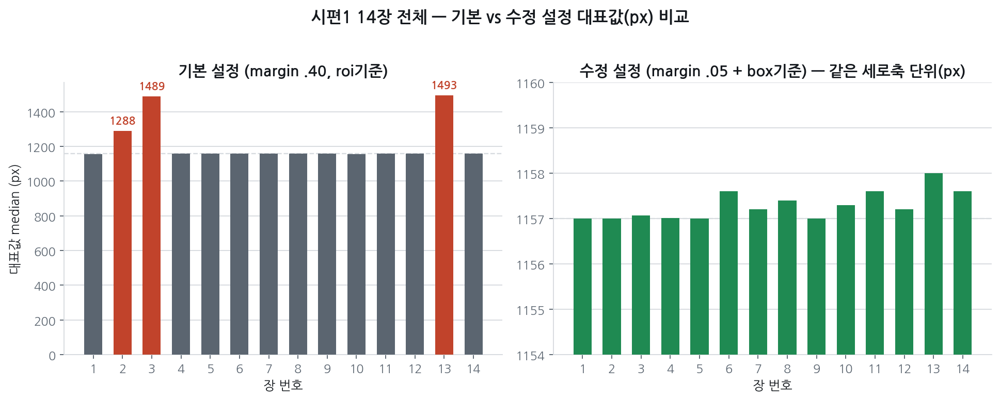
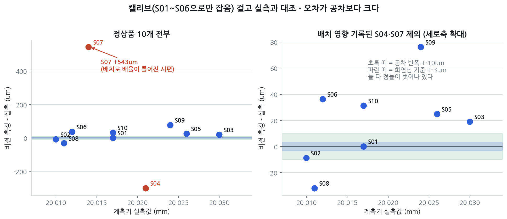

# 2026-09-23 작업 정리

상세 근거는 [`2026-09-23_엣지검출_브리핑.md`](./2026-09-23_엣지검출_브리핑.md). 스크립트는 `experiments/20260923_edge_selection/`.

---

### 1. 원본 해상도 오검출 — 원인 규명과 해결
- 원본 6008px의 A2 사진에서 31개 측정선 중 17개가 반사띠·배경을 경계로 잡음. 과반이라 중앙값이 오답(1288px)이 되고, 이상치 제거도 작동하지 않아 "유효 31/31"로 조용히 틀림
- 원인: 허용 지름 범위(ROI 높이의 25\~60% = 박스의 45\~108%)가 느슨해 가짜 쌍도 통과하고, "제일 넓은 쌍" 규칙이 가짜를 고름. 2992px에서도 가짜가 8개 잡혔지만 소수라 걸러졌다
- 해결: YOLO 박스 안에서만 탐색 + 허용 범위를 박스 기준(55\~95%)으로 → A2 산포 145px → 0.93px, 시편1 14장 전부 1157\~1158px
- 박스 그대로(margin 0)도 결과가 같음. 탐색 범위만 줄이면 진짜 지름이 잘려 오답

### 2. 정확도 검증 — 시편 전체 161장
- S01로 잡은 캘리브 17.30µm/px(팀 상수 17.28과 0.01% 차이) → S07\~S10 MAE 170.6µm
- 규격 판정에 쓰면 정상품 10개 중 9개를 불합격으로 오판정. 사이즈 에러품 3개는 전부 검출
- 같은 시편 반복 촬영 흔들림은 3\~11µm로 작은데, 시편을 바꾸면 값이 121\~838µm 움직임 → 정확도 병목은 엣지 검출이 아니라 배치

### 3. 추가 확인 세 가지
- 캘리브 시편 수 확대: 1개 → 9개로 늘려도 예측 MAE 192 → 122µm. 10개 전부 써도 109µm가 한계 → 캘리브 개수로는 해결 안 됨
- 제안서 잣대(오차 sd)로 환산: 보정 전 186µm(09-17: 189µm), S04 −324 / S07 +512µm로 기존 결과 재현. 제안서 17µm는 두 기준 보간 값이라 이번 측정(측정부만)으로는 산출 불가
- 캘리브 설계(S01\~03 캘리브 → S04\~06 검증 → S07\~10 테스트)를 기존 데이터로 계산: 보정 없이 테스트 MAE 169µm. 09-17 두 기준 보간 데이터로는 6.8µm지만, 실측 평균만 찍는 기준선(5.0µm)을 넘지 못함

### 4. 문서 · 공유
- 브리핑 문서: 결론 세 줄, 이전 대비 달라진 점·개선되지 않은 것, 다시 돌릴 때 주의사항(원본 해상도·재학습 YOLO 모델·확인 기준값) 추가
- 정정: 원인 서술(해상도가 아니라 느슨한 허용 범위), 5.4µm와 17µm는 다른 지표(반복성 vs 실측 대비 오차), 라인 피팅 "장별 개선"은 다른 양끼리의 비교
- 실험 스크립트 절대경로 제거(`paths.py`) → 팀원도 경로만 지정하면 실행 가능. 문서 5개의 `~` 취소선 표시 오류 수정
- 회의록 09-17 \~ 09-23 작성

---

### 다음 할 일
- vertical_margin·허용 범위 설명을 팀에 공유(원본 엔진에는 박스 기준 허용 범위가 없어 코드 변경이 필요)
- 선행 저장소 현장 가이드의 캘리브 설계(A/B/C → D/E/F → G\~J) 의도와 전제를 같이 확인. 캘리브용 시편끼리 크기 차이가 충분해야 한다는 조건 포함
- 추석 기간 촬영 구조물 시험 → 10/2 공장 촬영에 재거치 반복 세트·칼라와 끝단이 함께 찍히는 구도·크기 차이가 큰 기준물 포함

### 보류
- 원본 해상도 두 기준 보간(예상 1\~2시간), 라인 피팅 재판정, "박스 경계에 가까운 후보 선택" 규칙 검증
