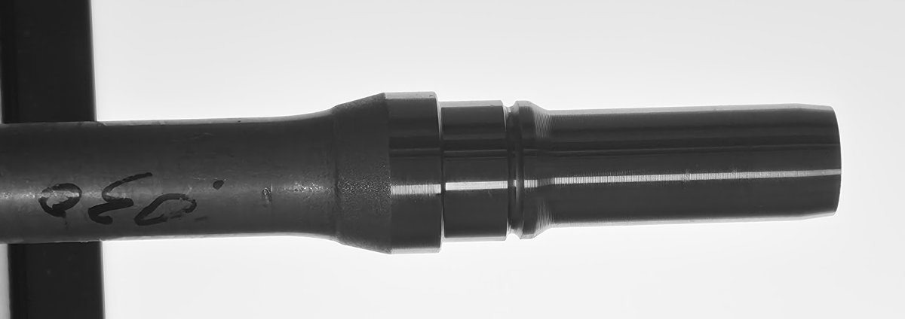
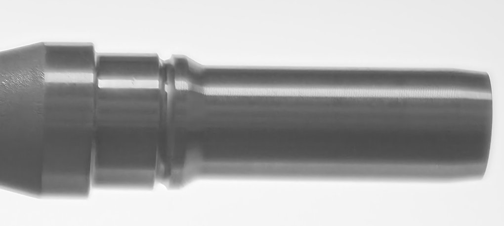
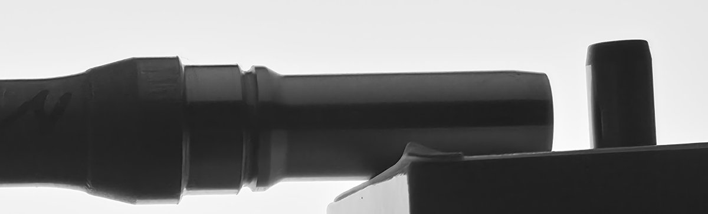
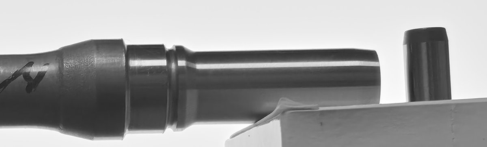

# 10-01 자체 촬영 사전 점검 — 40cm · 200MP · 핀게이지 조건 (사진 6장)

10-02 2차 현장 촬영 조건(1배 메인 렌즈, 약 400mm, 핀게이지 동시 촬영)을 집에서 미리 찍어 보고 문제를 찾았다. 계획서: [`../2026-10-02_2차촬영_계획서.md`](../2026-10-02_2차촬영_계획서.md)

## 요약

| 발견 | 근거 | 내일 대응 |
|---|---|---|
| **핀이 샤프트와 다른 깊이에 있으면 배율이 틀어진다** | 핀으로 환산한 같은 구간 지름이 배치마다 19.0\~21.2mm로 흔들림. 같은 배치(5·6번)끼리는 19.98 / 20.05mm로 가깝다 | 핀은 세워서 지름(가로 폭)을 재고, **축을 샤프트 축과 같은 깊이에**(직각자 + 캘리퍼스, 계획서 3.5절) |
| **배치가 바뀌면 배율이 크게 바뀐다** | 같은 구간이 배치마다 492\~527px | 거치대 고정, 촬영 중 폰 접촉 금지(타이머·리모컨), 사진마다 핀 px 기록 |
| **주변 조명은 표면 반사와 경계 대비 저하를 만든다** | 불 켬(2번) 경계 대비 88\~138 vs 불 끔(4번) 140\~197. 불 켜면 샤프트 표면에 밝은 반사 줄 | 검은 천 준비. 현장에서 차광 있음/없음 비교로 필요성 판단 |
| 같은 배치에서 불을 켜고 꺼도 지름 차이는 못 찾았다 | 5·6번: 칼라-홈 0.5px, 끝단 0.1px, 핀 1.1px 차이(한 장씩 비교의 잡음 범위) | 한 장씩이라 0.5px(약 20µm) 이하 차이는 이 실험으로 가릴 수 없다 |
| 흰 판으로 가리면 효과가 없다 | 3번: 샤프트 안쪽 밝기 76\~80으로 그대로(흰 면이 빛을 되비춤) | 차광재는 무광 검정 |
| 40cm · 200MP에서 측정부 크기는 쓸 만하다 | 측정부(추정) 약 490\~530px. 1차 2992px 축소본(577px)과 비슷한 규모 | 200MP 모드 고정(12MP면 약 1/4 크기) |
| 경계 선명도는 문제없었다 | 6장 모두 경계 폭 4\~16px | 시험 1장에서 측정부·핀 경계 확인만 |

---

## 조건

- 폰: Galaxy S26 Ultra, 200MP(16320×7532), 1배 메인(35mm 환산 23mm), f/1.4, 자동 모드. 6장 모두 같은 렌즈·설정(EXIF 확인)
- 시편: 집에 보관 중인 샤프트 1개(**실측값 없음** — mm 환산값은 핀 깊이 어긋남을 보여 주는 용도이고 정확도 근거가 아니다), 핀게이지 Ø10 1개(세워서 놓음)
- 받침: 종이 상자(V-block 없음). 거리는 눈대중 약 40cm. 5·6번은 같은 배치에서 조명만 바꿨다
- 측정: 경계를 밝기 중간값으로 찾는 간이 방식(본 측정 엔진 아님). 측정부 여러 위치에서 위아래 경계 사이를 재 중앙값을 냈다
  - 경계 폭 = 경계 바로 앞뒤 ±15px 안에서 밝기가 20%에서 80%로 넘어가는 픽셀 수(작을수록 선명)
  - 경계 대비 = 그 범위의 밝은 쪽과 어두운 쪽 밝기 차(클수록 실루엣이 뚜렷)

## 사진별 결과

| # | 구성 | 측정부(추정) 지름 | 샤프트 안쪽 밝기 | 경계 폭 (위/아래) | 경계 대비 (위/아래) | 핀 지름 | 핀 기준 환산 |
|---|---|---|---|---|---|---|---|
| 1 | 백라이트 바닥, 위에서 촬영, 불 켬, 핀 없음 | 492.0px | 약 50 | 5 / 8px | 108 / 147 | — | — |
| 2 | 백라이트 세움·최대 밝기, 불 켬, 핀 세움 | 524.3px | 약 75 | 15 / 16px | 138 / 88 | 247.2px | 21.2mm |
| 3 | 2 + 흰 하드보드지로 천장 빛 가림 | 527.3px (받침 간섭으로 흔들림) | 76\~80 | 10 / 11px | 119 / 121 | 276.2px | 19.1mm |
| 4 | 불 끔 | 494.5px | 40 | 11 / 8px | 197 / 140 | 260.4px | 19.0mm |
| 5 | 새 배치, 불 끔 | 503.8px | 34 | 7 / 8px | 201 / 144 | 252.1px | 19.98mm |
| 6 | 5와 같은 배치, 불 켬 | 503.3px | 53 | 4 / 8px | 200 / 129 | 251.0px | 20.05mm |

측정부(추정) = 칼라와 홈 사이 구간. 이 샤프트의 측정부가 맞는지, 실제 지름이 얼마인지는 확인하지 못했다.

## 사진

1번 — 백라이트를 바닥에 두고 위에서 촬영  

**문제점**
- 천장 조명이 카메라 쪽 샤프트 윗면을 직접 비춘다 → 표면에 밝은 반사 줄
- 샤프트 왼쪽 절반이 상자 위에 있어 그 부분은 경계 뒤가 백라이트가 아니다
- 핀이 없어 배율을 확인할 수 없다
- 위에서 내려다보는 구성은 렌즈–샤프트 거리(높이 방향)를 재고 고정하기 어렵다 → 이후 백라이트를 세우는 구성으로 바꿈

2번 — 백라이트를 세우고 불 켬. 샤프트가 은회색으로 보인다(앞쪽 조명)  

**문제점**
- 앞쪽 방 조명 때문에 샤프트가 검은 실루엣이 아니라 은회색(안쪽 밝기 약 75)으로 찍힌다. 아래 경계 대비 88로 낮다
- 핀을 상자 위에 눈대중으로 세웠다. 핀 기준 환산 21.2mm가 다른 배치(19.0\~20.05mm)와 크게 달라, 핀 깊이가 샤프트와 다른 것으로 보인다
- 다른 샤프트가 카메라 쪽으로 튀어나와 화면에 함께 찍혔다(측정 대상 외 물체)

3번 — 흰 하드보드지로 위를 가림. 흰 면이 빛을 되비춰 효과가 거의 없다  

**문제점**
- 흰 하드보드지가 빛을 되비춰 샤프트가 여전히 밝다(안쪽 76\~80) — 가림 효과 없음
- 하드보드지를 손으로 들어 위치가 일정하지 않다
- 샤프트 끝단 아래가 상자에 닿아 아래 경계가 백라이트가 아니다(측정값 흔들림 sd 37px)
- 핀 위치가 눈대중이라 환산 19.1mm — 배치마다 값이 달라지는 문제 그대로

4번 — 불 끔. 샤프트가 검은 실루엣이 된다  

**문제점**
- 실루엣은 좋아졌다(안쪽 40). 남은 문제: 핀 위치가 눈대중이라 환산 19.0mm — 배치마다 값이 달라지는 문제 그대로
- 끝단 오른쪽 아래가 상자에 걸쳐 있다
- 현장에서는 공장 불을 끌 수 없다 → 차광으로 같은 효과를 내야 한다

5번 — 새 배치, 불 끔  

**문제점**
- 6장 중 가장 양호하다. 남은 문제: 끝단 오른쪽 아래가 여전히 상자에 걸쳐 있다
- 샤프트 실측값이 없어 핀 기준 환산 19.98mm가 맞는지 판단할 수 없다
- 종이 상자 받침이라 같은 배치를 다시 만들 수 없다(재현성 없음)

6번 — 5번과 같은 배치, 불 켬. 샤프트 표면에 밝은 반사 줄이 생기지만 지름은 거의 같다  

**문제점**
- 샤프트 표면에 밝은 반사 줄이 생긴다(안쪽 53) — 1차 오검출의 원인과 같은 종류
- 5번과 지름 차이는 0.5px 이하였지만 한 장씩 비교라 그보다 작은 차이는 가릴 수 없다
- 5번과 같은 받침·핀 문제를 그대로 가진다

## 해석

1. **핀 깊이**: 배율은 카메라와의 거리에 반비례하므로, 핀으로 잡은 배율을 샤프트에 쓰려면 두 축의 깊이가 같아야 한다(20mm에서 2µm 오차 이내로 하려면 0.04mm). 핀을 상자 위에 세워 두면 놓는 위치에 따라 깊이가 cm 단위로 달라져 환산값이 19.0\~21.2mm로 흔들렸다. 같은 배치(5·6번)에서는 19.98 / 20.05mm로 서로 가까웠다 — 배치만 고정되면 핀 배율은 재현된다. 앞면이 아니라 **축**을 맞춰야 한다(반지름 차 5mm만큼 축이 어긋나므로). 핀을 V-block에 눕혀 얹으면 V자 벽이 핀 아래쪽 경계를 가리므로, 핀은 세운 채 직각자 기준선에서 거리를 캘리퍼스로 맞춘다(계획서 3.5절).
2. **거치**: 배치가 바뀔 때마다 같은 구간이 492\~527px로 달라졌다. 정확한 40cm보다 **촬영 중 거리가 변하지 않는 것**과 **사진마다 핀으로 배율을 다시 잡는 것**이 중요하다. 38\~42cm 범위면 원근 보정량 차이는 약 ±0.7µm로 작다.
3. **조명**: 불을 켜면 샤프트 앞면이 방 조명을 받아 표면 반사 줄이 생기고, 조명 방향에 따라 경계 대비가 떨어진다(2번). 같은 배치(5·6번)에서는 지름 차이가 잡음 범위였지만 한 장씩 비교라 0.5px 이하 차이는 가릴 수 없다. 1차 현장 사진의 반사띠가 원본 해상도 오검출의 원인이었고(09-23 브리핑), 공장 조명은 더 강하고 방향도 다양하다. 그래서 검은 천을 준비하고, 현장에서 차광 있음/없음을 같은 배치로 5장씩 찍어 필요성을 판단한다.
4. **백라이트 크기**: 주변 빛은 카메라 쪽에서 오므로 백라이트를 A3로 키워도 막지 못한다. 확산 백라이트가 넓어지면 비스듬한 빛이 늘어 둥근 가장자리를 감싸는 빛(래핑)이 커질 수 있다. 지금 A4로 측정부·칼라·끝단·핀이 모두 백라이트 앞에 들어오므로 A4로 충분하다.

## 정정 (작성 중 바로잡은 것)

처음 분석에서는 경계 폭을 경계 앞뒤 ±50px로 넓게 쟀다. 그 범위에 샤프트 표면의 명암(반사·그림자)이 섞여 경계 폭이 50\~75px로 나왔고, 이를 "초점이 샤프트에 안 맞아 흐리다", "아래 경계가 위보다 넓다"로 해석했다. 경계 바로 앞뒤(±15px)만 보면 6장 모두 4\~16px로 선명했다. 두 해석은 측정 방법이 만든 것이라 철회한다. 이전 5·6번(12:46·12:47 촬영)은 촬영 중 배치가 움직여 지우고 다시 찍었다.

## 한계

- 샤프트 실측값이 없어 정확도는 평가하지 않았다
- 사진마다 한 장씩이라 반복 흔들림(장간 sd)을 측정하지 않았고, 0.5px 이하 차이는 판단할 수 없다
- 측정은 간이 경계 찾기로 했고, 본 측정 엔진(YOLO + 31개 측정선)으로 돌리지 않았다
- 초점이 맞는 깊이 범위(±6mm)는 계산 추정이며, 이번 사진들에서 초점 문제는 관찰되지 않았다
