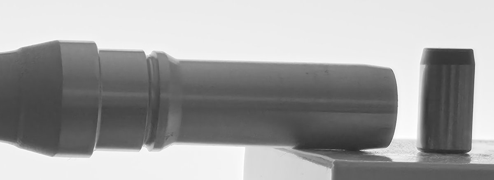
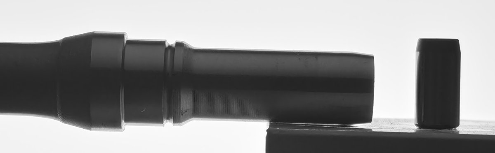
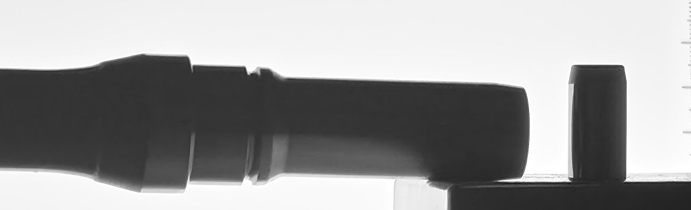
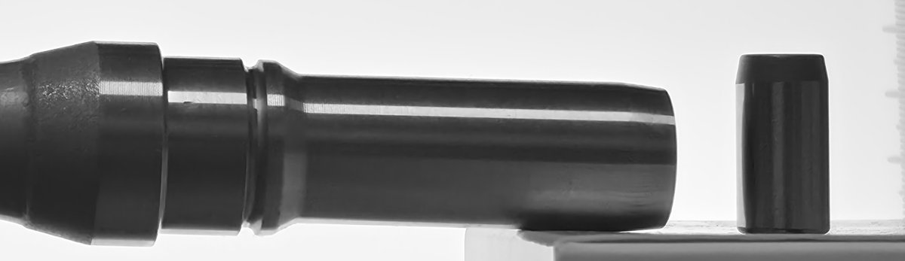

# 10-01 자체 촬영 사전 점검 — 40cm · 200MP · 핀게이지 조건 (사진 6장)

10-02 2차 현장 촬영 조건(1배 메인 렌즈, 약 400mm, 핀게이지 동시 촬영)을 집에서 미리 찍어 보고 문제를 찾았다. 계획서: [`../2026-10-02_2차촬영_계획서.md`](../2026-10-02_2차촬영_계획서.md)

## 요약

| 발견 | 근거 | 내일 대응 |
|---|---|---|
| **주변 조명이 샤프트 표면을 비춰 실루엣이 약해진다** | 불 켬(2·3번): 샤프트 안쪽 밝기 75\~80 / 불 끔(4번): 40. 6번(불 켬)은 42지만 표면 반사 줄이 보임 | **무광 검정 차광**(검은 천·검은 폼보드). 흰 판은 반사판이 되어 효과 없음 |
| **초점은 한 깊이에만 맞는다** | 같은 사진에서 핀 경계 5\~19px(선명) vs 샤프트 50\~59px(흐림). 초점을 둘 사이로 옮기자 샤프트 위 경계 8\~10px | 측정부를 눌러 초점 고정 → 시험 1장에서 핀·샤프트 둘 다 선명한지 확인 |
| **핀이 샤프트와 다른 깊이에 있으면 배율이 틀어진다** | 핀으로 환산한 같은 구간 지름이 사진마다 19.0\~21.2mm로 흔들림 | 핀을 눕혀 **축을 샤프트 축과 같은 선에**(V-block 중심선 일치) |
| **거치가 단단하지 않으면 배율이 사진마다 크게 바뀐다** | 같은 구간이 391\~528px. "고정" 상태 두 장 사이에도 +28% | 거치대 고정, 촬영 중 폰 접촉 금지(타이머·리모컨), 사진마다 핀 px 기록 |
| 40cm · 200MP에서 측정부 크기는 쓸 만하다 | 측정부(추정) 약 390\~530px. 1차 2992px 축소본(577px)과 비슷한 규모 | 200MP 모드 고정(12MP면 약 1/4 크기) |
| (미확인) 아래 경계가 위 경계보다 넓다 | 5·6번: 위 8\~10px vs 아래 32\~75px | 흰 상자 받침의 반사로 추정. 내일은 검은색 또는 금속 받침 |

---

## 조건

- 폰: Galaxy S26 Ultra, 200MP(16320×7532), 1배 메인(35mm 환산 23mm), f/1.4, 자동 모드. 6장 모두 같은 렌즈·설정(EXIF 확인)
- 시편: 집에 보관 중인 샤프트 1개(**실측값 없음** — mm 환산값은 비교용일 뿐 정확도 근거가 아니다), 핀게이지 Ø10 1개(세워서 놓음)
- 받침: 종이 상자(V-block 없음). 거리는 눈대중 약 40cm
- 측정: 경계를 밝기 중간값으로 찾는 간이 방식(본 측정 엔진 아님). "경계 흐린 폭" = 밝기가 10%에서 90%로 넘어가는 데 걸리는 픽셀 수(작을수록 선명)

## 사진별 결과

| # | 구성 | 측정부(추정) 지름 | 샤프트 안쪽 밝기 | 경계 흐린 폭 | 핀 지름 | 핀 기준 환산 |
|---|---|---|---|---|---|---|
| 1 | 백라이트 바닥, 위에서 촬영, 핀 없음 | 492.1px | 약 50 | 위 45\~50 / 아래 29px | — | — |
| 2 | 백라이트 세움·최대 밝기, 핀 세움 | 524.3px | 약 75 | 아래 69px | 247.3px | 21.2mm |
| 3 | 2 + 흰 하드보드지로 천장 빛 가림 | 527.5px(받침 간섭) | 76\~80 | 아래 46\~56px | 274.8px | 19.2mm |
| 4 | 불 끔 | 494.6px | **40** | 위 50 / 아래 59px | 260.3px (경계 5\~19px) | 19.0mm |
| 5 | 불 끔, 초점을 핀과 샤프트 사이 | 391.5px | 52 | **위 8** / 아래 75px | 185.7px | 21.1mm |
| 6 | 불 켬, 초점을 핀과 샤프트 사이 | 501.5px | 42(반사 줄 있음) | **위 10** / 아래 32px | 254.1px | 19.7mm |

측정부(추정) = 칼라와 홈 사이 구간. 이 샤프트의 측정부가 맞는지, 실제 지름이 얼마인지는 확인하지 못했다. 1차 현장 사진(9/16)의 경계 흐린 폭은 약 0.29mm, 샤프트 안쪽 밝기는 약 50이었다.

## 사진

1번 — 백라이트를 바닥에 두고 위에서 촬영  

2번 — 백라이트를 세우고 불 켬. 샤프트가 은회색으로 보인다(앞쪽 조명)  

3번 — 흰 하드보드지로 위를 가림. 흰 면이 빛을 되비춰 효과가 거의 없다  

4번 — 불 끔. 샤프트는 검은 실루엣이 됐지만 초점이 핀 쪽이라 샤프트 경계가 흐리다  

5번 — 불 끔, 초점을 핀과 샤프트 사이에. 샤프트 위 경계가 선명해졌다  

6번 — 불 켬, 초점을 핀과 샤프트 사이에. 샤프트 표면에 밝은 반사 줄이 다시 보인다  

## 해석

1. **조명**: 이 구성에서 샤프트 앞면은 방 조명을 그대로 받는다. 1차 현장 사진에도 반사띠가 있었고, 그것이 원본 해상도 오검출의 원인이었다(09-23 브리핑). 거리가 멀어지면서 폰·손이 가려 주던 효과가 사라져 더 심해진 것으로 보인다. 흰 판은 빛을 되비추므로 차광은 무광 검정이어야 한다.
2. **초점**: f/1.4 고정 조리개라 400mm에서 초점이 맞는 깊이가 대략 ±6mm로 좁다(계산 추정). 핀과 샤프트의 깊이가 다르면 둘 중 하나는 흐려진다. 둘의 축을 같은 깊이에 두면 초점 문제와 배율 문제(아래 3)가 함께 풀린다.
3. **핀 깊이**: 배율은 거리에 반비례하므로, 핀으로 잡은 배율을 샤프트에 쓰려면 두 축의 깊이가 같아야 한다(20mm에서 2µm 오차 이내로 하려면 0.04mm). 앞면을 맞추면 반지름 차이(5mm)만큼 축이 어긋나므로 **축**을 맞춘다. V-block에 얹으면 굵기와 관계없이 축이 V 중심에 오므로 두 V-block 중심선을 한 직선에 맞추면 된다.
4. **거치**: 5번과 6번은 카메라를 고정한 상태였는데 샤프트는 +28%, 핀은 +37% 커졌다. 비율이 다르므로 카메라 거리뿐 아니라 핀이나 샤프트 위치도 바뀐 것으로 보인다. 정확한 40cm보다 **촬영 중 거리가 변하지 않는 것**과 **사진마다 핀으로 배율을 다시 잡는 것**이 중요하다. 38\~42cm 범위면 원근 보정량 차이는 약 ±0.7µm로 작다.

## 한계

- 샤프트 실측값이 없어 정확도는 평가하지 않았다. mm 환산은 핀 깊이 어긋남을 보여 주는 용도
- 사진마다 한 장씩이라 반복 흔들림(장간 sd)은 측정하지 않았다
- 측정은 간이 경계 찾기로 했고, 본 측정 엔진(YOLO + 31개 측정선)으로 돌리지 않았다
- 아래 경계가 넓은 원인(받침 반사 추정)은 확인하지 않았다
