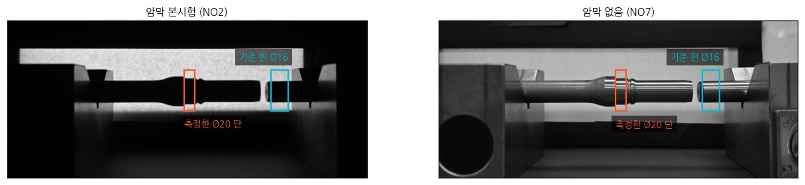
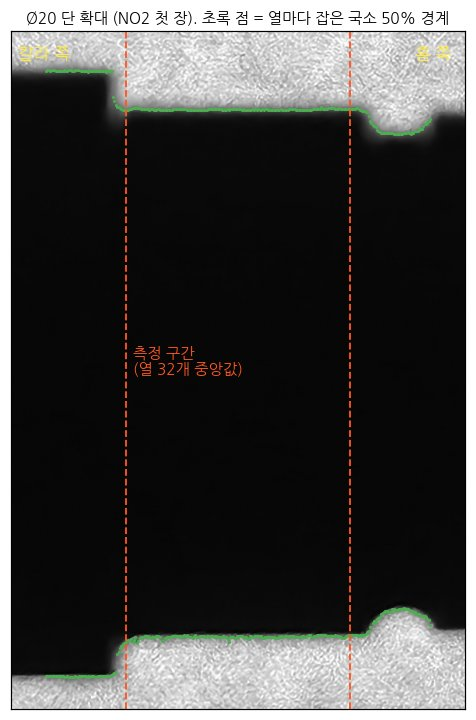
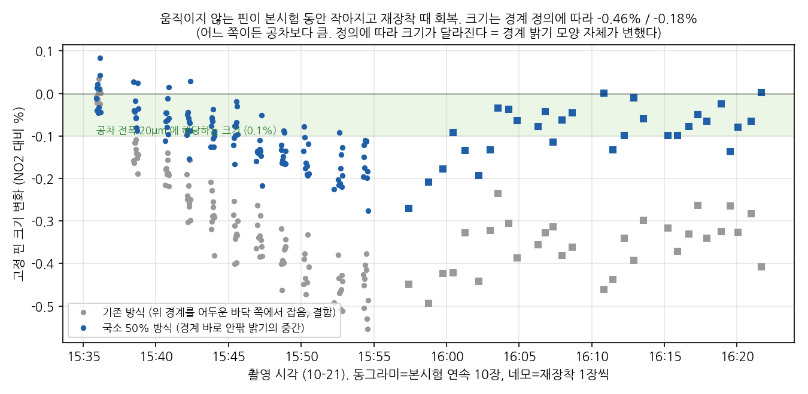
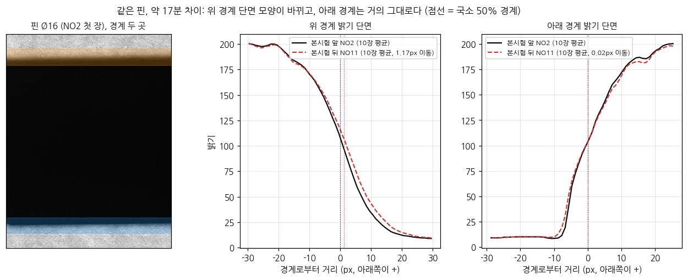
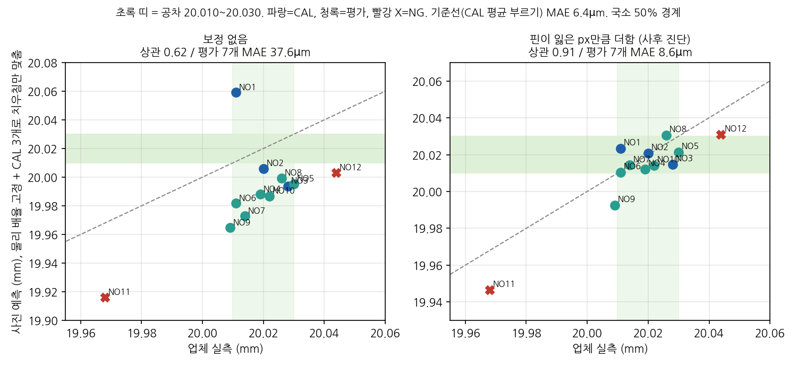
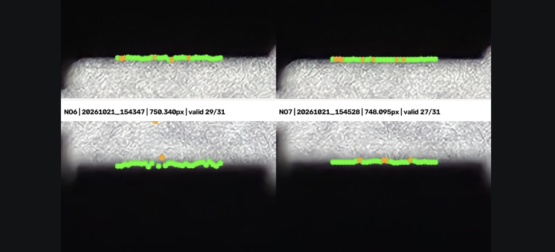
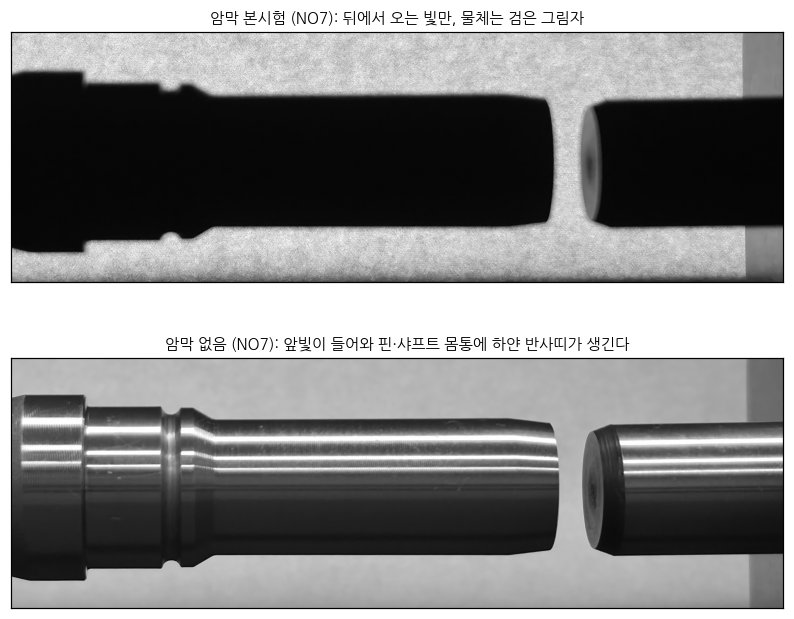
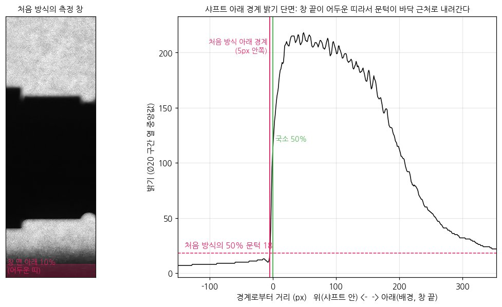

# 3차 멘토링 준비 (2026-10-23 금 18:00)

3차 촬영 [분석 정리](2026-10-23_3차촬영_분석정리.md)를 요약하고, 멘토께 드릴 질문을 모은 문서다.

## 이번 멘토링의 목표
**3차 촬영(10-21) 결과를 보고하고, 남은 기간을 "폰 실험 마무리 + 정리"로 갈지 멘토 의견을 듣는 자리.**
끝날 때 아래 "정할 것" 표가 채워져 있으면 된다.

시작 전 체크
- [ ] 구글밋 녹화 켜기 (10-22 미팅은 녹음 누락)
- [ ] 화면 공유할 이 문서 열어 두기(그림이 문서 안에 다 있다)
- [ ] 팀원 분석 README 열어 두기: `gon311/final_project/experiments/3rd/E6_E10_20261021/README.md`

## 1. 3차 촬영과 분석 한 장 요약

**촬영:** 12개 시편(CAL 3·VAL 3·랜덤 4·NG 2), 30cm, 200MP, 차광 박스+아크릴+A4+켄트지, 노출 고정. 사용 190장(본시험 120 + 재장착 30 + 암막 없음 40). 1px 약 26.7µm, 공차 폭 20µm = 0.75px

- 파란 상자 = 기준 핀 Ø16, 주황 상자 = 측정한 Ø20 단

- Ø20 단 확대(NO2 첫 장). 왼쪽 칼라 쪽, 오른쪽 홈 쪽, 점선 사이가 측정 구간이다. 초록 점은 열마다 잡은 국소 50% 경계다

팀장과 팀원이 각자 사전 규칙을 정하고 따로 분석했다. 결론은 같다.

| 항목 | 팀장 분석 ([3차 촬영 분석 정리](2026-10-23_3차촬영_분석정리.md)) | 팀원 분석 (E6·E10) |
|---|---|---|
| 사전 규칙 판정 | **통과 못 함.** V3 + CAL 3점 회귀 MAE 7.9µm vs 기준선(CAL 평균 부르기) 6.4µm. NG 둘 다 합격 판정 | **통과 못 함.** 주 방법(핀 기준 물리 스케일 V1) LOSO MAE 8.48µm vs 평균 찍기 6.64µm |
| 가장 좋았던 방법 | 사후 시간 보정 MAE 8.6µm (기준선 못 이김) | 핀 비율 선형 3.99µm. 하지만 사전 기준(2.92µm 이상 개선 + 9 fold 중 7승)엔 못 미침 |
| NG 방향 | 사후 보정 후 NG1·NG2 둘 다 불합격으로 잡힘(NG2 아슬아슬) | 주 방법에서 둘 다 방향 맞음. NG1은 모든 방법에서 NG. NG2는 상한까지 14µm(0.53px)뿐이라 경계에 걸림 |
| 고정 핀 크기 변화(본시험 약 18분) | **-0.18%**(약 36µm) | **-0.19%**(약 38µm) -> 따로 측정했는데 같다 |
| 같은 놓임 반복성 | 9.0µm (국소 50%) | 2.92µm (shaftlab cross50) |
| 재장착 반복성 | 11.6µm (한 장 찍기) | 5.2µm |
| 실측 레이블 학습(멘토 제안) | - | E10 8개 변형 모두 효과 없음. 학습이 셋업 잡음을 못 넘음 |

- **반복성 숫자가 2 \~ 3배 다른 이유:** 경계를 잡는 방법(측정 창, 경계 정의)이 다르기 때문이다. 같은 사진이라도 방법에 따라 반복성이 달라진다는 뜻이다. 그래도 둘 다 기준선을 못 이긴다는 결론은 같다

- 그림 1: 움직이지 않는 핀의 크기가 본시험 동안 줄었다가 재장착 단계에서 회복한다

- 같은 핀의 경계 밝기 단면, 본시험 앞(NO2 10장 평균) vs 뒤(NO11 10장 평균). 아래 경계는 거의 겹치고 위 경계 단면 모양이 바뀌었다

- **원인(공통):** 촬영 중 시간에 따라 크기가 변했고, 그 양이 공차보다 크다. 촬영 순서가 시편 순서와 같아서(NO2 -> NO12) 시간 변화와 시편 차이가 섞였다
  - 팀장: 배율·빛 변화는 아니다(가로 위치·배경 밝기로 확인). 경계를 잡는 밝기에 따라 줄어든 양이 2.5배 달라서, 경계 밝기 모양이 변한 것으로 보고 폰 처리·센서 쪽을 추정한다
  - 팀원: 느린 변화는 핀 비율이 보정하지만, 재장착 단위의 작은 변동에서는 샤프트가 핀을 절반만 따라간다(기울기 0.48, 기대 1.23)
- **남는 오차(팀장 분석):** 시간 변화를 빼도 시편마다 약 9µm씩 고정으로 치우친다. 6번 놓아 평균해도 줄지 않는다

- 그림 2: 시간 보정 전후 예측 vs 실측(사후 진단이라 성과 아님). 보정 후 상관 0.91, 평가 MAE 8.6µm

- **MSA로 놓으면(팀장 분석):** 측정 1회 sd 11.6µm -> %GRR 약 350%(30% 넘으면 불합격), ndc 0.9(5 이상 필요). 측정자 1명이라 재현성이 빠져 있어 실제보다 좋게 나온 값이다
- **표면 거칠기:** 선삭면 Ra 1.5 \~ 2.0, Rz 6.8 \~ 8.8µm(3개만 측정). 공차 ±10µm와 같은 크기다. 12개 재측정을 요청했다

## 2. 질문

### 2-1. 선행 개발자 질문 (10-23 문서, 질문자 의견 그대로)
배경 자료: 3차 시편 2개의 측정부 위·아래 윤곽선. 초록 경계선이 표면 요철을 따라가고, 일부 주황색 이상점이 있다.

> 원문: "초록색 Edge가 표면 요철을 따라가고 있고 일부 주황색 이상점도 있습니다. 이 상황에서 31-point Median을 최종 직경으로 사용하는 것이 맞는지, 아니면 외곽 envelope 기준으로 바꿔야 하는지 의견을 듣고 싶습니다."

**H1. 전자 마이크로미터와 CV가 같은 외경 정의를 측정하고 있는가?**
- 마이크로미터는 두 접촉면 사이의 물리적 거리라 표면 peak의 영향을 받는다. CV는 "위 경계 - 아래 경계 -> 31개 지름 -> 이상점 제거 -> Median"이다. 같은 위치를 측정해도 대표값의 정의가 다를 수 있다
- 제안 실험: 같은 시편·같은 축 위치·같은 회전 방향에서 마이크로미터 값을 31점의 Median, Mean, P90, P95, Top 3 \~ 5 평균, Max와 비교한다. 여러 시편에서 반복적으로 가장 잘 맞는 대표값을 찾는다

**H2. Ra/Rz와 CV 치우침(Bias)의 관계를 어떻게 검증할 것인가?**
- 12개 시편 좌·우 Ra/Rz 재측정으로 시편마다 한 행(실측, CV Median, Bias, 좌·우·평균 Rz, 촬영 간 변동)을 만든다
- 볼 관계 세 가지: Rz와 |Bias|, Rz와 촬영 간 변동, 좌우 Rz 차이와 변동
- Rz 8µm가 Bias 8µm라는 뜻은 아니다. Rz는 원인 후보이고 Bias는 결과라서 데이터로 검증해야 한다

**H3. 31-point Median을 유지할지, 외곽 envelope 방식으로 바꿀지?**
- 지금은 Median을 버리지도, envelope로 바로 바꾸지도 않는다. Median은 먼지·반사점·버 하나에 흔들리지 않지만, 바깥 peak를 지워 마이크로미터보다 작게 나올 수 있다
- 알고리즘을 바꾸지 말고 31개 원자료에서 여러 대표값을 동시에 계산한다. 마이크로미터에 가장 가까운 값을 사후에 하나 고르면 안 되고, 12개 전체에서 일관성을 봐야 한다
- 핵심 질문: "광학적으로 검출된 미세한 요철들을 어떤 규칙으로 하나의 외경으로 정의해야 전자 마이크로미터와 같은 측정량이 되는가?"

### 2-2. 팀장 분석에서 나온 질문 (우선순위 순)

**Q1. 기준값을 어떻게 믿을 수 있나 (가장 중요)**
- 배경: Rz가 8µm 수준이면 마이크로미터(산꼭대기 접촉)와 카메라(그림자 경계)가 서로 다른 지름을 볼 수 있다
- 질문: 비전 측정을 검증할 때 기준값은 보통 무엇으로 정하나? 교정된 마이크로미터, 공기 마이크로미터, 3차원 측정기 중 무엇인가? "기준 측정기는 대상보다 10배 정밀해야 한다" 같은 규칙을 현장에서 실제로 쓰나?
- 팀이 할 수 있는 것: 업체 측정기 종류, 교정 성적서 날짜, 측정 위치를 받아 기록

**Q2. 결과를 MSA(측정 시스템 분석)로 정리해도 되나**
- 질문: 최종 보고서의 결론을 "폰 시스템의 Gage R&R 결과 + 합격하려면 필요한 조건(측정 1회 sd 1µm 이하)"으로 쓰는 게 산업 쪽에서 의미 있는 형식인가? 우리 실험을 R&R 형식에 맞추려면 무엇이 빠져 있나(측정자 여러 명 등)?

**Q3. 시간에 따른 크기 변화 해석** (그림 1)
- 질문: 산업용 카메라에서도 이런 변화(열에 따른 초점·처리 변화)를 보나? 보통 기준물을 같이 찍어 보정하나, 아니면 측정 사이사이에 기준 시편을 끼워 찍나?

**Q4. 폰 실험을 여기서 마무리하는 판단이 맞나** (그림 2)
- 질문: "폰 PoC는 약 50µm 급 불량의 방향은 가리지만(두 분석 모두 NG 방향 맞음), ±10µm 판정은 불가"로 정리하는 게 합당한가? 남은 기간에 더 해 볼 만한 것이 있다면 무엇인가?

### 2-3. 질문끼리 이어지는 곳
- **Q1과 H1은 같은 질문이다.** 기준값 신뢰(Q1)를 측정량 정의(H1) 쪽에서 본 것이다. 멘토께는 하나로 묶어서 묻는 게 좋다
- **H2는 팀이 하려던 일(12개 거칠기가 오면 시편별 치우침과 대조)과 같다.** 시편별 치우침 약 9µm가 표면 거칠기에서 오는지 가르는 실험이다. 12개면 상관이 약 0.58은 넘어야 우연과 구분된다
- **H3 관련 참고:** 팀장 분석의 측정 위치 분석에서는 Ø20 단 안의 위치를 바꾸면 평가 MAE가 7.0 \~ 11.5µm로 달라졌다. 하지만 반복성이 없어서 채택하지 않았다. 대표값을 사후에 고르면 안 된다는 H3 의견과 같은 결론이다

## 3. 다음 시스템에 넘길 것 (두 분석 공통 제안)
- 촬영 순서를 무작위로 섞고, CAL(기준 시편)을 처음·중간·끝에 반복 촬영해서 시간 변화와 시편 차이를 분리한다
- 모든 시편을 2 \~ 3회 재장착한다(CAL·검증 시편 포함)
- 기준물은 교정 성적서가 있는 공인 게이지로 한다(이번 Ø16 핀은 현장 측정값)
- 촬영 중 기준물 px를 실시간으로 확인하고, 줌·초점·노출은 첫 장 전에 잠근다
- NG 시편을 공차 경계 근처(±5 \~ 20µm)로 더 확보한다
- MSA 형식에 맞춘 시험을 한다(측정자 여러 명, 시편 10개, 반복 3회)

## 정할 것 (멘토링 끝날 때 채우기)

| 항목 | 결과 |
|---|---|
| 기준값 확보 방법 / 외경 정의(Q1·H1) | |
| 최종 결론 형식(MSA 형식 여부) | |
| 거칠기 12개 분석 방법(H2) | |
| 대표값 방식(H3) | |
| 폰 실험 마무리 여부 | |
| 다음 멘토링 | |

## 물으시면 꺼낼 근거
- 50MP vs 200MP: 경계가 25 \~ 30px 번져 화소 수는 병목이 아니다(2차 2x2 축소 시험도 차이 없음)
- NO1이 1.41배 줌·다른 셔터로 찍혔다. NO1을 빼고 계산해도 판정은 같다(팀장 분석 2점 MAE 10.0, 팀원 분석은 NO1 제외 후 민감도만 확인)
- 거칠기 3개와 시편 오차 대조: NO7 +0 / NO10 -8 / NG1 -22µm vs Rz 8.8/8.1/6.8 -> 3개라 판단 불가
- 측정 위치: Ø20 단 안에서 시편마다 다른 테이퍼가 재장착하면 반복되지 않는다(상관 -0.12). 이 세팅으로는 진짜 테이퍼를 못 본다
- 암막 없음(앞빛) 40장: 사진 사이 흔들림 1.5µm로 암막의 약 6분의 1이다. 다만 놓임 1번·CAL 없음이라 정확도는 모른다

  

- 기준 핀 Ø16은 공인 핀게이지가 아니라 현장 측정값이다(수 µm 오측 가능). 팀장 분석은 핀 절대 지름을 안 쓴다. 팀원 분석의 V1 스케일은 16mm를 쓰지만, 핀 비율 계열은 CAL로 다시 맞춘다
- 경계 측정 정정: 팀장 분석의 처음 50% 방식은 아래 경계를 바닥 쪽에서 잡는 결함이 있어 다시 측정했다(핀 변화 -0.46% -> -0.18%). 다시 측정한 값이 팀원 분석의 독립 측정(-0.19%)과 맞는다

  

  - 처음 방식의 창 맨 아래 10%가 어두운 띠라서 문턱이 18로 내려가고, 아래 경계가 약 5px 안쪽에서 잡혔다

## 약점 (먼저 말해 둘 것)
- 사후 진단(시간 보정, 핀 비율 계열)은 사전 규칙 밖이라 성과로 내세우면 안 된다
- 반복성 숫자는 경계 측정 방법에 따라 2 \~ 3배 다르다(2.9 \~ 9.0µm). 결론은 같지만 숫자 하나를 정답으로 읽으면 안 된다
- Gage R&R은 측정자 1명, 재장착 6시편으로 계산했다
- 촬영 순서와 시편 순서가 겹쳐서, 시간 변화와 시편 효과를 완전히 나눌 수 없다
