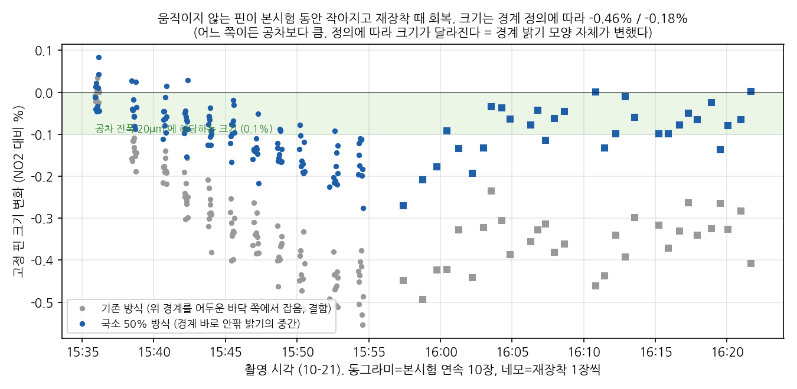
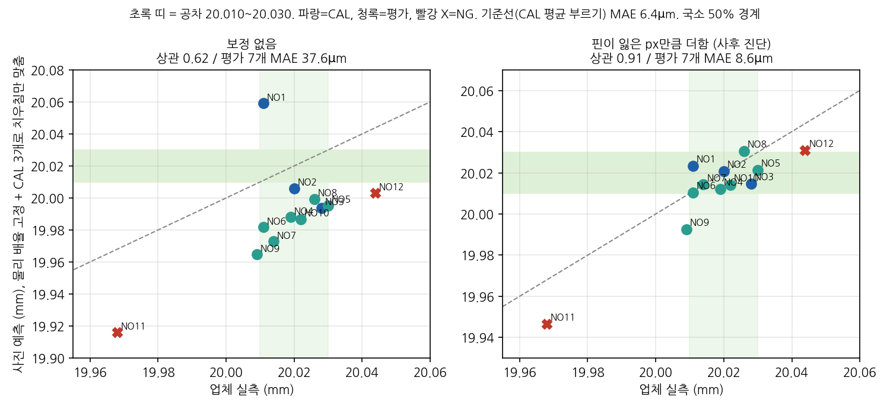
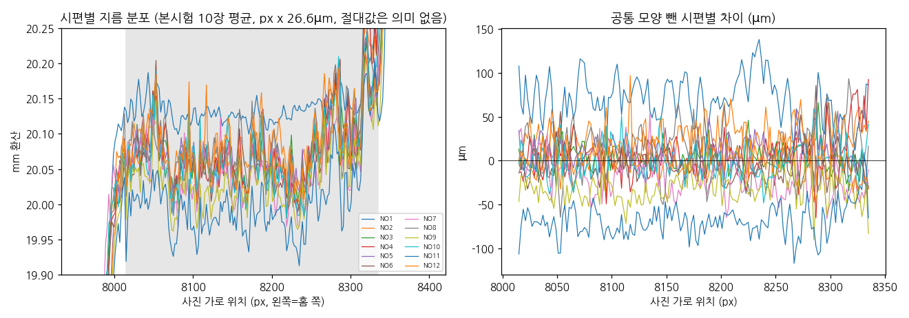

# 3차 촬영(10-21) 분석 정리 — 10-21 밤 ~ 10-23

10-21 원전기계 3차 촬영 사진을 [시나리오 문서](../2026-10-21_3차촬영_시나리오_체크리스트.md) 부록 B의 사전 규칙대로 판정하고, 원인과 남는 오차를 확인한 결과다. 숫자는 [02_facts](../02_facts.md) 「2026-10-21 3차 촬영」 절에 있다. 코드와 결과 파일은 [experiments/20261021_3차촬영](../../experiments/20261021_3차촬영/)에 있다.

추가 촬영은 없다고 보고 여기서 결론을 낸다.

---

### 1. 데이터
- 12개 시편: CAL 3(NO1~3) · VAL 3(NO4~6) · 랜덤 4(NO7~10) · NG 2(NO11, NO12)
- 사용 190장
  - 본시험(암막): 12개 x 10장 = 120장
  - 재장착(암막): NO7~12 x 5번 놓기 = 30장
  - 암막 없음: NO7~10 x 10장 = 40장
  - 찍은 197장 중 제외 3장, 예비 4장
- 실측: NO1 20.011 · NO2 20.020 · NO3 20.028 · NO4 20.019 · NO5 20.030 · NO6 20.011 · NO7 20.014 · NO8 20.026 · NO9 20.009 · NO10 20.022 · **NG1 19.968 · NG2 20.044**
- 사진: 16320x7532, 1/60 · ISO 50 고정(암막 없음은 ISO 12). 1px 약 26.7µm(Ø20 = 약 750px). 공차 폭 20µm = 0.75px
- 주의할 점
  - 사진이 EXIF 방향 3(180도 회전)으로 저장돼 있다. 원본 좌표의 위·아래가 실제와 반대다
  - NO1만 1.41배 디지털 줌·1/40으로 찍혔다. NO1을 빼고 계산해도 판정은 같다
  - 기준 핀 Ø16은 공인 핀게이지가 아니라 현장에서 측정한 값이다. 분석은 핀의 절대 지름을 쓰지 않고, 같은 핀의 px 변화만 본다
- 측정 구간: Ø20 단(칼라와 홈 사이, 원본 x 약 7995~8355)의 가운데 x 8015~8335. 처음에 끝단(약 Ø16.7 구간)을 잘못 측정했다가 바로잡았다

### 2. 사전 규칙 판정: 통과 못 함
- 규칙 (가): V3 엔진 + CAL 3점 회귀 -> 평가 7개(VAL 3 + 랜덤 4) MAE **7.9µm**, 최대 13.8µm
- 기준선(측정 없이 CAL 실측 평균 20.0197을 부르기): MAE **6.4µm**, 최대 10.7µm
- 회귀 기울기가 1px당 -2.4µm로, 물리 배율(+26.7µm)과 부호가 반대다
- NG1(19.968)과 NG2(20.044) **둘 다 합격으로 판정**했다
- NO1을 빼고 2점으로 회귀해도 MAE 10.0µm로 판정이 같다

### 3. 원인: 시간에 따라 크기가 변했다
움직이지 않는 핀이 본시험 동안 작아졌다가, 재장착 단계(1장씩, 약 2분 간격)에서 다시 커졌다.

| 항목 | 결과 |
|---|---|
| 핀 크기 변화(NO2 -> NO11, 약 16분) | **-0.18%**(Ø20 환산 약 36µm). 경계를 어두운 바닥 쪽에서 잡으면 -0.46%(약 92µm). 어느 쪽이든 공차 폭 20µm보다 크다 |
| 핀이 건드려졌나 | 아니다. 핀 중심 y가 ±0.3px 안에서 고정이고, 시편 바뀔 때 계단(평균 -0.07px)에 일정한 방향이 없다 |
| 배율이 바뀌었나 | 아니다. 배율이 0.5% 바뀌었다면 V블록 세로 경계가 약 -12px 움직여야 하는데 실제는 -3.1px다. 핀 끝면(-2.0px)도 같은 방향이라, 장면 전체가 2~3px 옮겨간 것으로 본다 |
| 빛이 바뀌었나 | 아니다. 노출 고정, 배경 밝기 164~166으로 일정하다 |
| 경계 모양 | 경계를 잡는 밝기에 따라 줄어든 양이 약 2.5배 다르다. 물체가 실제로 작아지거나 배율이 바뀐 것이라면 어느 밝기로 잡든 같은 만큼 움직여야 한다. 그래서 **경계 밝기 모양 자체가 시간에 따라 변했다**고 본다. 국소 50% 기준으로는 위 경계는 그대로(+0.02px)이고 아래 경계만 1.17px 움직였다 |

- 추정: 폰 내부 영상처리(잡음 제거·선명화)나 센서 쪽 변화(발열 등). 이 데이터로 확정하지는 못한다
- 판정에 미친 영향: CAL을 맨 앞에 찍어서 이 변화가 교정값에 그대로 섞였다

### 4. 반복성과 MSA(Gage R&R)
재장착 6시편(NO7~12)으로 계산했다. 측정자가 1명이라 재현성(사람 사이)은 0으로 가정했고, 그래서 실제보다 좋게 나온 값이다.

| 항목 | 결과 | 기준 |
|---|---|---|
| 같은 놓임 사진 사이 sd | 9.0µm | |
| 다시 놓고 한 장 찍기 sd(= GRR) | 11.6µm | |
| %GRR(6 x sd / 공차 20µm) | **약 350%** | 10% 이하 합격, 30% 넘으면 불합격 |
| ndc(정상 4개 기준) | 0.9 | 5 이상 |
| Type-1 Cg(한 시편 계속 찍기) | 0.07 | 1.33 이상 |
| 놓임 6번 x 사진 10장 평균 | %GRR 96% | |

- 30% 안에 들려면 측정 1회 sd가 1.0µm 이하여야 한다
- MSA 다섯 항목으로 놓으면
  - 반복성: 불합격(위 표)
  - 재현성: 측정 못 함(측정자 1명)
  - 치우침: 시간 보정 후에도 시편별 치우침 sd 약 8.5µm
  - 직선성: 판단 불가(9개, 상관 0.47)
  - 안정성: 불합격(고정 핀이 18분에 약 33µm 상당 변화)

### 5. 사후 진단: 시간 변화를 빼면 (사전 규칙 밖)
핀이 잃은 px만큼 샤프트에 더해 시간 변화를 빼고, 물리 배율을 고정한 뒤 CAL 3개로 치우침만 맞췄다. **결과를 보고 고른 방법이라 성과가 아니다.**

| 항목 | 보정 없음 | 시간 보정 |
|---|---|---|
| 12개 실측과 상관 | 0.62 | **0.91** |
| 평가 7개 MAE | 37.6µm | 8.6µm (기준선 6.4µm은 여전히 못 이김) |
| NG1 / NG2 예측 | 19.9160 / 20.0030 | 19.9465 / 20.0307 (둘 다 불합격, NG2는 아슬아슬) |
| 정상 10개 중 거짓 불합격 | | 2개(NO8, NO9) |

- 남는 시편별 치우침: sd 약 9µm
  - 시편별 오차(µm): NO1 +12 · NO2 +1 · NO3 -13 · NO4 -7 · NO5 -9 · NO6 -1 · NO7 +0 · NO8 +5 · NO9 -16 · NO10 -8 · NG1 -22 · NG2 -13
- 6번 놓아 평균 낸 NO7~12도 오차가 줄지 않는다. 그래서 놓임 흔들림이 아니라 시편마다 고정된 치우침이다. 후보는 측정 위치, 진원도, 실측값 자체의 불확도, 표면 거칠기다
- 비율로 보정(샤프트 px / 핀 px)해도 비슷하다: 상관 0.94, MAE 8.1µm
- 정리: 약 50µm 급 불량(NG1, NG2)을 가를 신호는 있다. 하지만 ±10µm 합불 판정은 못 한다

### 6. 측정 위치 (Ø20 단 안 축 방향)

- 모든 시편에서 홈 쪽 끝 -> 칼라 쪽 끝으로 지름이 약 65µm 커진다. 12개가 다 같으니 샤프트 모양이 아니라 사진 위치에 따른 효과(조명·렌즈)로 본다
- 시편마다 다른 모양(진짜 테이퍼 후보)은 재장착하면 반복되지 않는다
  - 본시험과 재장착의 테이퍼 상관 -0.12
  - 칼라 쪽 - 홈 쪽 차이의 상관 -0.78 (6개)
  - 사진 한 장의 위치차 잡음 17µm
- 단을 세 칸으로 나눠 측정하면 평가 MAE가 7.0~11.5µm로 달라진다. 하지만 결과를 보고 고르는 것이고 반복성도 없어서 채택하지 않는다
- 시편별 치우침(약 9µm)을 우리 쪽 측정 위치로는 설명하지 못한다. 업체가 어느 위치를 측정했는지는 따로 확인해야 한다

### 7. 암막 없음 40장 (앞빛, 초점 다시 잡음)
- 앞빛이라 핀 몸통 안에 하얗게 날아간 반사띠가 생긴다. 그래서 경계 바로 안팎만 보는 국소 50% 방식으로 측정했다
- 핀 628.8px, 사진 사이 sd 0.05~0.09px
- 시간 변화: 2.5분 동안 -0.06px. 암막 본시험 기울기대로면 -0.15px였어야 하지만, 차이가 잡음(±0.1px)과 구분되지 않는다. 판단 불가(시간이 짧다)
- 샤프트 사진 사이 sd가 0.06px(1.5µm)로 암막(0.34px)의 약 6분의 1이다
  - 4시편 치우침 sd 4.3µm (암막 같은 4개는 13.8µm)
  - 시편마다 한 번만 놓았고 CAL도 없어서 정확도는 모른다. 단서로만 둔다

### 8. 표면 거칠기 (업체 측정 3개)
| 시편 | Ra (µm) | Rz (µm) | 시간 보정 후 사진 오차 (µm) |
|---|---|---|---|
| NO7 | 1.970 | 8.807 | +0 |
| NO10 | 1.802 | 8.097 | -8 |
| NG1 | 1.543 | 6.781 | -22 |

- 가공: 선반 + 서멧 인서트(연삭이 아닌 선삭면). Rz 7~9µm로, 공차 ±10µm·남는 치우침과 같은 크기다
- 3개로는 관계를 판단할 수 없다. 12개 재측정을 요청했다. 값이 오면 시편별 치우침과 대조한다(12개면 상관 약 0.58 이상이어야 우연과 구분)

### 9. 경계 측정 정정 (10-23)
- 처음 50% 경계 측정은 측정 창 끝 10% 평균을 "바깥 밝기"로 썼다. 그런데 암막 사진은 창 맨 위(y 3000~3160)가 원래 어두운 띠라서, **위 경계를 50%가 아니라 거의 바닥(밝기 약 11)에서 잡고 있었다.** 아래 경계는 정상이었다
- 경계 바로 바깥 20~60px와 안쪽 10~30px의 밝기 중간값으로 잡는 국소 50% 방식으로 190장을 다시 측정했다. 이 문서의 50% 숫자는 모두 다시 측정한 값이다
- 처음 값과 비교

| 항목 | 처음(위 경계 바닥) | 국소 50% |
|---|---|---|
| 핀 크기 변화 | -0.46% | -0.18% |
| 같은 놓임 사진 사이 sd | 5.2µm | 9.0µm |
| %GRR | 172% | 348% |
| 시간 보정 후 상관 / MAE | 0.94 / 8.9µm | 0.91 / 8.6µm |
| 시편별 치우침 sd | 8.2µm | 8.7µm |

- 사전 규칙 판정(V3 엔진)은 이 문제와 무관하다
- 결론(시간 변화 > 공차, %GRR >> 30%, 시편별 치우침 약 9µm)은 어느 방식에서도 같다
- 처음 값으로 냈던 "핀 경계가 위아래에서 1.5px씩 대칭으로 깎인다"는 결론은 착시였다

---

### 정리
1. 폰 + 백라이트 세팅으로는 ±10µm 합불 판정이 안 된다. 사전 규칙 판정에서 기준선을 못 이겼고, %GRR은 약 350%다
2. 가장 큰 원인은 촬영 중 시간에 따른 크기 변화다(공차보다 큼). 경계 밝기 모양이 변한 것이라 폰 내부 처리 쪽으로 추정한다
3. 시간 변화를 사후에 빼면 약 50µm 급 불량은 가르는 신호가 있다. 하지만 시편마다 약 9µm 치우침이 남는다. 이는 세팅을 고쳐서 내려가는 종류가 아니다
4. 남는 치우침의 원인을 가르려면 기준값 자체를 확인해야 한다: 업체 측정기 종류, 교정 날짜, 측정 위치, 12개 거칠기

### 다음 시스템에 넘길 것
- 기준물은 교정 성적서가 있는 공인 게이지로
- CAL을 맨 앞에만 찍지 말고 앞뒤·사이사이에 끼워 찍기(시간 변화를 사전 규칙으로 보정할 수 있게)
- 연속 촬영 사이 쉬는 시간, 또는 열이 안정된 뒤 촬영
- MSA 형식에 맞춘 시험(측정자 여러 명, 시편 10개, 반복 3회)

### 약한 곳
- 사후 진단(시간 보정, 측정 위치)은 결과를 보고 고른 방법이다
- 50% 방식 숫자는 경계를 어느 밝기에서 잡느냐에 따라 달라진다. 결론은 같지만 숫자 하나하나를 정답으로 읽으면 안 된다
- Gage R&R은 측정자 1명, 재장착 6시편으로 계산했다
