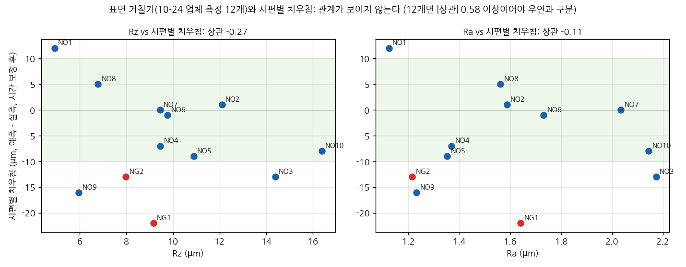

# 표면 거칠기 12개와 시편별 치우침 대조 (10-26)

선행 개발자가 받아 준 업체 거칠기 측정값(12개)을 3차 촬영의 시편별 치우침과 대조한 결과다. 숫자는 [02_facts](../02_facts.md) 「2026-10-26 표면 거칠기」 절에 있다. 코드와 출력은 [experiments/20261026_거칠기](../../experiments/20261026_거칠기/)에 있다.

---

### 1. 자료
- 업체 측정 10-24, Mitutoyo 접촉식, ISO1997, λc 0.8mm x5, 0.5mm/s. 시편마다 Ra·Rq·Rz 한 번씩
- 측정 구간: Ø20 단 폭 10.2mm 중 가운데 좌 2mm·우 3mm(5mm). 측정 헤드 간섭 때문에 전체 폭은 측정하지 못했다(선행 개발자 설명)
- 치우침: [3차 분석정리](2026-10-23_3차촬영_분석정리.md) 5절, 시간 보정 후 시편별 오차(예측 - 실측)

| 시편 | Ra (µm) | Rz (µm) | 치우침 (µm) |
|---|---|---|---|
| NO1 | 1.123 | 4.921 | +12 |
| NO2 | 1.587 | 12.099 | +1 |
| NO3 | 2.173 | 14.381 | -13 |
| NO4 | 1.369 | 9.449 | -7 |
| NO5 | 1.352 | 10.882 | -9 |
| NO6 | 1.731 | 9.769 | -1 |
| NO7 | 2.035 | 9.447 | 0 |
| NO8 | 1.561 | 6.785 | +5 |
| NO9 | 1.231 | 5.965 | -16 |
| NO10 | 2.144 | 16.375 | -8 |
| NG1 | 1.641 | 9.156 | -22 |
| NG2 | 1.215 | 7.976 | -13 |

### 2. 결과: 관계가 보이지 않는다

| 비교 | 12개 상관 | NO1 뺀 11개 |
|---|---|---|
| Rz vs 치우침 | -0.27 (순열 p 0.40) | +0.00 |
| Rz vs 치우침 크기 | -0.19 (p 0.55) | -0.15 |
| Ra vs 치우침 | -0.11 (p 0.73) | +0.18 |
| Ra vs 치우침 크기 | -0.28 (p 0.38) | -0.25 |

- 12개면 |상관| 0.58은 넘어야 우연과 구분되는데(3차 멘토링 자료에 미리 적어 둔 기준), 가장 큰 값이 0.28이다
- 방향도 일정하지 않다. NO1을 빼면 부호가 바뀐다
- **이 데이터로는 시편별 치우침 약 9µm를 표면 거칠기로 설명할 수 없다.** "관계가 없다"가 아니라 "12개·한 번 측정으로는 안 보인다"이다

### 3. 세 분석 비교
같은 거칠기 값을 세 사람이 다른 쪽에서 따로 봤다.

| | 팀장 (이 문서) | 선행 개발자 | 팀원 (E11) |
|---|---|---|---|
| 본 것 | 거칠기 vs 시편별 치우침 | 거칠기 vs 경계 흔들림(MAD·CV), 시편마다 첫 사진 1장 | 거칠기 vs 경계 굴곡·선명도·오차 모델 |
| 결과 | \|r\| 0.28 이하 | Rq–MAD r +0.50 (안정군 기준, 유의하지 않음) | Rz–경계 굴곡 ρ -0.30, Ra–경계 폭 ρ -0.49 (반대 방향) |
| 결론 | 설명 못 함 | 주원인이라 단정 못 함 | 판단 불가, 오차를 설명하지 못함 |

- 거칠기를 원인으로 지지하는 결과는 셋 다 없다
- 선행 개발자의 양의 경향과 팀원의 음의 경향이 반대다. 팀원 분석에서 경계 폭(ρ +0.85)과 V1 오차(ρ -0.80)가 촬영 순서와 강하게 움직였다. 촬영 중 크기 변화가 섞였을 수 있다
- 팀원 설정에서 사진은 약 0.1mm보다 긴 굴곡만 본다. Rz는 그보다 짧은 요철까지 포함하므로, 사진으로 거칠기 자체를 보기는 어렵다
- 팀원 E11-C: 오차가 가장 작은 방법(핀 비율 선형, 사후 선택)의 RMSE 5.15µm로 보면 **실측값 잡음은 최대 약 5µm**(95% 구간 2.8 \~ 7.1µm)일 수 있다. 그 위쪽이면 완벽한 측정기도 사전 규칙을 통과할 확률이 50% 아래다. 측정 오차와 실측값 잡음이 독립이라는 가정, 잡음 = c x Rz 모형에 기대는 값이다
- 10-28 팀원 E13: 선행 개발자 방식(14점, 1장)으로는 r +0.13, 같은 1장에서 모든 열을 쓰면 r +0.42 \~ +0.47, 같은 장착 10장 중앙값이면 r 약 0. 시편 11개면 |r| 0.60은 넘어야 0과 구분되므로 어느 조건에서도 상관이 있다고 말할 근거는 부족하다. 정리는 [2026-10-28 교차 대조](2026-10-28_교차대조.md) 3절
- 팀원 상세: [gon311/final_project experiments/3rd/roughness](https://github.com/gon311/final_project/tree/main/experiments/3rd/roughness)

### 4. 주의할 점
- **같은 시편의 Rz가 측정마다 크게 다르다.** 예전 3개 측정과 비교하면 NO7 8.8 -> 9.4, NG1 6.8 -> 9.2, NO10 8.1 -> 16.4µm다. 측정 위치나 방향이 달랐을 수 있다
- 측정 위치의 원주 각도 기록이 없어, 사진의 위·아래 경계와 같은 자리인지 모른다
- 치우침 쪽도 잡음이 있다. 시간 보정 후 값이고, 재장착 반복성이 한 장 기준 11.6µm다
- 좌·우를 따로 측정한 값이 없어 "좌우 Rz 차이와 변동" 비교는 하지 못했다

### 5. 확인할 것
- 선행 개발자 자료의 스케일: 272px = 10.2mm(1px 약 37.5µm). 팀장 26.7µm, 팀원 26.09µm와 다르다. 10-27 확인: 본시험 NO2에서 Ø20 단은 원본 x 약 8000 \~ 8350(약 355px)이고, ROI x 8008 \~ 8280은 그 왼쪽 약 77%다. 272px는 26µm/px 기준 약 7.1mm라서, "가운데 5mm" 비교 구간은 실제 약 3.5mm, 중심은 단 가운데에서 약 0.7mm 치우친다. 경계 지표(MAD 등)는 px 그대로라 값 자체는 영향이 없고, 비교 위치·폭 설명이 달라진다
- 선행 개발자 첫 번째 자료(거칠기 vs 광학 산포)의 산점도 원본 표: 점이 약 25개, Rq 0 \~ 0.5µm로 CSV(시편 11개, Rq 1.31 \~ 2.64µm)와 맞지 않는다
- 오른쪽 끝 열(x 약 8265)의 경계 급락: 팀원이 NO8을 뺀 10개 시편 공통으로 확인해 사진 쪽 아티팩트로 판단했고, 원인(장면·센서·렌즈·JPEG/ISP)을 가르는 E12를 진행 중이다(10-27)

### 최종보고서에 쓸 문장 (제안)
표면 거칠기(Rz 4.9 \~ 16.4µm)는 공차 ±10µm와 같은 크기지만, 세 사람이 따로 대조한 결과 거칠기를 오차 원인으로 지지하는 결과는 없었다(시편 11 \~ 12개라 판단 불가). 오히려 실측값 잡음이 최대 약 5µm일 수 있어, 다음 시스템은 기준값부터 확보한다.
