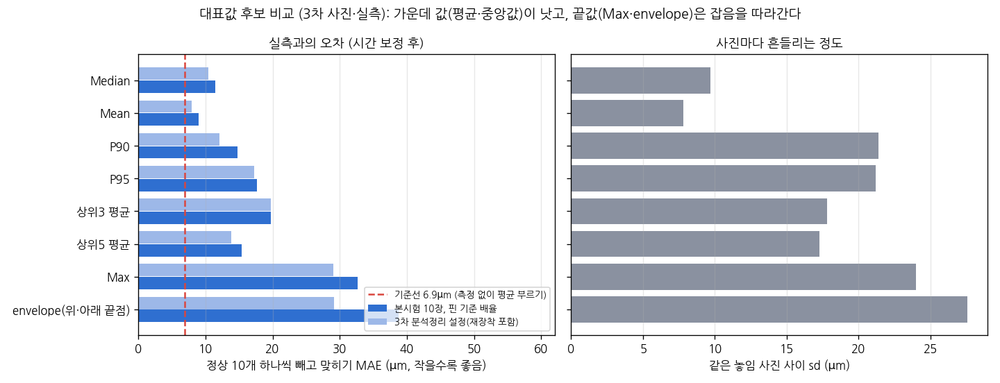

# 대표값 후보 비교 (10-27, 4차 멘토링 제안)

- 질문: 31개 열의 지름 중 어떤 대표값이 실측(마이크로미터)과 가장 가까운가
- 후보: 3회차 멘토링 PDF에 선행 개발자가 미리 적어 둔 것 전부(Median, Mean, P90, P95, 상위 3·5개 평균, Max) + 멘토가 권한 경계 envelope(위 경계 가장 바깥 + 아래 경계 가장 바깥). 결과를 보고 고르지 않도록 전부 보고
- 데이터: 3차 본시험 120장 + 재장착 30장, Ø20 단 31개 열(원본 x 8030 \~ 8320), 열마다 3px 평균 단면의 국소 50% 경계
- 교정: 물리 배율 고정 + 치우침만 맞춤. (A) CAL NO1 \~ 3으로 맞추고 평가 7개(NO4 \~ 10) / (B) 정상 10개 하나씩 빼고 맞히기. 시간 보정(핀이 잃은 px를 더함) 전·후
- 설정 두 가지: 본시험 10장만·핀 기준 배율(26.06µm/px) / 3차 분석정리 5절과 같은 설정(재장착 포함 놓임별 평균, 20.02/750mm)
- 코드와 출력: [experiments/20261027_대표값](../../experiments/20261027_대표값/)

## 결과

| 대표값 (시간 보정 후) | 사진 사이 sd | (B) MAE 본시험만 | (B) MAE 3차 설정 | Median보다 나은 시편 |
|---|---|---|---|---|
| Median | 9.7 \~ 9.9 | 11.5 | 10.4 | - |
| **Mean** | 7.8 \~ 8.0 | **9.0** | **7.9** | 7 \~ 8 / 10 |
| P90 | 21.4 \~ 21.9 | 14.8 | 12.1 | 4 \~ 5 / 10 |
| P95 | 21.2 \~ 21.7 | 17.7 | 17.3 | 3 \~ 4 / 10 |
| 상위3 평균 | 17.8 \~ 18.2 | 19.7 | 19.7 | 2 / 10 |
| 상위5 평균 | 17.3 \~ 17.7 | 15.4 | 13.8 | 3 \~ 4 / 10 |
| Max | 24.0 \~ 24.6 | 32.7 | 29.0 | 2 / 10 |
| envelope | 27.6 \~ 28.3 | 38.8 | 29.1 | 1 \~ 2 / 10 |
| (기준선: 측정 없이 평균 부르기) | | 6.9 | 6.9 | |

(단위 µm. 시간 보정 전 표와 (A) 결과는 실험 폴더의 repr_analyze_main.txt, repr_analyze_3rd.txt)

- **가운데 값(Mean, Median)이 끝값보다 낫다.** 시간 보정 후 두 설정 모두 Mean이 가장 작고(7.9 \~ 9.0µm), Max·envelope는 29 \~ 39µm로 가장 나쁘다. 끝값으로 갈수록 사진마다 흔들림도 커진다(8 -> 28µm)
- **한 장 안에서 튀는 열은 평균 1.6 \~ 1.8개(최대 5개)**다(중앙값 + 3MAD 초과). 멘토 기준("한두 개면 노이즈로 보고 Median")으로도 가운데 값 쪽이다
- 그러나 **어느 후보도 기준선(6.9µm)을 이기지 못했다.** Mean과 Median 차이(약 2.5µm)도 시편별 치우침(약 9µm)보다 작다
- 시간 보정 전에는 P90·P95·상위5 평균이 가장 작게 나오지만, 설정에 따라 순위가 바뀐다(P95 (A) 7.9 vs 13.8µm). 촬영 중 크기 변화가 섞인 상태라 해석하지 않는다

## 왜 envelope가 안 맞나

- 마이크로미터는 표면의 높은 곳에 닿으니 물리적으로는 envelope가 맞다(멘토 의견)
- 하지만 이 사진에서 31개 열 지름의 흔들림(열 sd)은 약 55µm로, 표면 요철(Rz 4.9 \~ 16.4µm)보다 몇 배 크다. 300mm 촬영에서 경계가 약 570µm 폭으로 번지고 배경 종이 결이 보였다(초점이 뒤에 맞은 것으로 추정)
- 그래서 끝값은 표면 꼭대기가 아니라 **경계 잡음의 꼭대기**를 잡는다. envelope는 경계 잡음이 표면 요철보다 작아야 의미가 있다

## 기준 문장 (제안)

"이 촬영 조건(스마트폰, 300mm, 경계 번짐 약 570µm)에서는 31개 열 지름의 **평균(또는 중앙값)**을 대표값으로 쓴다. 최댓값이나 envelope는 경계 잡음을 따라가 오차가 3 \~ 4배 커진다. 이 방법의 정밀도는 시간 보정 후에도 평균 절대오차 약 8 \~ 9µm로, 측정 없이 평균을 부르는 기준선(6.9µm)에 못 미친다. envelope처럼 마이크로미터와 같은 정의를 쓰려면 경계 잡음이 표면 요철(Rz 약 10µm)보다 작아지는 광학계(선명한 초점, 텔레센트릭)가 먼저 필요하다."

## 약한 곳

- 시간 보정은 사후 방법이고, 시편 10 \~ 12개·한 세션이다
- 3차 분석정리의 시간 보정 MAE(8.6µm)와 이 분석의 Median(10.4 \~ 11.5µm)이 다르다. 열 위치·열 평균(3px)·놓임 묶는 방식이 달라서다. 순위 결론(가운데 값 > 끝값)은 두 설정에서 같다
- 실측값 잡음(최대 약 5µm, 팀원 E11-C)이 있으면 후보 사이 2 \~ 3µm 차이는 더 흐려진다

## 10-28 보강: 끝값이 나빴던 상당 부분은 시편 공통으로 튀는 열이었다

위 31개 열(8030 \~ 8320)에는 시편 11개 모두에서 같은 자리로 튀는 열(위 경계 x 약 8281, 단 끝 8310·8320, 아래 경계 약 8049)이 들어 있었다. 이 열을 뺀 21개 열에서는 물리 배율 기준 Max 30.9 -> 10.9, envelope 36.2 -> 14.9µm로 2 \~ 3배 좋아진다. 가운데 값보다 나쁘다는 순서는 그대로다. 위 "끝값은 경계 잡음의 꼭대기를 잡는다"는 "사진 쪽 튀는 열을 먼저 잡는다"로 읽는다. 자세한 것은 [2026-10-28 교차 대조](2026-10-28_교차대조.md) ②

