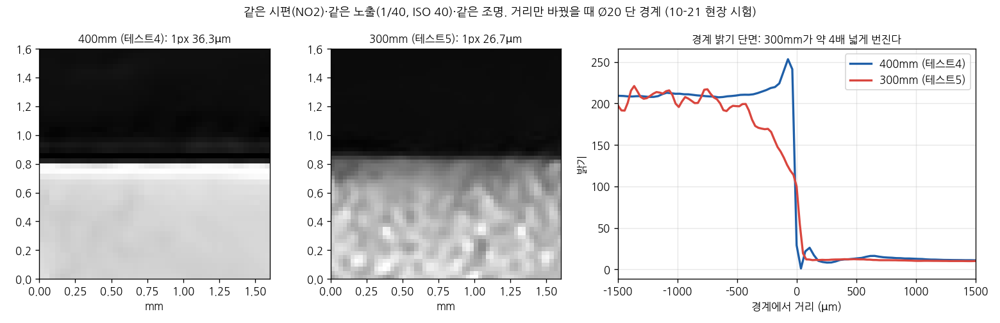

# 최종보고서 초안 공유와 같이 정할 것 (10-27)

- 초안: [reports/최종보고서/최종보고서_초안_20261027.pdf](../../reports/최종보고서/최종보고서_초안_20261027.pdf) (본문 8장 + 참고문헌 1장)
- 양식: 아이펠 "팀별 프로젝트 결과보고서" PPT, PDF 제출, 참고문헌 빼고 8쪽 이내. 마감 11-06(금), 팀장 제출
- 함께 내는 것: 최종 발표자료(PPT·PDF), 데모 영상(최대 1분), 깃허브 링크, 포스터(선택)
- 초안은 캔바에서 편집할 수 있게 만들었다. 고칠 곳은 이 문서나 디스코드로 알려주면 반영한다

### 초안 구성

| 장 | 내용 |
|---|---|
| 1 | 표지 + 목차 (8쪽에 맞추려고 합침) |
| 2 | 01 개요: 배경, 내용, 장비, 구조, 기대효과 + 결론 한 줄 |
| 3 | 02 팀 구성·역할 + 03 수행 절차(일정 표) |
| 4 | 04-① 세 번의 현장 촬영 |
| 5 | 04-② 측정 시스템 구조와 모듈 |
| 6 | 04-③ 3차 사전 규칙 판정과 원인(촬영 중 크기 변화) |
| 7 | 04-④ 남는 오차·MSA·거칠기, ⑤ 시연 영상 |
| 8 | 05 자체 평가: 완성도, 잘한 점·아쉬운 점, 추후 개선(MSA 순서), 느낀 점 |
| 9 | 참고문헌, 깃허브 |

결론 문장: "이 세팅의 스마트폰으로는 ±10µm 합불 판정을 못 한다. 대신 무엇 때문에 안 되는지, 다음 시스템에 무엇이 있어야 하는지를 근거와 함께 남겼다."

### 같이 정할 것

1. **보고서의 무게중심.** 초안은 중간보고서 목표대로 "Pilot으로 가능성 판정"에 두고, 구현한 것(측정 엔진·현장 시스템·점검 도구·프로토콜)과 못 낸 것(정밀도), 숙제(전문 장비 + MSA 검증)로 나눴다. 선행 개발자는 10-26에 "정밀 측정 시스템 구현까지가 맞고, 전문 장비는 향후 숙제로 둔다"는 의견을 냈다. 업체 쪽 기대도 감안해야 한다. 어느 쪽에 방점을 둘지 정한다
2. **깃허브.** 제출은 선행 개발자 저장소(`cho-heeyeon/Shaft_OD_Measurement`)로 정했다. 그런데 보고서의 그림·결과(3차 분석, 거칠기, 팀원 E 실험)는 대부분 팀장·팀원 저장소에 있다. 선행 개발자 저장소에 모을지, README에 각 저장소 링크를 걸지 정한다
3. **역할 칸.** 각자 자기 칸(3장)을 확인해 고칠 곳을 알려준다
4. **완성도 점수**(8장, 10점 만점)를 정한다. 초안은 "○ / 10"으로 비워 뒀다
5. **일정 표**(3장)의 "시스템 구현 09/14 \~ 10/20"은 팀장이 대략 잡은 기간이다. 실제 개발 기간으로 고친다
6. **중간보고서 질문 Q2(확대하면 나아지나)** 답을 넣는다. 아래 「300 vs 400mm」 절의 결과로 문장을 정한다
7. **데모 영상 1분.** 중간보고 영상(현장 시스템, 약 1분 45초)을 줄일지, 업체 거칠기 측정 동영상을 섞을지(선행 개발자 제안) 정한다
8. **인용 문장 확인.** 팀원의 "실측값 잡음 최대 약 5µm"(7·8장), 세 분석 비교 문장(7장)이 각자 뜻과 맞는지 본다
9. **목차·제목.** 결과 ① \~ ④ 제목을 양식(탐색적 분석, 모델 개요 등) 대신 우리 내용으로 바꿨다. 11-06 제출 전에 운영 쪽 확인을 받는다
10. **발표자료·포스터** 담당과 일정. 발표는 11-11, 리허설 11-09로 알고 있다(날짜 확인 필요)

### 300 vs 400mm (중간보고서 Q2, 10-27 추가)

3차 당일 시나리오대로 같은 시편(NO2)·같은 노출(1/40, ISO 40)·같은 조명으로 400mm(테스트4)와 300mm(테스트5)를 5장씩 찍어 비교하고 300mm로 정했다. 같은 사진을 두 방법으로 보면 결과가 반대다.

| | 400mm | 300mm | 무엇을 봤나 |
|---|---|---|---|
| 선행 개발자 (V3 픽셀 모드, 당일 결정 근거) | 4/5 성공, 유효점 11 \~ 16개, sd 26.7px | 5/5 성공, 유효점 27 \~ 31개, sd 6.7px | 엔진이 그 사진을 안정적으로 처리하나 |
| 팀장 (국소 50% 경계, Ø20 단 가운데) | sd 0.017px(0.6µm), 경계 폭 127µm | sd 0.30px(7.9µm), 경계 폭 571µm | 사진의 경계 자체가 선명하고 반복되나 |

- 300mm 사진은 뒤의 A4 결이 선명하게 보인다. 초점이 샤프트보다 뒤(확산판)에 맞았을 가능성이 크다. 당일 팀장 채팅에서도 "지금 데이터로는 400mm가 좋고, 300mm는 샤프트 경계에 초점을 잠그고 다시 찍어 비교해야 한다"는 조건부 의견이었는데, 다시 찍은 비교는 하지 못했다
- 본시험 NO2(300mm, 10장)도 경계 폭 533µm, 사진 사이 sd 9.8µm로 테스트5와 같다. 본시험 내내 초점이 뒤에 맞아 있었을 수 있고, 3차 같은 놓임 반복성 9.0µm의 상당 부분이 여기서 왔을 수 있다. 촬영 중 크기 변화와 시편별 치우침까지 설명되는지는 모른다
- V3가 400mm에서 유효점이 적었던 이유는 확인하지 못했다(경계의 선명화 테두리, 픽셀 범위 설정 등 후보). V3의 measured_pixel(300mm 650px, 400mm 480px)은 같은 사진에서 측정한 Ø20 단 지름(742px, 547px)과 달라, 측정 위치를 맞춰 볼 필요가 있다. 두 거리의 비율(1.35)은 같다
- 표면 거칠기는 두 거리에서 같은 시편이라 거리 차이의 원인이 될 수 없다
- 보고서 문장 제안: "확대(300mm)로 1px은 27% 작아졌지만, 초점이 배경에 맞아 경계가 약 4배 번지고 반복성이 나빠졌다. 당일에는 측정 엔진의 처리 안정성을 기준으로 300mm를 골랐는데, 경계 품질로 보면 400mm가 나았다. 다음 시스템은 초점·노출을 잠근 뒤 경계 폭을 확인하고, 현장 결정 기준을 미리 숫자로 정한다"

### 조명 안정성 (10-27 추가)

백라이트 밝기·파장이 흔들려 크기가 변했는지 3차 사진 140장으로 확인하려 했지만, **폰 사진으로는 판단할 수 없었다.**

- 화이트밸런스가 자동(EXIF 139/140)이라 빛의 색이 바뀌어도 폰이 맞춘다
- 테스트5에서 본시험으로 노출이 17% 줄었는데(조명·세팅은 그대로, 백라이트 1단계) 밝은 배경·V블록 옆면·바닥 밝기가 모두 그대로이거나 밝아졌다(+0.9 \~ +4.7%). 폰이 사진 밝기를 맞춘다는 뜻이라, 사진 밝기로 조명 변화를 감지할 수 없다
- 사진 안에서는 본시험 동안 배경 밝기 ±0.06%, R/B 일정, 줄무늬 일정이었지만 위 이유로 "조명이 안정적이었다"는 근거가 못 된다
- 남는 간접 근거: 연속 촬영 중에는 줄고 간격이 길면 회복하는 핀 크기 패턴은 계속 켜져 있던 백라이트보다 폰 쪽과 맞는다
- 다음 시스템: 조도계·색온도 기록 또는 화이트밸런스·노출 수동 잠금·RAW 촬영, 백라이트 단계를 바꿔 감도 측정

### 회차 간 비교에 대한 정리 (10-27 추가)

촬영마다 원인을 하나씩 고치는 개선 방식이라 회차 간 직접 비교가 어려웠다. 한 촬영 안의 반복성은 측정했지만(같은 놓임, 재장착, Gage R&R), 회차마다 같은 기준 조건을 함께 찍어 두지 않아 환경 변화와 세팅 효과를 나눌 수 없었다. 다음 시스템은 매 회차 고정 기준 조건(기준 시편, 같은 세팅)을 함께 촬영한다.

### 기다리는 것
- 오늘(10-27) 17:00 멘토링 답변: MSA 형식, 마무리 판단. 반영해서 5·8장과 멘토 역할 문구를 고친다
- 선행 개발자 거칠기 자료의 스케일과 산점도 원본 표 ([거칠기 대조](2026-10-26_거칠기_대조.md) 5절)

### 일정 (제안)

| 날짜 | 할 일 |
|---|---|
| 10-29(목) \~ 10-30(금) | 위 1 \~ 8번 의견 모으기, 멘토링에서 초안 보여드리기 |
| 11-03(화) | 수정본으로 멘토링, 발표자료 초안 |
| 11-05(목) | 숫자 대조, 최종 PDF |
| 11-06(금) | 제출 |
