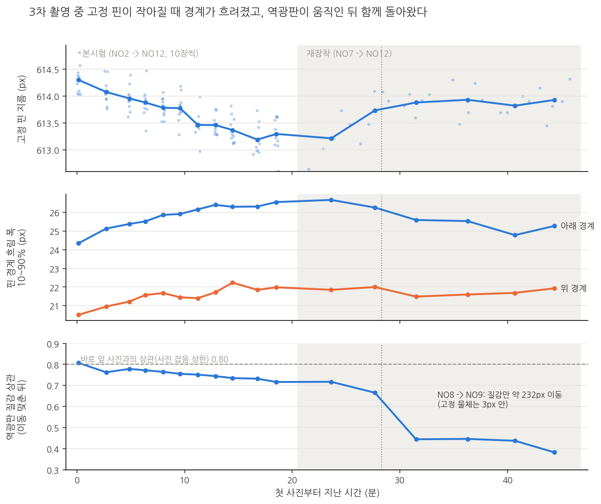

# 팀장·팀원 분석 교차 대조 (10-28)

같은 3차 사진을 팀장과 팀원이 따로 분석해 왔다. 결론은 같은 쪽을 가리키지만, 같은 질문에 숫자가 다르게 나온 곳이 네 군데 있었다. 그 차이가 어느 선택에서 오는지 한 틀에 놓고 갈랐다. 팀원이 10-27 ~ 10-28에 팀 노션에 올린 자료 2개(E11 쉬운 정리, E13 상관 설명)도 같이 정리했다.

- 숫자는 [02_facts](../02_facts.md) 「2026-10-28 교차 대조」 절, 코드와 출력은 [experiments/20261028_교차대조](../../experiments/20261028_교차대조/)
- 팀원 자료: [gon311/final_project](https://github.com/gon311/final_project) `experiments/3rd/E6_E10_20261021`, `3rd/roughness`(E11), `4th/E12_endspike`, `4th/E13_roughness_reconcile`
- **공통 틀:** 팀원 E6 규칙(NO1 제외, 정상 9개 하나씩 빼고 맞히기, 시편 대표값 = 본시험 + 재장착 사진 지름의 중앙값)을 팀장 코드로 다시 짜서 팀원 숫자를 그대로 재현했다(평균 부르기 6.64, 전체 선형 5.34, 물리 배율 8.48, 핀 비율 선형 3.99, 핀 비율 x16 5.17µm). 아래 표는 모두 이 틀이다
- 전부 결과를 본 뒤의 분석이다(사후). 시편이 9 ~ 11개라 1 ~ 2µm 차이는 순위로 읽지 않는다

## 1. 공통점과 시각 차이

**따로 했는데 같게 나온 것**

| 항목 | 팀장 | 팀원 |
|---|---|---|
| 촬영 중 고정 핀 크기 변화 | -0.18% | -0.19% |
| 기준선을 넘었나 | 못 넘음 (7.9 vs 6.4µm) | 사전 기준 못 넘음 (최선 3.99 vs 6.64µm, 기준은 2.92µm 이상 개선) |
| 거칠기가 원인인가 | 치우침과 관계 안 보임 | 경계 굴곡과도 판단 불가 |
| 다음에 바꿀 것 | 촬영 순서 무작위, CAL 처음·중간·끝, 모든 시편 재장착 | 같음 |

**같은 데이터를 보는 눈이 다르다**

| | 팀장 | 팀원 | 선행 개발자 |
|---|---|---|---|
| 묻는 질문 | 측정 시스템으로 쓸 수 있나 (MSA, 오차 예산) | 이 데이터로 그렇게 주장해도 되나 | 엔진이 안정적으로 값을 내나 |
| 방식 | 물리 배율 고정, 원인별 크기 쪼개기 | 결과 전에 규칙 커밋, 검출력 계산, "판단 불가" 엄격히 구분 | 엔진 출력 px, 현장에서 바로 판단 |
| 놓치기 쉬운 것 | 보정 방식·창을 바꾸면 결과가 얼마나 바뀌는지 | 그래서 시스템에 무엇이 필요한지로 번역하기 | 단위 환산 |

아래 ① ~ ④는 이 차이가 숫자로 드러난 곳이다.

## 2. 숫자가 갈린 네 곳과 기준선

### ① 최선 MAE 3.99 대 8.6µm: 경계보다 교정식에서 갈린다

정상 9개 하나씩 빼고 맞히기 MAE(µm), 평균 부르기 6.64

| 교정 방식 | 팀원 cross50 (약 110열 직선) | 팀장 32열 중앙값 (3차 분석정리) | 팀장 31열 평균 | 팀장 21열 평균 |
|---|---|---|---|---|
| 전체 선형 (기울기 자유) | 5.34 | 4.72 | 4.45 | 4.52 |
| 핀 비율 선형 (기울기 자유, 팀원 방식4) | **3.99** | 5.22 | 4.49 | 5.58 |
| 물리 배율 | 8.48 | 6.72 | 7.93 | 7.88 |
| 물리 + 핀 px 1:1 더함 (팀장 시간 보정) | 5.03 | 7.80 | 7.41 | 8.65 |
| 물리 + 핀 px x0.478 더함 | 6.51 | 7.13 | 7.46 | 7.78 |
| 핀 비율 x16 고정 | 5.17 | 8.53 | 7.40 | 9.18 |

- **기울기를 자유롭게 맞춘 방식은 어느 경계로 해도 4.0 ~ 5.6µm, 물리 배율로 고정한 방식은 대부분 6.7 ~ 9.2µm다.** 3.99는 경계보다 방식 쪽 몫이 크다
- 자유롭게 맞춘 기울기는 물리 배율의 0.35 ~ 0.60배다. 사진 속 지름 차이를 절반 이하만 믿고 평균 쪽으로 당기는 식이다(1차 선행 보고서의 "기울기 14배 작음"과 같은 성질, 정도는 약함). 그래도 평균 부르기보다 1 ~ 2.6µm 낫다
- **그래서 "방식4가 지금까지 가장 좋은 방법"에는 단서가 필요하다.** 실측 범위가 좁은(21µm) 9개로 기울기까지 맞춘 값이고, 새 시편이 범위를 벗어나면 그만큼 작게 반응한다. 팀원 E11-C의 실측값 잡음 상한(RMSE 5.15µm)도 이 방식 위에서 계산됐다
- 물리 배율에 시간 보정을 더하면 팀원 경계는 8.48 -> 5.03µm로 좋아지고, 팀장 경계는 거의 그대로이거나 나빠진다. 팀원은 핀과 샤프트를 같은 방법(cross50, 많은 열)으로 측정했고, 팀장은 따로 측정했다. 보정은 두 측정의 잡음을 더하므로 같은 방법·충분한 열 수가 필요하다
- 팀장 가설("1:1 보정이 과보정")은 맞지 않았다. 팀원 경계에서는 1:1이 0.478배보다 낫다

### ② 대표값 비교의 Max·envelope가 나빴던 것은 시편 공통으로 튀는 열 때문이었다

- 시편마다 첫 사진을 1px 열마다 측정했다. 위 경계(원본 좌표) x 8279 ~ 8282가 **11개 시편 모두** -70 ~ -84µm 튀었다. 팀원 E11 부록·E12의 끝열 스파이크(팀원 좌표 x 약 8265)와 같은 현상으로 보인다(두 좌표계가 15 ~ 20px 어긋난다는 것은 창 중심 비교로 추정)
- 그 밖에 위 경계 8304 ~ 8315, 아래 경계 8052 ~ 8055, 단 양 끝도 시편 공통으로 튄다. 10-27 대표값 비교의 31개 열(8030 ~ 8320)은 이 중 4개를 포함했다
- 튀는 열을 뺀 21개 열(8069 ~ 8262)로 다시 비교했다

| 대표값 | 물리 배율 31열 -> 21열 | 물리 + 시간 보정 31열 -> 21열 | 핀 비율 선형(자유) 31열 -> 21열 |
|---|---|---|---|
| Median | 9.8 -> 9.3 | 9.7 -> 6.7 | 5.0 -> 4.3 |
| Mean | 7.9 -> 7.9 | 7.4 -> 8.7 | 4.5 -> 5.6 |
| P90 | 10.0 -> 11.1 | 12.3 -> 15.1 | 6.5 -> 6.8 |
| Max | 30.9 -> 10.9 | 26.3 -> 17.1 | 7.5 -> 7.3 |
| envelope | 36.2 -> 14.9 | 35.4 -> 18.6 | 7.7 -> 7.3 |

- **Max·envelope는 창만 바꿔도 2 ~ 3배 달라진다.** 10-27의 "Max·envelope 3 ~ 4배 나쁨"의 상당 부분은 튀는 열 몫이었다. 깨끗한 창에서도 Mean·Median보다는 나쁘다
- Mean과 Median의 순위는 창과 교정식에 따라 뒤집힌다. 둘 사이는 이 데이터로 가릴 수 없다
- 10-29 멘토링 답(수정안): "마이크로미터처럼 가장 높은 곳을 잡는 정의는 사진에서는 표면보다 사진 쪽 튀는 열을 먼저 잡는다. 튀는 열을 미리 빼야 하고, 빼도 가운데 값(Mean·Median)보다 나빴다"

### ③ 재장착 반복성 11.6 대 5.2µm: 정의가 아니라 경계 잡음 차이다

| 경계 | 사진 사이 sd (팀장 정의 / 팀원 정의) | 재장착 측정 1회 sd (팀장 정의) | 6번 놓임 sd (팀원 정의) | 놓임 몫 | %GRR |
|---|---|---|---|---|---|
| 팀원 cross50 | 3.3 / 2.9 | 4.3 | 5.2 | 2.7 | 128 ~ 155% |
| 팀장 32열 중앙값 | 9.1 / 8.6 | 11.3 | 10.0 | 6.7 | 299 ~ 339% |
| 팀장 31열 평균 | 6.1 / 6.1 | 7.2 | 6.7 | 3.8 | 200 ~ 216% |
| 팀장 21열 평균 | 6.9 / 6.7 | 7.4 | 7.5 | 2.7 | 223 ~ 224% |

- 같은 경계에서는 두 정의가 1µm 안팎으로 비슷하다. 차이는 **사진 한 장의 경계 잡음**(약 3 vs 6 ~ 9µm)에서 온다
- 열을 많이 평균하면 잡음이 준다는 계산과 맞는다: 31열 6.1µm x √(31/110) = 3.2µm, 팀원 약 110열 2.9 ~ 3.3µm
- 다시 놓을 때 생기는 몫은 2.7 ~ 3.8µm로 경계와 상관없이 비슷하다
- **%GRR은 가장 좋은 경계에서도 128 ~ 155%다.** 30% 기준을 크게 넘는다는 결론은 그대로다. 보고서의 "약 350%"는 "측정 방법에 따라 130 ~ 350%"로 고친다

### ④ 촬영 중 크기 변화: 배율도 이동도 아니고, 경계가 흐려진 것과 함께 간다

**배율 변화가 아니다**
- 본시험 18분 동안 고정 물체가 x로 움직였다: V블록 오른쪽 경계 -3.1px, 핀 끝면 -2.0px, 역광판 질감 0.0 ~ -2.1px
- 위치별 이동을 "평행 이동 + 배율"로 맞추면 평행 이동 -1.9px, 배율 -0.04%다. 핀은 -0.16% 줄었다(4배 차이)
- 핀이 배율로 줄었다면 V블록 경계는 -4.0px, 핀 끝면은 반대 방향으로 +3.7px 움직였어야 한다. 실제로는 둘 다 같은 쪽(-)으로 움직였다
- 평행 이동은 지름을 바꾸지 않는다. 서서히 움직인 원인은 거치대의 열 변형·처짐이나 폰 손떨림 보정 렌즈(OIS)의 위치 흐름일 수 있고, 사진만으로는 둘이 똑같이 보인다

**핀이 줄어든 만큼 경계가 흐려졌다**
- 핀 아래 경계 10 ~ 90% 폭: 본시험 24.3 -> 26.6px (시간 r +0.78, 핀 크기 r -0.61). 위 경계 20.5 -> 22.0px
- 재장착 NO9부터 핀이 회복할 때 흐림 폭도 줄었다(아래 경계 26.7 -> 24.8 ~ 25.6px)
- 팀원 E11-B의 "윗엣지 10 ~ 90% 폭과 촬영 순서 ρ +0.85"와 같은 현상이다. 팀원은 원인을 "초점·배율이 조금씩 흐름"으로 적었는데, 배율은 위에서 빠진다

**흐려지면 왜 작게 잡히나: 폰 사진의 밝기 곡선(감마)**
- 빛은 선형으로 번지지만 JPEG 밝기값은 밝기 곡선을 거친 값이다. 밝기값 50% 지점은 실제 빛으로는 약 22%(감마 2.2) 지점이라 경계 중심보다 물체 안쪽에 있다
- 경계가 흐려지면 이 지점이 물체 안쪽으로 더 밀려 물체가 작게 잡힌다
- 계산(가우스 경계 가정): 흐림 폭이 평균 1.85px 넓어지면 지름이 -0.8 ~ -1.3px(감마 1.8 ~ 2.4) 준다. **관측 -1.00px와 같은 크기다**

**역광판은 재장착 중에 움직였다**
- 재장착 NO8 -> NO9에서 고정 물체는 3px 안에서 그대로인데 역광판 질감만 약 232px 옮겨 갔고 모양도 달라졌다(이동을 맞춘 뒤 상관 0.67 -> 0.44, 같은 시편 안 바로 앞 사진과는 0.80). 밝은 쪽 밝기도 198.7 -> 196.1로 떨어졌다
- 핀 회복과 흐림 감소가 이때 일어났다. 재장착 간격도 4 ~ 5분으로 길어 폰이 식은 것과 시점이 겹친다. 둘은 이 자료로 갈리지 않는다
- 팀원 E12의 "질감이 움직이므로 장면 쪽"은 재장착의 232px 이동에서는 분명하다. 본시험의 1.5px 이동은 고정 물체 이동과 크기가 비슷해 카메라 쪽 이동으로도 설명된다

**정리:** 촬영 중 크기 변화는 "경계가 흐려지며 작게 잡힘(감마)"으로 크기까지 설명된다. 흐려진 원인은 초점 흐름(발열), 폰 영상 처리 변화, 역광판·확산층 변화 중 하나이고 갈리지 않는다. 감마 없는 선형 출력(RAW, 산업용 카메라)이면 흐려져도 50% 경계가 거의 안 움직인다. 다음 시스템에 "RAW·자동 처리 끔"이 필요한 이유가 숫자로 하나 더 생겼다

### ⑤ 기준선 세 개는 시편 구성만 다르다

| 기준선 | 시편 | 값 |
|---|---|---|
| CAL(NO1 ~ 3) 평균 -> 평가 7개(NO4 ~ 10) | 3차 사전 규칙 | 6.4µm |
| 정상 10개(NO1 ~ 10) 하나씩 빼기 | 10-27 대표값 비교 | 6.9µm |
| NO1 빼고 정상 9개 하나씩 빼기 | 팀원 E6, 이 문서 | 6.64µm |

- 실측값 자체의 sd가 7.4 ~ 7.6µm라 기준선이 6 ~ 7µm로 나온다. 팀원 E11-C로 보면 실측값 잡음이 최대 약 5µm일 수 있다. 기준선과 1 ~ 2µm 차이를 가르려면 실측값이 그보다 정확해야 하므로, "기준선을 못 이겼다"의 일부는 실측값 한계일 수 있다

## 3. 팀원 노션 자료 2개

**「표면 거칠기 실험 (E11)」 (10-27)**: E11 README를 처음 보는 사람도 읽게 다시 쓴 판이다. 결론 넷: 사진으로 거칠기는 보이지 않는다(판단 불가) / 거칠기는 오차를 설명하지 못한다(Rz 항을 넣으면 3.99 -> 4.71µm) / 촬영 순서가 훨씬 크다(흐림 폭 ρ +0.85, 오차 ρ -0.80) / 실측값 흔들림 가능성은 남는다(E11-C). 부록 「7절-4」는 NO3·NO7·NO10 오른쪽 끝 급락을 원본 사진으로 따라가 시편 10개 공통의 사진 쪽 튀는 줄로 판단했다. 이번 ②의 x 8279 ~ 8282와 같은 현상으로 보인다

**「E13 - 상관관계 설명」 (10-28)**: r +0.13 / +0.4 / 0이 모두 "Rq vs 하단 윤곽선 MAD"이고, 바뀐 것은 MAD 계산(14점이냐 모든 열이냐, 사진 1장이냐 10장 중앙값이냐)뿐이라고 풀었다. n = 11 신뢰구간 표를 붙였다(값 확인함)

| r | p (양측) | 95% 구간 |
|---|---|---|
| +0.13 (14점, 1장) | 0.70 | -0.51 ~ +0.68 |
| +0.42 ~ +0.47 (모든 열, 1장) | 0.15 ~ 0.20 | 약 -0.2 ~ +0.8 |
| +0.50 (선행 개발자, 안정군) | 0.12 | -0.14 ~ +0.85 |

- 시편 11개면 |r| 0.60은 넘어야 0과 구분된다. 결론: 어느 조건에서도 거칠기와 상관이 있다고 말할 근거는 부족하다
- 같은 장착 10장 중앙값에서는 r ≈ 0이고, Range·STD는 1장에서도 Rq와 반대 방향이라(E13 README 3절) 1장 MAD의 양의 상관은 그 사진 한 장의 변동일 가능성이 있다

## 4. 보고서·문서 반영 (제안)

1. 7장 대표값 카드: "Max·envelope 3 ~ 4배 나쁨" -> "사진 쪽 튀는 열을 먼저 잡는다(창만 바꿔도 2 ~ 3배). 빼도 가운데 값보다 나쁘다"
2. 7장 두 분석 표: 3.99 옆에 "기울기 자유(물리 배율의 0.6배)" 주석
3. MSA: %GRR "약 350%" -> "측정 방법에 따라 130 ~ 350%"
4. 촬영 중 크기 변화 원인: "폰 발열 추정" -> "경계가 흐려지며 작게 잡힘(감마). 흐려진 원인은 초점·영상 처리·역광판 중 미확정"
5. 기준선 표기: 숫자마다 어느 틀인지 붙인다
6. 거칠기 카드: E13의 "n = 11이면 |r| 0.60 넘어야 0과 구분" 한 줄

## 5. 같이 볼 것

- **방식4의 위치.** 팀원 문서들이 "지금까지 가장 좋았던 방법"으로 소개한다. 위 ①의 단서(기울기 자유, 평균 쪽 수축)를 붙이는 데 동의하는지
- **재장착 NO8 ~ NO9 무렵 역광판·아크릴·A4를 건드린 기억이 있는지.** 있으면 ④를 "역광판을 건드린 뒤 핀 회복"으로 한 단계 좁힐 수 있다
- 팀원 E12의 스파이크 좌표(x 약 8265)와 이 문서의 x 8279 ~ 8282가 같은 줄인지, 팀원 좌표계의 원본 대응을 확인

## 약한 곳

- ②의 좌표 대응은 창 중심 비교로 추정했다
- ④의 감마 계산은 가우스 경계와 감마 1.8 ~ 2.4를 가정했다(폰의 실제 밝기 곡선은 모른다). 흐림과 크기가 같이 움직인다는 것은 상관이고, 계산한 크기가 맞는다는 것이 근거다
- ①의 "평균 쪽 수축" 해석은 기울기 크기로 본 것이다. 시편 9개라 기울기 자체도 흔들린다
