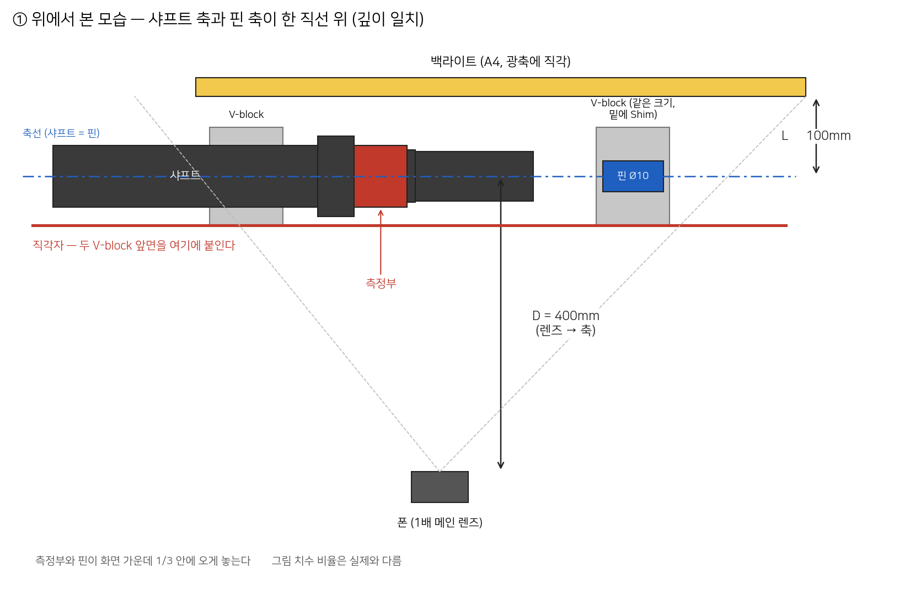
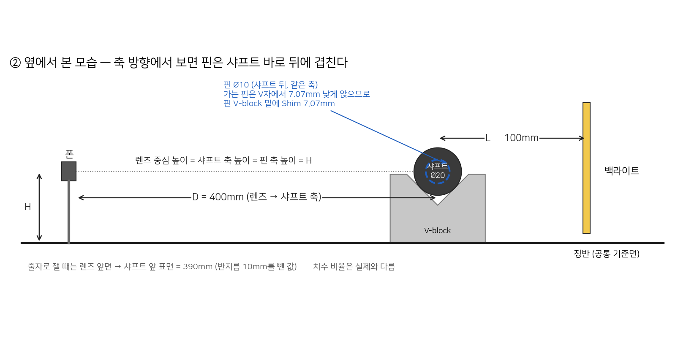
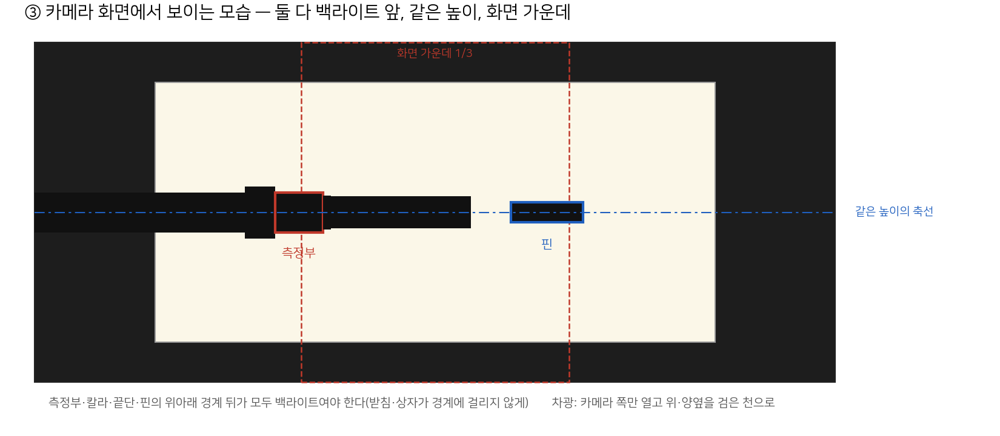

# 2차 현장 촬영 계획서 (2026-10-02)

기준 문서: 선행 개발자 「촬영조건 표준화 시나리오」(09-29, 노션 자료실). **장비 배치·정렬·점검 절차는 그 문서를 그대로 따른다.** 이 계획서는 그 위에 "무엇을, 몇 장, 어떤 순서로" 찍을지와 오늘 회의(10-01) 결정을 더한 것이다.

---

## 0. 이번 촬영으로 답할 질문

| # | 질문 | 왜 |
|---|---|---|
| Q1 | 같은 시편을 **빼고 다시 놓으면** 값이 얼마나 흔들리나 | 1차 데이터에는 재장착이 없어 배치 흔들림을 직접 잰 적이 없다. 정확도 병목이 배치라는 결론(09-23)의 첫 실측 |
| Q2 | 캘리브 방식별로 검증 시편 오차가 얼마인가 — **(가) 회의 결정대로 상·중·하 3점 캘리브**, **(나) 핀게이지(Ø10) + 샤프트(Ø20) 캘리브**를 같은 사진으로 함께 분석 | (가)는 10-01 회의 결정. 다만 상·중·하는 실측 폭이 20µm뿐이라 1차에서 분리 비율이 약 1.0이었다(선행 개발자 09-23 보고서). (나)는 핀과 샤프트가 10mm 차이라 기울기를 잡을 폭이 있다. 두 결과를 나란히 보고 판단한다 |
| Q3 | 촬영 조건(모드·거리)에 따라 흔들림이 달라지나 | 자동 vs 수동은 미결, 거리는 1차가 권장 범위 밖 |

**하루에 다 못 할 수 있다.** 조건 맞추는 데 시간이 많이 걸리므로 블록 A\~C(필수)를 먼저 끝내고 남는 시간에 D\~G를 한다.

---

## 1. 준비물

| 구분 | 품목 | 비고 |
|---|---|---|
| 촬영 | 스마트폰(기종·모델명 기록), 고정형 거치대, 리모컨 또는 타이머 | 촬영 중 폰을 손으로 만지지 않는다 |
| 조명 | 백라이트(팀 보유 A4, 확산형 아님), 전원 | 밝기 값 기록. A3로 키울 필요 없음(10-01 자체 점검 해석 4) |
| 차광 | **검은 천(암막천) 1\~2장** 또는 검은 폼보드 2\~3장 + 집게·테이프 | **무광 검정만.** 흰 판은 빛을 되비춰 효과 없음(10-01 자체 점검 3번 사진) |
| 지그 | **같은 크기 V-block 2개(한 쌍)** — 샤프트용·핀용, 핀 쪽 Shim(90° V-block이면 7.07mm) | 접촉면 닦을 천. 크기가 다른 V-block이면 3.5절 마지막 항목대로 따로 맞춤 |
| 기준물 | 핀게이지 Ø10 × 5개(오키타 DP-B, 공차 0\~+0.005) | **현장에서 마이크로미터로 실측** |
| 정렬 | 하이트 게이지(현장 협조), 직각자, 줄자, 마스킹 테이프(기준선 표시) | |
| 확인 | 노트북(즉석 측정용), 보조배터리, 기록지(아래 5절) | |

## 2. 시편 · 실측 (업체 요청, 선행 개발자 연락)

| 용도 | 수량 | 내용 |
|---|---|---|
| 캘리브·검증 | 상·중·하 × 2세트 | 20.030 / 20.020 / 20.010 근처. **1세트 = 캘리브용, 2세트 = 검증용**(10-01 회의). 핀 캘리브(나)도 같은 검증 세트로 평가 |
| 측정 | 4개 | 무작위 |
| 불량 | 약 10개 | 치수 불량 + 가공 누락 + 외관 불량, 종류 기록 |
| 핀게이지 | 5개 | 지름 실측(가운데 부분, 모따기 끝 제외) |

실측 요청 사항: 측정 위치(축 방향 어디), 측정 횟수(가능하면 3회 평균), 그리고 **가능하면 칼라·끝단 지름도 함께**(두 기준 보간·시편 간 차이 원인 확인용). 측정하는 모습을 팀이 직접 관찰한다.

## 3. 고정 조건 (전 블록 공통, 바꾸는 블록만 예외)

| 항목 | 기본값 | 바꾸는 블록 |
|---|---|---|
| 렌즈 | 후면 메인 1.0× (자동 렌즈 전환 확인) | — |
| 해상도 | **200MP 모드로 고정**(4절 A 참고 — 400mm에서 12MP면 지름이 약 136px뿐). 모드 섞지 않기(1차에 200M/12M 혼용 시 +486µm 어긋남 기록) | — |
| 거리 | 렌즈–측정면 **400mm**(가능 범위 350\~500mm, **250mm 이하 금지** — 10-01 회의) | E |
| 촬영 모드 | 기본 카메라 **자동**. 측정부를 길게 눌러 **초점·노출 잠금(AF/AE Lock)** | D |
| 정렬 | 렌즈·샤프트·핀게이지 중심 높이 일치, 핀과 샤프트 측정 단면 같은 깊이, 광축 직각 | F |
| 구도 | 핀게이지와 샤프트를 화면 중앙 부근에 나란히. **칼라와 끝단이 함께 보이게** | — |
| 조명 | 백라이트 위치·밝기 고정, 차광 설치(카메라 쪽만 열고 위·양옆 가림) | D2 |

## 3.5 배치와 거리

### 배치도

그림 생성 스크립트: `_scratch/Pre365/build/draw_setup_20261002.py`(개인 작업 폴더). 치수 비율은 실제와 다르다.

### 거리 · 위치 숫자

| 항목 | 값 | 재는 법 · 허용 | 왜 |
|---|---|---|---|
| **D** 렌즈 → 샤프트 축 | **400mm** | 줄자로 렌즈 앞면 → 샤프트 앞 표면 = **390mm**(축까지 400에서 반지름 10을 뺀 값). 촬영 중 바뀌면 안 된다 | 거리 1mm 변화 = 배율 0.25% = 20mm에서 약 50µm. 그래서 사진마다 핀 px로 감시한다 |
| **핀–샤프트 깊이 차** | **0.04mm 이하** | 손으로 맞출 수 없는 정밀도 → **V-block 중심선을 한 직선에 맞춰** 해결(아래) | 깊이 0.04mm 차이 = 배율 0.01% = 20mm에서 2µm(목표 바이어스 수준) |
| **높이** | 렌즈 중심 = 샤프트 축 = 핀 축 = H | 하이트 게이지: 축 높이 = 윗면 높이 − 지름/2 | 높이 차는 배율을 바꾸지 않고 화면 위치만 바꾼다. 화면 중앙에서 멀어지면 렌즈 왜곡을 받는다 |
| **L** 샤프트 축 → 백라이트 | **100mm** (제안값, 고정·기록) | 백라이트 면을 광축에 직각으로, 중심 높이 H | 확산광이 둥근 가장자리를 감싸 들어오는 현상(래핑)은 백라이트가 가까울수록 커진다. 1차 조건과 다르면 결과도 달라지므로 값을 기록 |
| **백라이트 크기** | 측정부와 핀 뒤를 모두 덮고 위아래 여유 | V-block 그림자가 측정부 위아래 경계에 걸리지 않을 것 | 경계 뒤가 밝아야 실루엣이 생긴다 |
| **화면 위치** | 측정부와 핀이 화면 가운데 1/3 안 | 시험 사진으로 확인 | 렌즈 왜곡은 화면 가장자리에서 커진다 |

### 핀과 샤프트의 깊이를 맞추는 법 — V-block 중심선

핀은 **눕혀서** 샤프트와 같은 방향으로 둔다. 10-01 자체 점검에서 핀을 상자 위에 세워 두었더니 놓는 위치에 따라 깊이가 cm 단위로 달라져, 핀으로 환산한 같은 구간 지름이 19.0\~21.2mm로 흔들렸다. 맞춰야 하는 것은 앞면이 아니라 **축**이다(앞면을 맞추면 반지름 차 5mm만큼 축이 어긋난다).

V-block에 둥근 물체를 놓으면 **지름이 달라도 축은 V자의 한가운데(대칭면)에 온다.** 카메라가 수평으로 볼 때 깊이 방향은 바로 이 대칭면과 직각인 방향이다. 그래서:

- **같은 크기 V-block 두 개**를 쓰고, 두 V-block의 카메라 쪽 면을 **직각자 한 줄에 붙이면** 두 대칭면이 한 직선 위에 와서 깊이가 자동으로 같아진다(그림 ①)
- 대신 **높이는 달라진다.** 90° V-block이면 핀(Ø10) 축이 샤프트(Ø20) 축보다 **7.07mm 낮다**(반지름 차 5mm × √2). 핀 V-block 아래에 Shim 7.07mm를 깔거나, 하이트 게이지로 두 축 높이를 맞춘다
- V-block 종류가 다르면 각 V-block의 대칭면 위치를 따로 재서 맞춘다

### 처리 때 보정할 것 (촬영과 무관, 기록만 정확히)

렌즈가 가까이서 둥근 물체를 보면 실루엣이 축 평면에서의 실제 지름보다 조금 크게 보인다(겉보기 과대 ≈ 반지름³ ÷ D²). 400mm에서 샤프트는 약 **+6.3µm**, 핀은 약 **+0.8µm** 크게 보인다. 핀으로 배율을 잡으면 샤프트가 약 5µm 크게 나오므로 분석 때 계산으로 뺀다. 이를 위해 **D를 정확히 기록**한다.

## 4. 촬영 순서

### 필수

**A. 세팅 확인** (시험 3장)
- 선행 개발자 시나리오 8절 점검 → **차광 설치** → **측정부를 눌러 초점 고정** → 3장 촬영 → 노트북으로 즉석 확인: 샤프트·핀 지름 px, 경계 선명도, YOLO 검출
- 핀 px로 측정부를 mm로 환산해 실측과 크게 다르면(예: 1% 이상) 핀과 샤프트의 깊이가 어긋난 것 → V-block 정렬을 다시 본다
- **샤프트 지름이 원본 사진에서 몇 px인지** 확인. 기종의 1× 메인 렌즈를 35mm 환산 약 24mm로 가정하면(추정), 400mm에서 화면 가로가 약 600mm라 지름 20mm는 **200MP 모드에서 약 540px, 12MP 모드에서 약 136px**이다. 1차는 2× 줌·시야 약 104mm(원본 1157px)로, 같은 렌즈 가정이면 거리 약 14cm로 추정된다
- 즉 400mm에서는 **200MP 원본의 px 크기(약 37µm/px)가 1차의 2992px 축소본(34.7µm/px)과 비슷**해진다. 1차처럼 크게 찍고 줄여서 잡음을 깎는 여유가 없다 → 이번 데이터는 **축소하지 않고 원본으로 처리**할 가능성이 크다(D-001 재검토). 흔들림이 1차보다 커질 수 있고, 그게 거리 비교(E)의 핵심 확인 사항이다
- 지름이 약 400px 아래로 나오면 거리를 줄일지 팀이 그 자리에서 정한다. 시험 사진에서 화면 가로 시야(mm)를 줄자 눈금으로 확인해 두면 위 추정을 바로 바꿀 수 있다

**B. 본 데이터 — 고정 연속 촬영**
- 상·중·하 2세트 + 측정 4개 = 시편 10개 × **10장**(시편을 놓은 채 연속)
- **시편 촬영 순서는 무작위**로 정해 기록지에 미리 적어 간다(상→중→하 순서로 찍으면 시간에 따른 변화가 크기 차이로 섞인다 — 선행 개발자 09-23 보고서 7.1)
- 시편을 바꿀 때 폰·백라이트·핀게이지는 움직이지 않는다

**C. 재장착 반복** (Q1)
- "중"(20.020) 시편 1개를 **빼고 다시 놓기 20회 × 1장**
- 시간이 되면 "하" 또는 "상" 시편 1개 더
- 핀게이지는 그대로 두고 샤프트만 재장착 → 핀 px는 배율 안정성, 샤프트 px는 배치 흔들림을 보여준다

### 권장

**D. 촬영 모드 비교** (Q3) — "중" 시편, 400mm
- 자동 10장 / 수동(ISO 최저·셔터로 밝기 맞춤·초점 고정) 10장
- 분석 때 **두 모드를 같은 방식으로 처리해(축소 여부 동일)** 비교한다(09-18 "프로 모드가 더 나빴다"는 실제로는 축소 여부의 차이였음)

**D2. 차광 비교** — "중" 시편 + 핀, 같은 배치
- 차광 있음 5장 / 차광 없음 5장(공장 조명 그대로)
- 두 묶음의 지름 차이가 묶음 안 흔들림(장간 sd)보다 크면 차광은 필수, 아니면 선택으로 정리한다. 10-01 자체 점검에서는 한 장씩 비교라 0.5px 이하 차이를 가리지 못했다

**E. 거리 비교** (Q3) — "중" 시편 + 핀
- 350mm 10장 / 500mm 10장 (400mm는 B의 값 사용). 거리 바꿀 때마다 핀 px 기록

### 선택

**F. 일부러 어긋나게** — "중" 시편
- V-block 아래 Shim으로 높이 +0.5 / +1 / +2mm, 각 5장
- 한쪽 V-block만 Shim으로 들어 **기울기** 약 1° / 2°, 각 5장(팀원 09-18 요청: 틀어진 상태의 데이터. 1차 S07은 약 6.9°)
- 어디서부터 값이 무너지는지 경계를 채운다(1차는 S07 한 점만 있음)

**G. 불량품** — 약 10개 × 5장 (모델 학습용, 측정 정확도와는 별개)

## 5. 기록

**사진 파일명은 폰 기본값 그대로** 두고, 기록지에 **블록·시편·시각 범위**를 적어 나중에 짝을 맞춘다(1차 manifest와 같은 방식). 블록마다 첫 장 시각을 적는 것이 핵심이다.

| 시각 | 블록 | 시편 ID | 장 수 | 재장착 번호 | 거리 | 모드 | 핀 px(즉석) | 특이사항 |
|---|---|---|---|---|---|---|---|---|
| | | | | | | | | |

시작할 때 한 번: 폰 기종·모델명, 카메라 앱, 해상도, 백라이트 밝기 값, 하이트 게이지 값(렌즈·샤프트·핀 중심 높이), 거리 실측.

## 6. 현장에서 멈출 신호

- 같은 조건인데 **핀 px가 블록 사이에 0.1% 넘게 바뀜**(선행 개발자 Gate 1 기준) → 폰·거치대·렌즈 전환 점검 후 재개
- YOLO가 샤프트를 못 찾거나 엣지가 번짐 → 초점·노출 재확인
- 시편 실측값을 아직 못 받았는데 시편을 돌려줘야 함 → 실측부터

## 7. 하지 않을 것

- 블록 중간에 줌·해상도·모드 바꾸기, 폰 손으로 만지기, 백라이트 밝기 바꾸기
- 원본 사진 덮어쓰기·편집(원본 그대로 보관)

## 8. 촬영 뒤 분석 (예정)

| 질문 | 볼 숫자 |
|---|---|
| Q1 | 재장착 20장의 장간 sd vs 같은 시편 고정 연속 10장의 장간 sd |
| Q2 | (가) 상·중·하 1세트 3점 캘리브, (나) 핀 + 샤프트 캘리브 각각으로 검증 세트(상·중·하 2세트)와 측정 4개의 오차(MAE·최대 오차·바이어스). **실측 평균만 찍는 기준선과 나란히** 보고 |
| Q3 | 모드별·거리별 장간 sd와 핀 px 안정성, 차광 있음/없음 지름 차이 vs 장간 sd |

처리 규격: 1차는 2992px 축소(D-001)였지만, 400mm 촬영분은 원본 px 크기가 이미 그 수준이라 축소 여부를 블록 A·E 결과로 다시 정한다. 원본 해상도로 처리할 때는 브리핑(09-23) 부록의 주의사항(박스 기준 허용 범위 등)을 따른다. 겉보기 과대 보정(3.5절)을 적용한다.

## 3시 검토 때 정할 것

| # | 정할 것 | 왜 |
|---|---|---|
| 1 | **검증 통과 기준**: 검증 세트 오차가 몇 µm 안이면 캘리브를 인정하나 | 선행 개발자 지적(09-23 회의·보고서 7.2). 결과를 본 뒤 기준을 정하면 결과에 맞춰 기준을 고르게 된다 |
| 2 | **파일명 규칙**: 선행 개발자 시나리오의 `SAMPLE_REPEAT_DATE_TIME`으로 바꿀지, 폰 기본 이름 + 기록지 시각으로 갈지 | 현장에서 이름을 바꾸는 데 드는 시간 vs 나중에 짝 맞추는 수고 |
| 3 | **휘도향상 필름(3M BEF)·청색 LED** 사용 여부 | 팀원 09-30 조사. 이번 계획에는 준비 시간·예산이 정해지지 않아 넣지 않았다 |
| 4 | 하루 안에 못 끝낼 때 **어디까지를 이번 촬영의 최소 완료**로 볼지 | 블록 A\~C 기준 제안 |

## 역할 (제안, 3시 회의에서 확정)

| 사람 | 맡을 일 |
|---|---|
| 선행 개발자 | 업체 소통·시편/실측 요청, 정렬(하이트 게이지), 실측 과정 안내 |
| 팀장 | 촬영·기록지·즉석 확인(노트북) |
| 팀원 | (KPT 발표 일정과 조율) 가능하면 기록·검수 |
